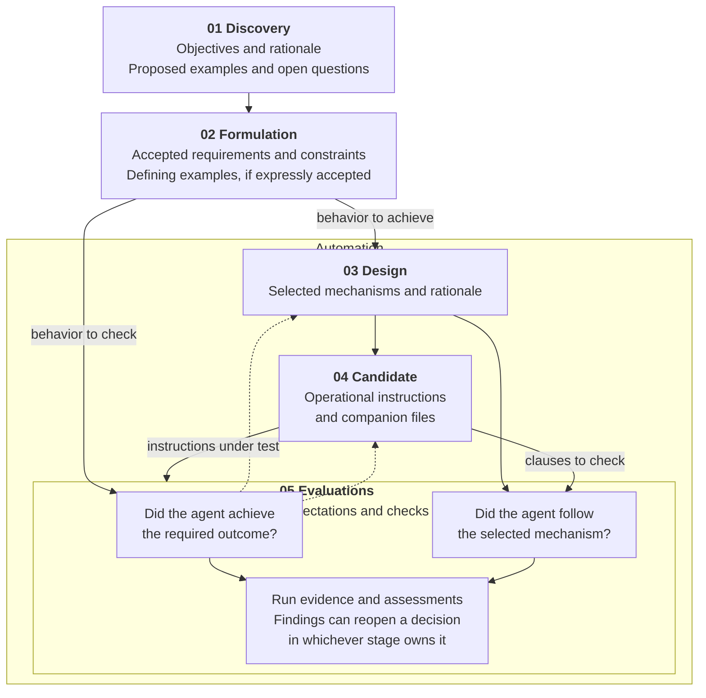

# AGENTS-spec

AGENTS-spec develops a reusable `AGENTS.md` file that tells coding agents how to work with the people requesting changes.

Suppose an agent pauses to ask a question when the requester expected it to keep working. Before rewriting the instruction, a contributor can use the pipeline to compare what people wanted, what the instruction said, and what the agent actually did.

## Development pipeline

The project uses behavior-driven development (BDD) to build agreement from concrete examples. **Discovery** explores what should happen in a situation like this and why. **Formulation** records what the requester or their delegate accepts as a requirement.

Several approaches can satisfy the same requirement. In AGENTS-spec, BDD’s **Automation** practice spans three stages. **Design** selects an approach and **Candidate** expresses it in the working `AGENTS.md`. **Evaluations** defines what to check and assesses how an agent behaves with those instructions.

The diagram shows what each stage owns and how the work can overlap in the intended model. For a **test-first** change, Evaluations can derive an expectation directly from an accepted requirement before Design selects a mechanism. That expectation guides Design and Candidate (dotted arrows) and still applies if the mechanism changes. [`docs/pipeline.md` § Test-first iteration](docs/pipeline.md#test-first-iteration)

Today's behavioral cases exercise selected Candidate clauses. The suite has no acceptance check derived directly from a Formulation requirement. [`05-evaluations/docs/maintaining-evaluations.md` § Establish the expectation](05-evaluations/docs/maintaining-evaluations.md#establish-the-expectation) · [`05-evaluations/docs/evaluation-model.md` § Purpose and evaluation model](05-evaluations/docs/evaluation-model.md#purpose-and-evaluation-model)

## Where to start

| What are you looking for? | Where to start |
| --- | --- |
| The need behind a proposal | [`01-discovery/README.md`](01-discovery/README.md) · [`01-discovery/deliverables/objectives-and-rationale.md` § Established objectives](01-discovery/deliverables/objectives-and-rationale.md#established-objectives) |
| The behavior people agreed on | [`02-formulation/README.md`](02-formulation/README.md) |
| The reason for a design choice | [`03-design/README.md`](03-design/README.md) |
| An instruction and the decisions behind it | [`04-candidate/pre_AGENTS.md`](04-candidate/pre_AGENTS.md) · [`docs/contract-traces.md` § Contract clause index](docs/contract-traces.md#contract-clause-index) |
| How to use the instructions in your project | [`04-candidate/pre_README.md`](04-candidate/pre_README.md) |
| The companion files and where to install them | [`04-candidate/`](04-candidate/) · [`docs/architecture.md` § Staged sources and release-relative references](docs/architecture.md#staged-sources-and-release-relative-references) |
| What the checks cover and where the gaps are | [`05-evaluations/README.md`](05-evaluations/README.md) · [`docs/traceability.md` § Current traceability gaps](docs/traceability.md#current-traceability-gaps) |
| How the stages fit together and where to find shared guidance | [`docs/architecture.md` § Stage interfaces](docs/architecture.md#stage-interfaces) · [`docs/README.md`](docs/README.md) |
| How to clarify an instruction while keeping its meaning | [`docs/changing-the-contract.md` § Clarify Candidate wording](docs/changing-the-contract.md#clarify-candidate-wording) |
| Who can authorize a change to the expected behavior | [`docs/changing-the-contract.md` § Find the owner and the decision](docs/changing-the-contract.md#find-the-owner-and-the-decision) |
