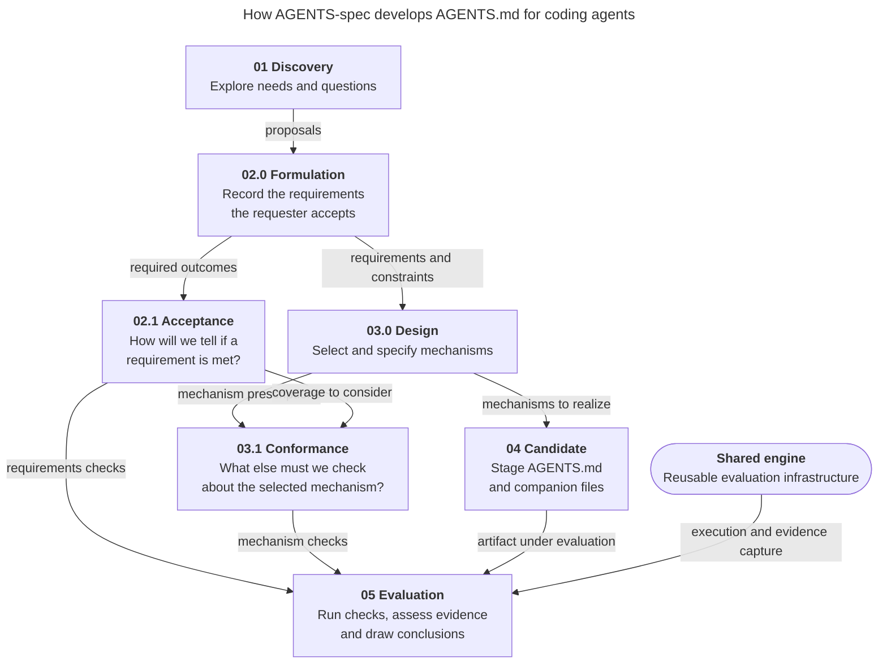

# AGENTS-spec

AGENTS-spec develops a reusable `AGENTS.md` file that tells coding agents how to work with the people requesting changes.

Suppose an agent pauses to ask a question when the requester expected it to keep working. Before rewriting the instruction, a contributor can use the pipeline to compare what people wanted, what the instruction said, and what the agent actually did.

## Development pipeline

The numbered stages show the conceptual order of work. The arrows show what each owner uses. A requirement can survive a change of mechanism, so checking the required outcome and checking the selected mechanism answer different questions.

**Current coverage.** One registered smoke case checks the infrastructure. Nine behavioral cases exercise existing Candidate clauses, and eight require human judgment. There are zero independently derived requirements-Acceptance cases. The nine cases have provisional Conformance ownership pending review of their basis in Design and their complementary coverage.

## Where to start

| What are you looking for? | Where to start |
| --- | --- |
| Use the instructions and install the companion files | [`04-candidate/pre_README.md`](04-candidate/pre_README.md) · [`docs/architecture.md` § Staged sources and release-relative references](docs/architecture.md#staged-sources-and-release-relative-references) |
| Find the need, the accepted rule or the design choice | [`01-discovery/README.md`](01-discovery/README.md) · [`02.0-formulation/README.md`](02.0-formulation/README.md) · [`03.0-design/README.md`](03.0-design/README.md) |
| Trace an instruction to a decision | [`04-candidate/pre_AGENTS.md`](04-candidate/pre_AGENTS.md) · [`docs/contract-traces.md` § Contract clause index](docs/contract-traces.md#contract-clause-index) |
| See what the checks cover and how results are assessed | [`02.1-acceptance/deliverables/coverage.md`](02.1-acceptance/deliverables/coverage.md) · [`03.1-conformance/deliverables/coverage.md`](03.1-conformance/deliverables/coverage.md) · [`05-evaluation/README.md`](05-evaluation/README.md) |
| Understand how the stages fit together or change the contract | [`docs/architecture.md` § Stage interfaces](docs/architecture.md#stage-interfaces) · [`docs/pipeline.md` § Test-first iteration](docs/pipeline.md#test-first-iteration) · [`docs/README.md`](docs/README.md) |
