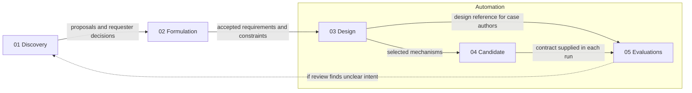

# AGENTS-spec

AGENTS-spec develops a reusable `AGENTS.md` file that tells coding agents how to work with the people requesting changes.

Suppose an agent pauses to ask a question when the requester expected it to keep working. Before rewriting the instruction, a contributor can use the pipeline to compare what people wanted, what the instruction said, and what the agent actually did.

## Development pipeline

The project uses behavior-driven development (BDD) to build agreement from concrete examples. **Discovery** explores what should happen in a situation like this and why. **Formulation** records what the requester or their delegate accepts as a requirement.

Several approaches can satisfy the same requirement. In AGENTS-spec, BDD’s **Automation** practice spans three stages. Contributors choose an approach in **Design**, express it in the **Candidate** (the working version of `AGENTS.md`), and check how an agent behaves with those instructions in **Evaluations**.

The arrows show what the stages share today. Their work can overlap, and a finding can reopen an earlier decision.

The **current behavioral tests** ask whether an agent followed a particular Candidate instruction on a task. Case authors use the instruction and the approach selected in Design to decide what behavior to look for. This is the Design input shown in the diagram. [`05-evaluations/docs/maintaining-evaluations.md` § Establish the expectation](05-evaluations/docs/maintaining-evaluations.md#establish-the-expectation)

The suite has yet to include a test whose expected result comes directly from an accepted requirement in Formulation. For a change in required behavior, the documented **test-first** method calls for Evaluations to define that expectation before contributors choose an approach for the change. The expectation would guide Design and Candidate. Evaluations would later check whether the agent achieved the agreed outcome, whichever approach was chosen. [`docs/pipeline.md` § Test-first iteration](docs/pipeline.md#test-first-iteration) · [`05-evaluations/docs/evaluation-model.md` § Purpose and evaluation model](05-evaluations/docs/evaluation-model.md#purpose-and-evaluation-model)

## Where to start

| What are you looking for? | Where to start |
| --- | --- |
| The need behind a proposal | [`01-discovery/README.md`](01-discovery/README.md) · [`01-discovery/deliverables/objectives-and-rationale.md` § Established objectives](01-discovery/deliverables/objectives-and-rationale.md#established-objectives) |
| The behavior people agreed on | [`02-formulation/README.md`](02-formulation/README.md) |
| The reason for a design choice | [`03-design/README.md`](03-design/README.md) |
| An instruction and the decisions behind it | [`04-candidate/pre_AGENTS.md`](04-candidate/pre_AGENTS.md) · [`docs/contract-traces.md` § Contract clause index](docs/contract-traces.md#contract-clause-index) |
| How to use the instructions in your project | [`04-candidate/pre_README.md`](04-candidate/pre_README.md) |
| The companion files and where to install them | [`04-candidate/`](04-candidate/) · [`docs/architecture.md` § Staged sources and release-relative references](docs/architecture.md#staged-sources-and-release-relative-references) |
| What the checks cover and where the gaps are | [`05-evaluations/README.md`](05-evaluations/README.md) · [`docs/traceability.md` § Current traceability gaps](docs/traceability.md#current-traceability-gaps) |
| How the stages fit together and where to find shared guidance | [`docs/architecture.md` § Stage interfaces](docs/architecture.md#stage-interfaces) · [`docs/README.md`](docs/README.md) |
| How to clarify an instruction while keeping its meaning | [`docs/changing-the-contract.md` § Clarify Candidate wording](docs/changing-the-contract.md#clarify-candidate-wording) |
| Who can authorize a change to the expected behavior | [`docs/changing-the-contract.md` § Find the owner and the decision](docs/changing-the-contract.md#find-the-owner-and-the-decision) |
