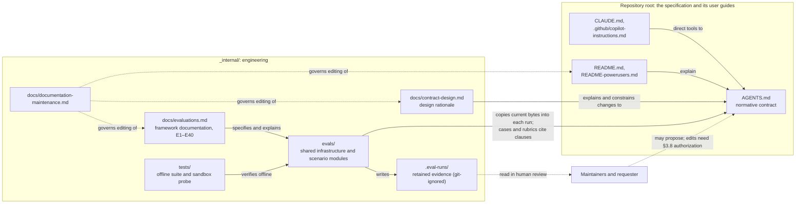

# AGENTS-spec engineering architecture

This document explains how the internal engineering project behind [AGENTS.md](../../AGENTS.md) fits together: why it exists, how its responsibilities relate, where its principal boundaries lie, and through which dependencies a change in one area affects another. It owns those system-level relationships. Detailed knowledge stays with the documents listed in [where detailed knowledge lives](#where-detailed-knowledge-lives); this document summarizes them only as far as the relationships require.

## Purpose and scope

The repository delivers a specification: the root `AGENTS.md` contract and two instruction bridges, `CLAUDE.md` and `.github/copilot-instructions.md`, which adopters copy into their own repositories following the [installation steps](../../README.md#get-started). The root [README.md](../../README.md) and [README-powerusers.md](../../README-powerusers.md) explain that specification to its users.

`_internal/` holds the engineering work used to develop and assess the specification. Adopters do not install it, and it adds no operating duties: the root contract governs work here as everywhere else in the repository. The engineering project has three related responsibilities:

1. **Specification design and evolution.** Explaining why the contract is designed as it is and constraining how it may change. [contract-design.md](contract-design.md) owns this rationale; it is also the public technical guide linked from the root guides.
2. **Evaluation.** A local Python framework that runs Codex on a finite set of cases against the current contract and produces evidence about those cases. [evaluations.md](evaluations.md) owns its documentation, including requirements E1–E40.
3. **Knowledge maintenance.** Keeping each fact, rule, explanation, and decision with one canonical owner and keeping its dependents consistent, across the whole repository including the root guides. [documentation-maintenance.md](documentation-maintenance.md) owns the ownership map and editorial guidance.

Its readers are people who engineer, evaluate, evolve, operate, and maintain the specification and its evaluation framework. Outside its scope are the normative content of the contract, which only `AGENTS.md` defines; the facts and architecture of adopting projects; and the instruction-loading behavior of agent tools, which their providers' documentation governs. The root guides are user documentation rather than engineering documentation, although their editing follows `documentation-maintenance.md`.

## Context and relationships

Solid arrows are actual references or mechanisms; dashed arrows are human activities. No automated path leads from evaluation results back to the contract.

- **Contract and bridges.** `AGENTS.md` is the only operating contract. The bridges apply it through different mechanisms: `CLAUDE.md` uses Claude Code's import syntax, while the Copilot file links to the contract and directs the tool to read and follow it. Neither adds policy, and actual loading still depends on the tool, interface, and settings; [why the bridges differ](contract-design.md#why-the-bridges-differ) explains them.
- **Design rationale.** `contract-design.md` explains the contract's choices and the constraints on changing it. It cannot change operating behavior; only an authorized edit to `AGENTS.md` can.
- **Evaluation framework.** The framework depends on the specification; the specification does not depend on the framework. Evaluation workspaces contain the root contract and the case fixture, with no bridge files, and the framework runs only Codex, so it exercises neither bridge nor any other tool.
- **Offline tests.** The unittest suite, a fake Codex executable, and an offline smoke substitute verify infrastructure and technical assertions without contacting OpenAI. An opt-in probe checks the installed Codex sandbox. Neither establishes live agent behavior or the semantic validity of a rubric.
- **Evidence and human review.** Each run retains its evidence outside the disposable workspace. Human reviewers assess rubric criteria outside the CLI, which collects no verdicts.
- **Documentation maintenance.** This concern spans all of the above: it assigns owners and governs how dependent documents are kept consistent.

### What evaluation evidence can establish

Results are evidence about the specific cases run, not about general contract compliance. The cases are finite and present designed conditions; automated assertions answer defined technical questions, while semantic criteria remain with human reviewers; model behavior is nondeterministic, so one run is not repeated evidence; and showing that the contract caused an observed behavior requires comparative evidence. [Purpose and evaluation model](evaluations.md#purpose-and-evaluation-model) owns these limits and the current coverage gaps. Evaluation evidence may inform a maintainer's assessment or a proposal to change the contract. It does not authorize that change: `AGENTS.md` changes only through an authorized edit under its [protected-file rule](../../AGENTS.md#38-instructions-protected-files-and-external-actions), assessed against the [evolution constraints](contract-design.md#evolving-the-contract).

## Principal boundaries

| Boundary | What it separates | Detail |
| --- | --- | --- |
| Contract and rationale | `AGENTS.md` defines behavior. `contract-design.md` explains reasons and constrains evolution. Guides and examples cannot enact behavior. | [AGENTS.md](../../AGENTS.md), [contract-design.md](contract-design.md) |
| Shared evaluation infrastructure and scenarios | Shared modules have no dependency on individual scenarios. Each scenario module owns its prompt, fixture, assertions, any functional checks, and any human-review rubric. The CLI composes the two. | [Responsibilities and dependency direction](evaluations.md#responsibilities-and-dependency-direction) |
| Execution, observation, grading, and human assessment | The agent works in a disposable sandboxed workspace. Observations are captured outside it. Automated grading reads only captured observations. Human assessment uses the retained rubric and evidence. | [Purpose and evaluation model](evaluations.md#purpose-and-evaluation-model), [execution and security boundaries](evaluations.md#execution-and-security-boundaries) |
| Implementation and verification | The offline suite verifies infrastructure with substitutes. The sandbox probe checks enforcement. Live behavior needs a separately authorized run and its review. | [Run offline checks](evaluations.md#run-offline-checks), [verify a behavior change](evaluations.md#verify-a-behavior-change) |
| Evidence retention and interpretation | Evidence directories record what happened. Reports classify execution failures, assertion failures, and pending review separately. Interpretation stays tied to the captured contract and rubric. | [Results, evidence, and failure investigation](evaluations.md#results-evidence-and-failure-investigation) |
| Documentation ownership | Internal documents give each detailed fact one owner. The root guides are user-facing and may overlap intentionally. | [documentation-maintenance.md](documentation-maintenance.md) |

## Specification-to-evaluation dependencies

The framework exists to evaluate the current contract, so its dependence on that contract is intended. The dependencies below are the known direct dependents to inspect under the contract's [canonical-knowledge rule](../../AGENTS.md#35-canonical-knowledge-and-affected-documentation) when `AGENTS.md` changes. They describe what exists; they add no procedure or approval step.

| Dependency | Mechanism | Consequence |
| --- | --- | --- |
| Runtime contract injection | `CONTRACT_PATH` in [workspace.py](../evals/workspace.py) resolves to the repository-root `AGENTS.md`. Workspace preparation copies its current bytes into every workspace, and fixtures cannot override it (E1, E22). | Every run evaluates the contract as it stands at run time; no version is pinned. A contract edit reaches the next run whether or not affected cases and rubrics were reviewed. Offline tests compare against the same current bytes rather than fixed contents, so they neither depend on nor detect contract wording. |
| Clause references | The [case catalogue](evaluations.md#cases-and-interpretation) and case sections cite contract sections and link their heading anchors. Rubrics in [assumptions.py](../evals/assumptions.py), [inquiry.py](../evals/inquiry.py), and [findings.py](../evals/findings.py) cite section numbers and rule strengths. Other rubrics direct reviewers to the retained contract's strengths and triggers without numbering. Automated assertions encode scenario expectations derived from contract behavior, such as `ScopePreserved` for §1.2's restriction on unrelated cleanup. | Renumbered sections, renamed headings, or changed rule meaning can leave case descriptions, assertions, or rubrics stale. No automated check in the repository detects such staleness. |
| Contract identity in evidence | [codex.py](../evals/codex.py) records `contract_sha256` in `execution.json` and saves the injected `AGENTS.md` with each run's evidence. Each human-review run also retains its rubric as `review.md`. | Results stay tied to the contract and rubric they used. A later contract change neither revises earlier conclusions nor carries them over to the new text. |

Other documents also link `AGENTS.md` heading anchors, including `contract-design.md` and the root guides. Their synchronization follows ordinary [documentation maintenance](documentation-maintenance.md#editing-workflow).

### Change impact

A contract change does not necessarily require an evaluation change. Compare the changed clauses with the behavior each case exercises, using the catalogue's contract references and the rubric citations above:

- **Behavior an evaluated case exercises.** If a rule's strength, trigger, condition, exception, or scope changes where a case's assertions or rubric criteria depend on it, the scenario module and its catalogue entry are affected owners. Assess whether the case still presents its intended condition and whether its assertions and rubric still match the contract. An E1–E40 requirement changes only if the framework's own required behavior changes, through authorized requirement work.
- **Structure or wording without changed behavior.** Renumbering, renamed headings, or moved clauses need reference corrections in rubrics, the catalogue, and linking documents. Rubric meaning is unchanged.
- **No demonstrated evaluation impact.** A change to behavior that no case exercises needs no case change; [Purpose and evaluation model](evaluations.md#purpose-and-evaluation-model) lists known coverage gaps. Proposing new coverage is a separate decision, not an obligation created by the change.

Changes in the other direction never alter the contract. Editing a case or rubric changes what is assessed and how; it does not change what `AGENTS.md` requires.

## Where detailed knowledge lives

This architecture refines into the existing owners rather than replacing them:

- **Normative behavior:** [AGENTS.md](../../AGENTS.md), the only operating contract.
- **Specification rationale and evolution:** [contract-design.md](contract-design.md): design goals, choices and trade-offs, evolution constraints, design scenarios, and reference assignments.
- **Evaluation framework:** [evaluations.md](evaluations.md): evaluation model, operations and authentication, evidence and failure investigation, cases, execution boundaries, framework architecture and lifecycle, and E1–E40. Scenario modules own exact prompts, fixtures, checks, and rubrics.
- **Documentation ownership and editorial guidance:** [documentation-maintenance.md](documentation-maintenance.md), including the [per-document ownership table](documentation-maintenance.md#document-ownership) and the [public/internal distinction](documentation-maintenance.md#public-guides-and-internal-engineering-documents).

[_internal/README.md](../README.md) provides orientation and task-based navigation into these documents.

## Decisions

### Integrated engineering architecture with focused detailed owners

**Status:** Accepted. The requester accepted this direction after reviewing a read-only assessment of alternatives.

**Context.** The internal documents each had clear owners, but no document explained the engineering project as a whole. The internal README described two areas and a one-sentence dependency, while documentation maintenance appeared only as a file. `contract-design.md` does not refer to the evaluation framework, and `evaluations.md` links to contract clauses but not to the design rationale. The [dependencies above](#specification-to-evaluation-dependencies) were undocumented as relationships. Constraints: the README is orientation only; `contract-design.md` is also the public technical guide, not contributor onboarding; root-guide links into `_internal/docs/` and module docstrings referencing `docs/evaluations.md` should stay valid; and the contract's [architecture rule](../../AGENTS.md#36-architecture-guides-and-code-documentation) recommends starting architecture in one document, splitting sections as readability or maintenance warrants.

**Decision.** Add this document as the owner of system-level relationships, context, boundaries, and cross-domain dependencies. Keep `contract-design.md`, `evaluations.md`, and `documentation-maintenance.md` as the detailed owners, with `evaluations.md` intact as the framework's integrated documentation. The README keeps orientation and navigation. No paths or existing anchors change.

**Consequences.** One owner explains how specification design, evaluation, and documentation maintenance relate, without breaking external or docstring links. Maintainers keep one more document consistent, and must keep its summaries at the level of relationships so that it does not become a second owner of framework, rationale, or ownership detail.

**Rejected alternatives.**

- *Strengthen the existing documents only:* the README would have to own architecture, contrary to its role, and `contract-design.md` serves contract readers rather than the engineering project.
- *Subdirectories such as `specification/` and `evaluation/`:* folders do not explain relationships, and moving files would break root-guide links, docstrings, and anchors for a small document set.
- *Separate `evaluation-architecture.md` or `evaluation-cases.md`, extracted E1–E40, or another split of `evaluations.md`:* these would present evaluation as an independent subsystem and separate requirements from the case acceptance definitions and evidence they reference. Length alone did not justify a split.
- *Moving the framework lifecycle into this document:* it would separate that lifecycle from the outcome, evidence, and functional-check sections it explains.
