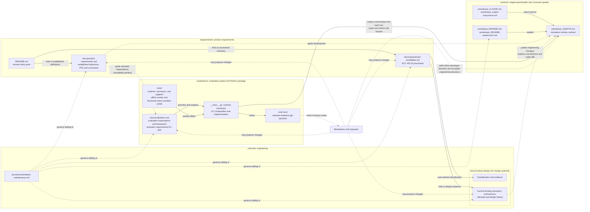

# AGENTS-spec engineering architecture

This document explains how the internal engineering project behind [AGENTS.md](../contract/prerelease_AGENTS.md) fits together: why it exists, how its responsibilities relate, where its principal boundaries lie, and through which dependencies a change in one area affects another. It owns those system-level relationships. Detailed knowledge stays with the documents listed in [where detailed knowledge lives](#where-detailed-knowledge-lives); this document summarizes them only as far as the relationships require.

## Purpose and scope

The repository stages a specification under `contract/` with `prerelease_` filenames: the `AGENTS.md` contract and two instruction bridges, `CLAUDE.md` and `.github/copilot-instructions.md`, whose intended consumer locations are described in the [installation steps](../contract/prerelease_README.md#get-started). The staged [README.md](../contract/prerelease_README.md) and [README-powerusers.md](../contract/prerelease_README-powerusers.md) explain that specification to its users.

`docs/` holds system-wide engineering documentation, including this architecture and its cross-domain relationships, authority model, and system-wide decisions; `_internal/` holds specification design and documentation governance; [requirements/](../requirements/README.md) owns established product requirements and provisional requirement candidates; `evaluations/` is the evaluation engineering project and Python package, containing its implementation, offline tests, dependencies, and documentation. Adopters do not install these engineering files, and they add no operating duties to the delivered contract. The [authority model below](#development-time-and-runtime-authority) distinguishes engineering authority from the instructions currently governing maintenance work. The engineering project has four related responsibilities:

1. **Product requirements.** Defining desired collaboration outcomes and why they are wanted, applicable product constraints, and established versus provisional status, independently of contract mechanisms and evaluation machinery. [requirements/README.md](../requirements/README.md) provides domain navigation and remaining migration work. [product-requirements.md](../requirements/docs/product-requirements.md) owns the established objectives, PR1, and product constraints; [requirement-candidates.md](../requirements/docs/requirement-candidates.md) owns RC1–RC10 as provisional candidates awaiting developer acceptance.
2. **Contract design and evolution.** Determining how instructions express desired outcomes and explaining the selected mechanisms, decisions, and trade-offs. [contract-design.md](../_internal/docs/contract-design.md) remains the authoritative engineering source for current binding design prescriptions, rationale, significant design history, and subsequent engineering evolution. Preserving current semantics does not accept provisional candidates as enduring requirements.
3. **Behavioral evaluation and evaluator verification.** A local Python framework runs Codex on finite cases against the current contract and produces evidence about those cases. Offline tests verify the evaluation machinery. [evaluations.md](../evaluations/docs/evaluations.md) owns the subsystem documentation, including evaluator requirements E1–E40, which are distinct from product requirements.
4. **Knowledge maintenance.** Keeping each fact, rule, explanation, and decision with one canonical owner and keeping its dependents consistent, across the whole repository including the consumer guides. [documentation-maintenance.md](../_internal/docs/documentation-maintenance.md) owns the ownership map and editorial guidance.

Its readers are people who engineer, evaluate, evolve, operate, and maintain the specification and its evaluation framework. This document explains the engineering relationships; it does not supply runtime operating rules, adopting-project facts or architecture, or provider-owned instruction-loading behavior. The staged files in `contract/` belong to the user-facing product or its adoption and usage material. They neither reference nor depend on `_internal/`, including optional further-reading links. Internal documentation may reference those files, and engineering navigation starts at [_internal/README.md](../_internal/README.md).

### Development-time and runtime authority

**Engineering authority.** [product-requirements.md](../requirements/docs/product-requirements.md) is the canonical owner of established product objectives, PR1, and product constraints. [requirement-candidates.md](../requirements/docs/requirement-candidates.md) is the canonical owner of provisional RC1–RC10 and their unresolved acceptance questions. [contract-design.md](../_internal/docs/contract-design.md) is the authoritative design source for currently binding design prescriptions and their semantics, selected mechanisms, rationale, significant design history, and subsequent engineering evolution; it retains classification and evidence, including the shared status distinctions. Product objectives, established product requirements and constraints, accepted engineering decisions, and requester direction govern that evolution and its acceptance criteria, including intended evaluation expectations. Design rationale explains why selected mechanisms realize that intent. Existing `AGENTS.md` wording is implementation evidence, not an independent justification for preserving every mechanism or automatic proof of accepted product intent. Inferred requirement candidates remain separate from established requirements and await review and acceptance by coherent topic; a complete independently accepted product-requirements baseline is not yet established. The [historical record below](#temporary-migration-authority) preserves the authority-transition provenance.

[requirements/README.md](../requirements/README.md) remains a navigational entry point. The transfers to `requirements/docs/product-requirements.md` and `requirements/docs/requirement-candidates.md` preserve provenance, qualifications, and decision status; the full design explanations remain in `contract-design.md` as rationale and application of established constraints and evidence for provisional candidates, without independent authority to redefine or accept requirements. Candidate acceptance and evaluation traceability remain separate work.

**Runtime normative authority.** `AGENTS.md` is the complete, self-contained normative operating contract delivered to consuming agents, within the applicable instruction hierarchy and tool permissions. Requirements and rationale in internal documentation create no additional operating duties or runtime dependencies. A mismatch between intended requirements and contract wording calls for human review and authorized correction, not an implicit change to the rules applied to an agent. Existing runs remain interpreted under their captured contract and rubric until approved changes are implemented; revised criteria do not silently revise historical conclusions. Neither source automatically grants permission to edit protected files or make consequential decisions beyond existing authorization; requester authority and tool permissions continue to apply.

**Development instruction loading.** The candidate is staged as `contract/prerelease_AGENTS.md`, with no root `AGENTS.md`, root `CLAUDE.md`, or active `.github/copilot-instructions.md`. Its `prerelease_` filename is not a standard automatic instruction entry point. The candidate does not govern development of this repository; agents may explicitly read it as source material. Authorization for development changes derives from developer direction and accepted engineering decisions, within applicable instructions and tool permissions, not from the candidate's protected-file rule. That rule protects instruction files in consuming repositories. Evaluation workspaces separately receive its unchanged bytes under the standard filename `AGENTS.md`, where its rules remain normative for the evaluated agents. The [staged-source mapping](../_internal/docs/documentation-maintenance.md#staged-sources-and-release-relative-references) documents release-relative exceptions in the preserved artifacts. This relocation does not modify external instruction configuration or unload instructions already present in a session.

An authorized redesign may reconsider or replace an existing mechanism, including PDSA or another method currently prescribed by the contract. Authorization to reconsider a mechanism does not itself suspend applicable loaded instructions. If changing the engineering process itself becomes necessary, that change must be addressed explicitly through an authorized and technically effective mechanism; editing or evaluating the contract creates no exemption from the instructions governing the agent.

The contract prescribes intended conduct; it does not independently enforce or guarantee compliance. Technical enforcement depends on the tool's actual controls, and observed behavior requires evidence.

Verifying the contract against intended requirements examines whether its text expresses the intended obligations, permissions, conditions, exceptions, and constraints. Behavioral evaluation instead examines what agents receiving that text actually do. Evaluator tests verify the machinery's own specified execution, observation, grading, reporting, and failure behavior; they do not establish agent compliance or the semantic validity of the expectations. These are separate evidence relationships. The [current-semantic specification](../_internal/docs/contract-design.md#current-semantics-vocabulary-and-coverage) records the current clauses and their interactions; traceability from independently accepted product requirements to the contract and evaluations remains pending.

#### Temporary migration authority

**Historical boundary — concluded November 8, 2026.** Throughout the source-of-truth migration, the frozen root `AGENTS.md` governed **all current operating semantics**, within the actual instruction hierarchy, permissions, and requester authority. The verified baseline is historical evidence:

| Identity | Value |
| --- | --- |
| `AGENTS.md` Git blob | `289a31a644d7ab1b816c873f244566ab632a330f` |
| File SHA-256 | `3d7b6c240e0f4b02713d166662d7d95ec74985b9939b23838863acd596407e81` |
| Reference commit on `refactor` | `184c7d5b26bfa78762c77e72381df9e408ac370b` |

Transfer required byte-for-byte preservation of `AGENTS.md`, semantic preservation in `contract-design.md`, and independent semantic and cross-document verification. The engineering specification had to preserve every obligation, prohibition, permission, recommendation, trigger, condition, exception, and relevant semantic interaction without weakening, strengthening, extending, or omitting them; other documentation had to remain consistent with the frozen contract.

Final requester-supplied independent verification against `66e63a443ac73712b4af8a54f5bc6fac3cb4fdff` returned **READY FOR TRANSFER DECISION**, with acceptance criteria A–H **PASS** and no corrective findings. Verification supplied evidence for the transfer decision; it did not itself transfer authority.

On **November 8, 2026**, after reviewing that verification, the requester explicitly replied **“Authorized”**, transferring engineering authority to `contract-design.md`. The transfer was documented in [`809e231`](https://github.com/indisoluble/AGENTS-spec/commit/809e231919c349b1ec3039ad3669dc88cf8b6e35). `AGENTS.md` retains self-contained normative runtime authority; internal documents create no runtime dependencies. The temporary byte-for-byte migration freeze concluded. The baseline was not a permanent prohibition on future separately authorized evolution under the authority model and protected-file rules then applicable; the [current authority model](#development-time-and-runtime-authority) distinguishes development from consumer runtime authority.

The transfer changes no existing agent operating behavior, amends no runtime contract, accepts none of RC1–RC10 as enduring product requirements, and selects or approves none of D1–D10. It authorizes no product redesign. Current methods, including PDSA, explicit increment predictions, EARS, and the other preserved prescriptions, retain their existing normative force until separately authorized change. The migration reviews establish neither comprehensive live-agent compliance nor measured token savings.

## Context and relationships

Solid arrows are current references or mechanisms; dashed arrows are engineering responsibilities and human activities, including the requirements relationships, with candidate acceptance and traceability still pending. The internal-to-contract editing relationships create no reference or dependency from product files back into engineering documentation. No automated path leads from evaluation results to changes in requirements, design, the contract, or evaluation expectations.

- **Contract and bridges.** `AGENTS.md` is the only operating contract. The bridges apply it through different mechanisms: `CLAUDE.md` uses Claude Code's import syntax, while the Copilot file links to the contract and directs the tool to read and follow it. Neither adds policy, and actual loading still depends on the tool, interface, and settings; [why the bridges differ](../_internal/docs/contract-design.md#why-the-bridges-differ) explains them.
- **Product requirements, current semantics, and design rationale.** `requirements/docs/product-requirements.md` owns established objectives, PR1, and product constraints; `requirements/docs/requirement-candidates.md` owns provisional RC1–RC10 and unresolved acceptance questions; `contract-design.md` retains classification and evidence and current binding semantics alongside rationale and design evolution. [Development-time and runtime authority](#development-time-and-runtime-authority) owns their relationship. Acceptance of RC1–RC10 remains separate and pending. Internal intent and explanation cannot change the delivered contract's operating rules; a future authorized behavioral change must be reflected consistently in `AGENTS.md` and affected canonical engineering documentation, within the development authority described above.
- **Evaluation framework.** The framework depends on the specification; the specification does not depend on the framework. Evaluation workspaces contain the root contract and the case fixture, with no bridge files, and the framework runs only Codex, so it exercises neither bridge nor any other tool.
- **Offline tests.** The unittest suite, a fake Codex executable, and an offline smoke substitute verify infrastructure and technical assertions without contacting OpenAI. A separate opt-in probe checks the evaluator-owned functional-check sandbox using the installed Codex CLI; it does not verify the evaluated-agent permission profile. Neither establishes live agent behavior or the semantic validity of a rubric.
- **Evidence and human review.** Each run retains its evidence outside the disposable workspace. Human reviewers assess rubric criteria outside the CLI, which collects no verdicts.
- **Documentation maintenance.** This concern spans all of the above: it assigns owners and governs how dependent documents are kept consistent.

### What evaluation evidence can establish

Results are evidence about the specific cases run, not about general contract compliance. The cases are finite and present designed conditions; automated assertions answer defined technical questions, while semantic criteria remain with human reviewers; model behavior is nondeterministic, so one run is not repeated evidence; and showing that the contract caused an observed behavior requires comparative evidence. [Purpose and evaluation model](../evaluations/docs/evaluations.md#purpose-and-evaluation-model) owns these limits and the current coverage gaps. Human review distinguishes evaluator faults, unsuitable expectations or scenarios, contract wording that fails intended requirements, agent behavior, and unresolved product intent. Findings can inform proposals about requirements, design, implementation, or evaluation expectations; they authorize none of those changes. Contract edits follow the [development authority model](#development-time-and-runtime-authority) and the [evolution constraints](../_internal/docs/contract-design.md#evolving-the-contract).

## Principal boundaries

| Boundary | What it separates | Detail |
| --- | --- | --- |
| Product intent and runtime implementation | Product requirements guide development; rationale explains design choices. `AGENTS.md` implements the intended behavior as the complete runtime contract. RC1–RC10 remain provisional; guides and examples cannot enact behavior. | [Development-time and runtime authority](#development-time-and-runtime-authority) |
| Product requirements and evaluator requirements | Product requirements concern intended agent behavior and product constraints. E1–E40 specify the suite's required behavior, including how cases are executed and assessed; they do not independently establish product intent. Fictional application requirements in fixtures concern those applications. | [Established product requirements](../requirements/docs/product-requirements.md), [provisional candidates](../requirements/docs/requirement-candidates.md#requirement-candidates), [verifiable requirements](../evaluations/docs/evaluations.md#verifiable-requirements) |
| Shared evaluation infrastructure and scenarios | Shared modules in `evaluations/runtime/` have no dependency on individual scenarios. Each scenario module in `evaluations/scenarios/` owns its prompt, fixture, assertions, any functional checks, and any human-review rubric. The CLI in `evaluations/__main__.py` composes the two. | [Responsibilities and dependency direction](../evaluations/docs/evaluations.md#responsibilities-and-dependency-direction) |
| Execution, observation, grading, and human assessment | Agent commands use the restrictive permission profile for a disposable workspace. The parent Codex client and Python evaluator operate outside that command sandbox. Observations are captured outside the workspace; automated grading reads those observations, and human assessment uses the retained rubric and evidence. | [Purpose and evaluation model](../evaluations/docs/evaluations.md#purpose-and-evaluation-model), [execution and security boundaries](../evaluations/docs/evaluations.md#execution-and-security-boundaries) |
| Implementation and verification | The offline suite verifies configuration and orchestration with substitutes. The repository's sandbox probe checks only the evaluator-owned functional-check boundary. Agent-command enforcement and authenticated integration need separate environment-specific validation. | [Agent execution](../evaluations/docs/evaluations.md#agent-execution), [verify a behavior change](../evaluations/docs/evaluations.md#verify-a-behavior-change) |
| Evidence retention and interpretation | Evidence directories record what happened. Reports classify execution failures, assertion failures, and pending review separately. Interpretation stays tied to the captured contract and rubric. | [Results, evidence, and failure investigation](../evaluations/docs/evaluations.md#results-evidence-and-failure-investigation) |
| Product and internal engineering documentation | Staged consumer files remain independent of internal engineering documentation. Internal documents give each detailed fact one owner; the consumer guides may overlap intentionally. | [Public guides and internal engineering documents](../_internal/docs/documentation-maintenance.md#public-guides-and-internal-engineering-documents) |

## Specification-to-evaluation dependencies

The framework currently exercises the staged candidate contract, and the dependencies below describe that implementation. The agreed requirements-led model guides future development without claiming that product-requirement traceability already exists. These are the known direct dependents to inspect under the contract's [canonical-knowledge rule](../contract/prerelease_AGENTS.md#35-canonical-knowledge-and-affected-documentation) when `AGENTS.md` changes; they add no procedure or approval step.

| Dependency | Mechanism | Consequence |
| --- | --- | --- |
| Runtime contract injection | `CONTRACT_PATH` in [workspace.py](../evaluations/runtime/workspace.py) resolves to `contract/prerelease_AGENTS.md`. Workspace preparation copies its current bytes into every workspace as root `AGENTS.md`, and fixtures cannot override it (E1, E22). | Every run evaluates the contract as it stands at run time; no version is pinned. A contract edit reaches the next run whether or not affected cases and rubrics were reviewed. Offline tests compare against the same current bytes rather than fixed contents, so they neither depend on nor detect contract wording. |
| Clause references | The [case catalogue](../evaluations/docs/evaluations.md#cases-and-interpretation) and case sections cite contract sections and link their heading anchors. Rubrics in [assumptions.py](../evaluations/scenarios/assumptions.py), [inquiry.py](../evaluations/scenarios/inquiry.py), and [findings.py](../evaluations/scenarios/findings.py) cite section numbers and rule strengths. Other rubrics direct reviewers to the retained contract's strengths and triggers without numbering. Automated assertions encode scenario expectations derived from contract behavior, such as `ScopePreserved` for §1.2's restriction on unrelated cleanup. | Renumbered sections, renamed headings, or changed rule meaning can leave case descriptions, assertions, or rubrics stale. No automated check in the repository detects such staleness. |
| Contract identity in evidence | [codex.py](../evaluations/runtime/codex.py) records `contract_sha256` in `execution.json` and saves the injected `AGENTS.md` with each run's evidence. Each human-review run also retains its rubric as `review.md`. | Results stay tied to the contract and rubric they used. A later contract change neither revises earlier conclusions nor carries them over to the new text. |

Other documents also link `AGENTS.md` heading anchors, including `contract-design.md` and the consumer guides. Their synchronization follows ordinary [documentation maintenance](../_internal/docs/documentation-maintenance.md#editing-workflow).

### Change impact

A contract change does not necessarily require an evaluation change. Established product requirements guide intended behavior and expectations; existing clauses and rubrics describe the current implementation and assessment baseline. Compare the changed clauses with the behavior each case exercises, using the catalogue's contract references and the rubric citations above, without treating contract edits alone as authority to redefine expected behavior:

- **Behavior an evaluated case exercises.** If a rule's strength, trigger, condition, exception, or scope changes where a case's assertions or rubric criteria depend on it, the scenario module and its catalogue entry are affected owners. Assess whether the case still presents its intended condition and whether its assertions and rubric still match the contract. An E1–E40 requirement changes only if the framework's own required behavior changes, through authorized requirement work.
- **Structure or wording without changed behavior.** Renumbering, renamed headings, or moved clauses need reference corrections in rubrics, the catalogue, and linking documents. Rubric meaning is unchanged.
- **No demonstrated evaluation impact.** A change to behavior that no case exercises needs no case change; [Purpose and evaluation model](../evaluations/docs/evaluations.md#purpose-and-evaluation-model) lists known coverage gaps. Proposing new coverage is a separate decision, not an obligation created by the change.

Changes in the other direction never alter the contract. Editing a case or rubric changes what is assessed and how; it does not change what `AGENTS.md` requires.

## Where detailed knowledge lives

This architecture refines into the existing owners rather than replacing them:

- **Runtime normative behavior:** [AGENTS.md](../contract/prerelease_AGENTS.md), the complete operating contract.
- **Requirements-domain entry point:** [requirements/README.md](../requirements/README.md), responsibility boundaries, navigation to established requirements and provisional candidates, and remaining migration work.
- **Established product requirements:** [product-requirements.md](../requirements/docs/product-requirements.md), the canonical owner of O1, O2, supporting knowledge continuity, PR1, and established product constraints with their qualifications and provenance.
- **Provisional product requirement candidates:** [requirement-candidates.md](../requirements/docs/requirement-candidates.md), the canonical RC1–RC10 inventory, unresolved acceptance questions, evidence references, qualifications, and provenance.
- **Current-semantic specification, rationale, and evolution:** [contract-design.md](../_internal/docs/contract-design.md), the authoritative design source for current binding design prescriptions, trade-offs, significant specification decisions and design history, evolution constraints, design scenarios, and reference assignments. Classification and evidence remains here, including the shared status distinctions; detailed design explanations apply established product constraints and supply evidence for provisional candidates.
- **Evaluation framework:** [evaluations.md](../evaluations/docs/evaluations.md): evaluation model, operations and authentication, evidence and failure investigation, cases, execution boundaries, framework architecture and lifecycle, and E1–E40. Scenario modules own exact prompts, fixtures, checks, and rubrics.
- **Documentation ownership and editorial guidance:** [documentation-maintenance.md](../_internal/docs/documentation-maintenance.md), including the [per-document ownership table](../_internal/docs/documentation-maintenance.md#document-ownership) and the [public/internal distinction](../_internal/docs/documentation-maintenance.md#public-guides-and-internal-engineering-documents).

[_internal/README.md](../_internal/README.md) provides orientation and task-based navigation into these documents.

## Decisions

The system-wide records below retain their historical paths and constraints. Later structural relocations, including `contract/prerelease_*`, `evaluations/`, and `docs/architecture.md`, and the development instruction loading described [above](#development-time-and-runtime-authority), do not rewrite those decisions' rationale or the intended consumer filenames. The [evaluation guide](../evaluations/docs/evaluations.md#setup-and-running-evaluations) owns current evaluation paths and commands.

This section holds engineering-system-wide decisions and indexes decisions owned at narrower scopes. Specification-design decisions belong with design rationale in `contract-design.md`; evaluation-subsystem decisions belong in [evaluations/docs/evaluations.md](../evaluations/docs/evaluations.md#engineering-decisions). The former evaluation-specific headings below remain as redirects for existing links. Documentation maintenance owns the ownership map and editing guidance, not duplicate decision records.

| Decision | Scope and canonical record |
| --- | --- |
| [Restrictive evaluation-agent command permissions](../evaluations/docs/evaluations.md#restrictive-evaluation-agent-command-permissions) | Evaluation project; canonical record in `evaluations/docs/evaluations.md`. |
| [Integrated engineering architecture with focused detailed owners](#integrated-engineering-architecture-with-focused-detailed-owners) | Engineering system; retained here with the refinements recorded below. |
| [Evaluation framework package and verification hierarchy](../evaluations/docs/evaluations.md#evaluation-framework-package-and-verification-hierarchy) | Evaluation project; canonical record in `evaluations/docs/evaluations.md`. |
| [Requirements-led engineering and product/internal separation](#requirements-led-engineering-and-productinternal-separation) | Engineering system; authority, ownership, and navigation boundaries. |

### Restrictive evaluation-agent command permissions

Canonical record: [Restrictive evaluation-agent command permissions](../evaluations/docs/evaluations.md#restrictive-evaluation-agent-command-permissions).

### Integrated engineering architecture with focused detailed owners

**Status:** Accepted. The requester accepted this direction after reviewing a read-only assessment of alternatives.

**Context.** The internal documents each had clear owners, but no document explained the engineering project as a whole. The internal README described two areas and a one-sentence dependency, while documentation maintenance appeared only as a file. `contract-design.md` does not refer to the evaluation framework, and `evaluations.md` links to contract clauses but not to the design rationale. The [dependencies above](#specification-to-evaluation-dependencies) were undocumented as relationships. Constraints: the README is orientation only; `contract-design.md` is also the public technical guide, not contributor onboarding; root-guide links into `_internal/docs/` and module docstrings referencing `docs/evaluations.md` should stay valid; and the contract's [architecture rule](../contract/prerelease_AGENTS.md#36-architecture-guides-and-code-documentation) recommends starting architecture in one document, splitting sections as readability or maintenance warrants.

**Decision.** Add this document as the owner of system-level relationships, context, boundaries, and cross-domain dependencies. Keep `contract-design.md`, `evaluations.md`, and `documentation-maintenance.md` as the detailed owners, with `evaluations.md` intact as the framework's integrated documentation. The README keeps orientation and navigation. No paths or existing anchors change.

**Consequences.** One owner explains how specification design, evaluation, and documentation maintenance relate, without breaking external or docstring links. Maintainers keep one more document consistent, and must keep its summaries at the level of relationships so that it does not become a second owner of framework, rationale, or ownership detail.

**Rejected alternatives.**

- *Strengthen the existing documents only:* the README would have to own architecture, contrary to its role, and `contract-design.md` serves contract readers rather than the engineering project.
- *Subdirectories such as `specification/` and `evaluation/`:* folders do not explain relationships, and moving files would break root-guide links, docstrings, and anchors for a small document set.
- *Separate `evaluation-architecture.md` or `evaluation-cases.md`, extracted E1–E40, or another split of `evaluations.md`:* these would present evaluation as an independent subsystem and separate requirements from the case acceptance definitions and evidence they reference. Length alone did not justify a split.
- *Moving the framework lifecycle into this document:* it would separate that lifecycle from the outcome, evidence, and functional-check sections it explains.

**Later navigation change.** The context and rejected alternatives above record root-guide links into `_internal/docs/` as they existed when this decision was made. A later editorial decision, owned by [documentation-maintenance.md](../_internal/docs/documentation-maintenance.md#public-guides-and-internal-engineering-documents), replaced those links with one pointer from each root guide to `_internal/README.md`. It changes navigation only; this decision, its paths, and the remaining link constraints from docstrings and external references are unaffected.

That pointer arrangement is historical. [Requirements-led engineering and product/internal separation](#requirements-led-engineering-and-productinternal-separation) supersedes it and refines the earlier rationale-only description of specification design, while retaining the integrated architecture and focused detailed owners.

### Evaluation framework package and verification hierarchy

Canonical record: [Evaluation framework package and verification hierarchy](../evaluations/docs/evaluations.md#evaluation-framework-package-and-verification-hierarchy).

### Requirements-led engineering and product/internal separation

**Status:** Accepted. The requester approved this engineering direction and authorized its documentation in Stage 1; requirements extraction, design-document restructuring, evaluation traceability, and directory reorganization remain outside this stage.

**Context.** The project now develops and evaluates a reusable contract, with separate evaluation code and offline tests. Earlier ownership described `contract-design.md` as rationale, while cases and rubrics referred to the implemented contract. That arrangement did not separately identify product intent as the basis for development. Root guides also pointed into `_internal/`, following the historical navigation change above. The requester established independent product documentation, requirements-led development, preservation of existing knowledge, and unchanged paths as the constraints for this correction.

**Decision.** Product requirements define intended agent behavior and product constraints and guide contract development and evaluation expectations. `contract-design.md` is their canonical owner alongside clearly distinguishable design rationale and specification-design decisions, in one document. Existing clauses are not automatically accepted requirements; inferred candidates remain separate for later review by coherent topic. `AGENTS.md` remains the complete runtime normative contract, and current runs retain their captured contract and rubric interpretation. E1–E40 remain evaluator requirements. Evaluation results provide evidence for human review, without automatically authorizing changes to any of these artifacts.

Everything outside `_internal/` belongs to the user-facing product or its adoption and usage material. Root product files contain no references or dependencies into `_internal/`; internal documentation may reference them. Apply [§3.6](../contract/prerelease_AGENTS.md#36-architecture-guides-and-code-documentation) by scope: the root README identifies user-facing documentation, while `_internal/README.md` identifies engineering documentation and serves as its entry point. The clause names `README.md` without explicitly assigning all documentation locations to one root entry point. This records the approved repository interpretation without changing that clause or adding consumer duties.

This architecture owns engineering-system-wide decisions and their index. Specification-specific records belong in `contract-design.md`, and evaluation-specific records belong in `evaluations.md`; the existing evaluation records remain here until separately authorized relocation. Keep the current paths for this stage. The [ownership map](../_internal/docs/documentation-maintenance.md#document-ownership) and [navigation guidance](../_internal/docs/documentation-maintenance.md#public-guides-and-internal-engineering-documents) apply these boundaries without duplicating decision records.

**Consequences.** Product documentation remains independently usable, with no internal runtime dependency. Maintainers distinguish intended requirements, design reasoning, implemented instructions, observed agent behavior, and verification of the evaluator. The requirements inventory is not yet extracted or accepted, and evaluation traceability is not yet established. Later work preserves significant rationale, constraints, accepted decisions, and useful alternatives; the historical PDSA guide informs that work without overriding current decisions or implementation. No code, grading policy, contract behavior, or directory layout changes in this stage. The earlier integrated-architecture decision remains accepted, with its rationale-only ownership description refined and its root-guide pointer arrangement superseded.

**Rejected alternatives.**

- *Accept current implementation wording wholesale as product requirements:* would infer intent from implementation without topic-level review.
- *Retain optional root-guide pointers into internal engineering documentation:* would violate the approved product/internal boundary.
- *Make internal requirements or rationale additional runtime instructions:* would make the adopted contract incomplete and create hidden dependencies.

Splitting requirements from rationale into separate files, relocating existing decision records, and reorganizing directories are deferred; this decision does not perform or authorize them.

**Later partial ownership transfer (Task 003B).** The earlier stage's scope and deferrals above remain historical. The separately authorized transfer makes [requirements/docs/product-requirements.md](../requirements/docs/product-requirements.md) the canonical owner of the established objectives, PR1, and product constraints, preserving their meaning, qualifications, provenance, and status. `contract-design.md` retains classification and evidence, provisional RC1–RC10 pending separate transfer, and all design-specific detail and history. This refines the earlier single-document ownership only for the transferred items; system-wide decisions remain here, and no candidate acceptance, contract redesign, or evaluation traceability is established.

**Later candidate ownership transfer (Task 003C).** [requirements/docs/requirement-candidates.md](../requirements/docs/requirement-candidates.md) becomes the canonical owner of provisional RC1–RC10 and their unresolved acceptance questions, preserving their content, order, evidence targets, qualifications, and status. `contract-design.md` retains classification and evidence, current binding design prescriptions, the complete linked design explanations, and all design-specific detail and history. Its original candidate heading remains a navigation pointer. This refines ownership only; earlier proposal acceptance and planning selections retain their distinct historical statuses, and no candidate acceptance, contract redesign, or evaluation traceability is established. System-wide relationships and decisions remain here.
