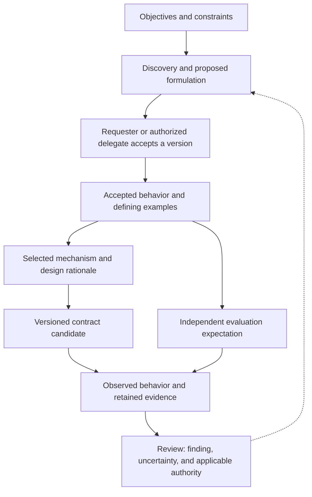
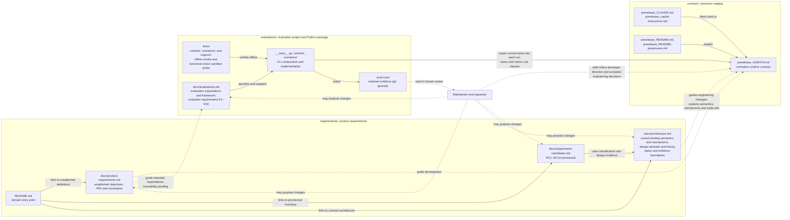

# AGENTS-spec engineering architecture

This document explains how the internal engineering project behind [AGENTS.md](../contract/prerelease_AGENTS.md) fits together: why it exists, how its responsibilities relate, where its principal boundaries lie, and through which dependencies a change in one area affects another. It owns those system-level relationships. Detailed knowledge stays with the documents listed in [where detailed knowledge lives](#where-detailed-knowledge-lives); this document summarizes them only as far as the relationships require.

## Purpose and scope

The repository stages consumer artifacts at the `contract/` root with `prerelease_` filenames: the `AGENTS.md` contract and two instruction bridges, `CLAUDE.md` and `.github/copilot-instructions.md`, whose intended consumer locations are described in the [installation steps](../contract/prerelease_README.md#get-started). The staged [README.md](../contract/prerelease_README.md) and [README-powerusers.md](../contract/prerelease_README-powerusers.md) explain that specification to its users. These five files are the only contents of `contract/`; engineering documentation is excluded from this staging area.

### Current BDD-first organization

The [13 November 2026 architecture decision](#bdd-first-reorganization-13-november-2026) organizes files by durable responsibility. BDD activities can revisit the same topic and cross several owners; directories are not sequential stage gates. An information owner is the canonical place to maintain a subject. Acceptance and change authority belong to the requester or an explicitly authorized delegate, not to a directory, activity, or evaluation result.

```text
/
├── .gitignore
├── LICENSE
├── behavior/
│   ├── README.md
│   ├── baseline.md
│   └── discovery.md
├── design/
│   ├── contract-design.md
│   └── design-review.md
├── contract/
│   ├── prerelease_AGENTS.md
│   ├── prerelease_CLAUDE.md
│   ├── prerelease_copilot-instructions.md
│   ├── prerelease_README.md
│   └── prerelease_README-powerusers.md
├── docs/
│   └── architecture.md
└── evaluations/
    ├── __init__.py
    ├── __main__.py
    ├── requirements.txt
    ├── docs/evaluations.md
    ├── runtime/
    ├── scenarios/
    └── tests/
```

| Owner | Durable responsibility and entry point |
| --- | --- |
| `behavior/` | [Navigation and editing](../behavior/README.md); [established objectives, PR1, constraints, and accepted behavior](../behavior/baseline.md); [proposed acceptance examples, coverage, historical candidates, and open formulation questions](../behavior/discovery.md). Established intent and proposals keep separate status. |
| `design/` | [Current binding mechanisms, selection rationale, alternatives, method assignments, clause coverage, and history](../design/contract-design.md); [editorial guidance and the 28 non-normative design illustrations](../design/design-review.md). Selected design authority is distinct from independent product acceptance. |
| `contract/` | Five staged consumer artifacts: the self-contained instructions, provider bridges, and adoption guides. Their [release-relative meanings](#staged-sources-and-release-relative-references) remain intact. |
| `evaluations/` | [Evaluator requirements, operational expectations, cases, evidence interpretation, and operations](../evaluations/docs/evaluations.md), with scenario policy, runtime machinery, and offline tests at their existing paths. Retained evidence stays in its [documented locations](../evaluations/docs/evaluations.md#retained-evidence). |
| `docs/` | Shared engineering authority, ownership, interfaces, traceability relationships, methodology integration, and system decisions. Detailed definitions remain with their domain owners. |

Start an objective, question, design concern, or evaluation finding through [behavior navigation](../behavior/README.md#starting-a-bdd-topic). Knowledge maintenance remains cross-cutting. Consumer artifacts acquire no dependency on this engineering organization or on BDD.

### BDD activities and complementary responsibilities

BDD is the methodological foundation for future behavioral development. [Cucumber's BDD account](https://cucumber.io/docs/bdd/) supplies the reference practice: collaborate on concrete examples, formulate them precisely in a form that can be automated, and connect them to automated checks that guide implementation. Discovery, Formulation, and Automation iterate; feedback can reopen an earlier question.

| Activity | Work and information owners |
| --- | --- |
| **Discovery** | Requester, implementation, and evaluation perspectives explore desired behavior through examples, counterexamples, assumptions, and material unknowns. One person may represent several perspectives. Durable questions and proposals belong in `behavior/discovery.md`, linked to the relevant objective, constraint, design, or evidence. |
| **Formulation** | Express agreed behavior as precise rules and distinguishing examples. Proposed rules and examples remain in discovery until independent product acceptance; `behavior/baseline.md` owns accepted wording and only those examples expressly accepted as defining. BR1–BR10 are accepted, while all Phase 2 examples remain proposed. Record the accepted scope, version, and decision authority. |
| **Automation** | Connect agreed examples to repeatable checks in `evaluations/`, starting with the check to guide any authorized implementation change. Exercise the identified candidate, inspect outcomes, and return feedback. Establish that a check distinguishes satisfying from violating the accepted condition before claiming coverage. If existing behavior already satisfies the rule, no implementation edit follows solely to create a change. |

These activities do not independently settle the responsibilities below. Use existing documents, stable IDs or headings, Markdown links, and version control proportionately; no additional lifecycle, schema, tool, or framework is introduced.

| Complementary responsibility | Authority and durable result |
| --- | --- |
| Objectives, priorities, and product acceptance | The requester or explicitly authorized delegate decides intended outcomes, priorities, and acceptance of a scoped rule and its defining examples. `behavior/baseline.md` owns established intent; pending decisions remain in discovery. BDD agreement or passing checks alone cannot establish acceptance. |
| Requirements completeness and baselining | Review the affected topic's actors, normal and exceptional conditions, conflicts, feasibility, and missing evidence. Keep unresolved scope explicit in its behavior owner. The [Phase 2 baseline](../behavior/baseline.md#phase-2-acceptance-and-editorial-provenance) records BR1–BR10 acceptance and its editorial limits. [Discovery](../behavior/discovery.md#disposition-of-the-earlier-candidates) retains the RC history and unresolved example detail; neither the earlier ten candidates nor the current examples imply exhaustive coverage or automatic new approval obligations. |
| Design-mechanism selection | The design owner relates consequential choices, alternatives, reasons, trade-offs, status, and successors to accepted intent and constraints, under requester authority. Current binding mechanisms remain binding at their existing strength; later reconsideration needs its own authorization. |
| Governance and change authorization | Record who authorized what scope and version. Requirement acceptance, design selection, implementation permission, and release permission remain distinct. No BDD activity or evaluation result grants any of them automatically. |
| Traceability and impact analysis | Follow the direct relationships below in both directions. Missing links remain visible; shared wording, an implementation clause, or a tidy tree cannot supply missing authority. |
| Outcome validation | Evaluation owners retain observations and limitations. Claims about O1/O2 benefits require appropriate comparative evidence, representative tasks, and requester feedback where relevant. Verification of a case or of the evaluator alone does not establish those benefits. |

**Reference practice, project choice, and departure.** The iterative three-activity practice above follows the reference. Responsibility-based directories, Markdown linked to the existing Python evaluator, and product acceptance authority are project choices BDD leaves open. A genuine future departure belongs with the affected owner: identify the reference practice, precise scope and conditions, reason, closer alternatives and why they are inadequate, and consequences. The competent owner decides whether to adopt it. If it changes verification, identify the reviewer, evidence, judgment method, and remaining inconclusive scope; a standing engineering change belongs here. This provision authorizes no departure during Phase 1 and creates no standing exception to Automation.

The existing [requester-guidance case](../evaluations/docs/evaluations.md#requester-guidance) illustrates an evidence limit: both a request for the missing timezone and an unsupported timezone guess can produce a nonempty response. Its automated presence and contract-preservation assertions do not decide the semantic distinction; the retained human rubric examines communications and changes. That partially automated case retains its original interpretation. It supplies no general exemption from Automation for future accepted examples; an inability to check a distinction reliably leaves a gap to report and review under the scoped provision above.

### Cross-domain traceability and feedback

Keep two distinct relationships: **objective or constraint → accepted requirement → selected mechanism → contract implementation**, and **accepted requirement → independent evaluation expectation → observed behavioral evidence**. Every observation also identifies the versioned candidate examined. A future expectation derives its authority from accepted intent or an expressly defining example, fixed before using the observation to judge the candidate; the current candidate alone cannot authorize the expected result.

The following view describes interfaces for future accepted behavioral changes, not completed coverage of every existing clause. Solid arrows show intent, implementation, and evidence relationships; the dashed return sends a question to Discovery through review and grants no authority.



| Exchange | Ownership, versioning, and reverse navigation |
| --- | --- |
| Objective or constraint → proposal → accepted behavior | Discovery retains the question, source, uncertainty, and decision link. The baseline owns accepted wording, conditions, exceptions, expressly defining examples, and acceptance provenance. Retain provisional IDs and unresolved aspects; replacement decisions link predecessors and successors without erasing their status. |
| Accepted intent → selected design → implementation | Design records link to the actual accepted intent and retain selection authority and reasons. The existing [clause index](../design/contract-design.md#current-semantics-vocabulary-and-coverage) links mechanisms to candidate passages. Inherited design without an independently accepted behavioral requirement retains its design authority and trace gap. PR1 can support direct standalone-text inspection without inventing an intermediary mechanism. Trace metadata stays outside consumer text. |
| Accepted behavior → independent expectation | The evaluation owner defines the operational criterion once, with the accepted rule/version and defining example where established. Distinguish product verification, design conformance, and fictional fixture correctness. Existing clause-based cases retain their original regression or design-conformance interpretation; they are not retroactively derived from a complete accepted baseline. |
| Candidate and expectation → observation → review | Existing bundles identify candidate bytes/digest, case, settings, observations, assertions, and applicable rubric. A future requirements-led claim also identifies the accepted requirement/expectation and evaluator versions in its review reference or run-associated record. Navigate from the run to both candidate and expectation; retain failed, pending, inconclusive, and unexercised distinctions. Phase 1 changes no bundle schema or runner. |
| Finding → appropriate owner | Observation, fixture, or evaluator faults return to evaluations; implementation discrepancies return to contract/design review. Unsettled behavior, conflicting intent, design trade-offs requiring new product direction, or inadequate evidence return to Discovery and the competent decision owner. Evidence proposes questions and changes; it does not accept requirements, select mechanisms, or authorize revisions. |

Store each edge once at its dependent or the existing clause index; use exact IDs, targets, and versions for reverse lookup. Review direct dependents and the role of each link before a change. Changing a fixture raises observation and comparability questions; changing an expected verdict under the same accepted conditions raises an interpretation or authority question. Matching terminology is insufficient evidence of a trace link.

For example, historical [RC4](../behavior/discovery.md#disposition-of-the-earlier-candidates) now maps to accepted [BR4](../behavior/baseline.md#br4--bounded-investigation-and-timely-reassessment). The design's [bounded-inquiry account](../design/contract-design.md#completion-predictions-and-bounded-investigation) supports that outcome, and [proposed examples](../behavior/discovery.md#requirement-to-scenario-coverage) distinguish sufficient evidence, justified continuation, and missing authority. The existing [bounded-inquiry case](../evaluations/docs/evaluations.md#bounded-inquiry) retains its clause-based interpretation: its consistency assertion is not retroactively an accepted product criterion. Defining-example acceptance and requirement-to-evaluation authority remain separate work.

### Historical responsibility arrangement at the Phase 1 baseline

The following account preserves the four responsibilities, reading path, and linear development path at [the accepted 9 November 2026 source revision](https://github.com/indisoluble/AGENTS-spec/blob/4e44bd2c03d2e708654f5060705398e630d0dace/docs/architecture.md#purpose-and-scope). Its former paths and ownership describe that arrangement. The [13 November successor](#bdd-first-reorganization-13-november-2026) changes organization and method, preserving its knowledge and authority distinctions.

`docs/` holds system-wide engineering documentation, including this architecture and its cross-domain relationships, authority model, and system-wide decisions; [requirements/](https://github.com/indisoluble/AGENTS-spec/blob/4e44bd2c03d2e708654f5060705398e630d0dace/requirements/README.md) owns established product requirements, provisional requirement candidates, and the [operating-contract architecture](https://github.com/indisoluble/AGENTS-spec/blob/4e44bd2c03d2e708654f5060705398e630d0dace/requirements/docs/architecture.md); `evaluations/` is the evaluation engineering project and Python package, containing its implementation, offline tests, dependencies, and documentation. Adopters do not install these engineering files, and they add no operating duties to the delivered contract. The [authority model below](https://github.com/indisoluble/AGENTS-spec/blob/4e44bd2c03d2e708654f5060705398e630d0dace/docs/architecture.md#development-time-and-runtime-authority) distinguishes engineering authority from the instructions currently governing maintenance work. The engineering project has four related responsibilities:

1. **Product requirements.** Defining desired collaboration outcomes and why they are wanted, applicable product constraints, and established versus provisional status, independently of contract mechanisms and evaluation machinery. [requirements/README.md](https://github.com/indisoluble/AGENTS-spec/blob/4e44bd2c03d2e708654f5060705398e630d0dace/requirements/README.md) provides domain navigation and remaining requirements work. [product-requirements.md](https://github.com/indisoluble/AGENTS-spec/blob/4e44bd2c03d2e708654f5060705398e630d0dace/requirements/docs/product-requirements.md) owns the established objectives, PR1, and product constraints; [requirement-candidates.md](https://github.com/indisoluble/AGENTS-spec/blob/4e44bd2c03d2e708654f5060705398e630d0dace/requirements/docs/requirement-candidates.md) owns RC1–RC10 as provisional candidates awaiting developer acceptance.
2. **Contract design and evolution.** Determining how instructions express desired outcomes and explaining the selected mechanisms, decisions, and trade-offs. [requirements/docs/architecture.md](https://github.com/indisoluble/AGENTS-spec/blob/4e44bd2c03d2e708654f5060705398e630d0dace/requirements/docs/architecture.md) owns the contract's design goals and boundaries, layer interaction, continuation behavior, shared current-semantics vocabulary and contract-clause coverage index, and [selected contract-design decisions and historical alternatives](https://github.com/indisoluble/AGENTS-spec/blob/4e44bd2c03d2e708654f5060705398e630d0dace/requirements/docs/architecture.md#architecture-decisions), together with [method-reference semantics and source assignments](https://github.com/indisoluble/AGENTS-spec/blob/4e44bd2c03d2e708654f5060705398e630d0dace/requirements/docs/architecture.md#principles-and-reference-boundaries) under Crosscutting Concepts and non-normative [assessment scenarios](https://github.com/indisoluble/AGENTS-spec/blob/4e44bd2c03d2e708654f5060705398e630d0dace/requirements/docs/architecture.md#assessing-design-changes) under Design Reference. The contract architecture also owns the current binding design prescriptions, their semantics, selected mechanisms, rationale, trade-offs, and evolution qualifications. This is a requirements-domain design owner, not an additional pipeline stage. Preserving current semantics does not accept provisional candidates as enduring requirements.
3. **Behavioral evaluation and evaluator verification.** A local Python framework runs Codex on finite cases against the current contract and produces evidence about those cases. Offline tests verify the evaluation machinery. [evaluations.md](https://github.com/indisoluble/AGENTS-spec/blob/4e44bd2c03d2e708654f5060705398e630d0dace/evaluations/docs/evaluations.md) owns the subsystem documentation, including evaluator requirements E1–E40, which are distinct from product requirements.
4. **Knowledge maintenance.** Keeping each fact, rule, explanation, and decision with one canonical owner and keeping its dependents consistent, across the whole repository including the consumer guides. Each domain owns its documentation and review guidance; [documentation ownership boundaries](https://github.com/indisoluble/AGENTS-spec/blob/4e44bd2c03d2e708654f5060705398e630d0dace/docs/architecture.md#documentation-ownership-boundaries) explains their relationship.

Its readers are people who engineer, evaluate, evolve, operate, and maintain the specification and its evaluation framework. This document explains the engineering relationships; it does not supply runtime operating rules, adopting-project facts or architecture, or provider-owned instruction-loading behavior. The staged files at the `contract/` root belong to the user-facing product or its adoption and usage material. They neither reference nor depend on engineering documentation, even for optional further reading. Engineering documentation may reference those files. Start requirements and contract-design work at [requirements/README.md](https://github.com/indisoluble/AGENTS-spec/blob/4e44bd2c03d2e708654f5060705398e630d0dace/requirements/README.md), evaluation work at [evaluations.md](https://github.com/indisoluble/AGENTS-spec/blob/4e44bd2c03d2e708654f5060705398e630d0dace/evaluations/docs/evaluations.md), and cross-domain work here.

The development path remains established product requirements → staged candidate contract → behavioral evaluations → human review → authorized revision when appropriate. Knowledge maintenance supports each domain; it adds no pipeline stage. The current contract and evaluation framework remain distinct from independently accepted product intent.

### Development-time and runtime authority

**Engineering authority.** [baseline.md](../behavior/baseline.md) is the canonical owner of established product objectives, accepted BR1–BR10, PR1, and product constraints. [discovery.md](../behavior/discovery.md) owns proposed acceptance examples, their coverage, remaining formulation questions, and the retained RC inventory with its disposition. The product-design decisions and rationale in [design/contract-design.md](../design/contract-design.md) guide development of the candidate AGENTS.md. It owns design goals and boundaries, layer interaction, continuation, shared current-semantics vocabulary and contract-clause coverage index, and [selected contract-design decisions and historical alternatives](../design/contract-design.md#architecture-decisions), together with the current binding design prescriptions and their semantics, selected mechanisms, rationale, and subsequent engineering evolution. Product objectives, established product requirements and constraints, accepted engineering decisions, and requester direction govern that evolution and its acceptance criteria, including intended evaluation expectations. Design rationale explains why selected mechanisms realize that intent. Existing `AGENTS.md` wording is implementation evidence, not an independent justification for preserving every mechanism or automatic proof of accepted product intent. Inferred detail and proposed defining examples remain separate from accepted requirements. [Phase 2 provenance](../behavior/baseline.md#phase-2-acceptance-and-editorial-provenance) records the owner's BR acceptance without claiming a verbatim original formulation, acceptance of every mechanism, or exhaustive coverage. The [historical record below](#temporary-migration-authority) preserves the authority-transition provenance.

[behavior/README.md](../behavior/README.md) remains a navigational entry point. The transfers to `behavior/baseline.md`, `behavior/discovery.md`, and `design/contract-design.md` preserve provenance, qualifications, and decision status; design explanations in the contract architecture provide rationale and application of established constraints and evidence for provisional candidates, without independent authority to redefine or accept requirements. Acceptance of the proposed defining examples and requirement-to-evaluation traceability remain separate work.

**Repository applicability.** The applicable engineering practices selected for AGENTS.md also guide AGENTS-spec development as established engineering direction: [bounded work and adequate depth](../design/contract-design.md#small-commitments-with-sufficient-depth), [adequate validation](../design/contract-design.md#validation-and-test-evidence), [preservation of existing behavior](../design/contract-design.md#component-boundaries-refactoring-and-validation), [canonical knowledge ownership](../design/contract-design.md#dry-keeping-knowledge-consistent-as-work-progresses), and appropriate [documentation](../design/contract-design.md#documentation-choices) and [decision records](../design/contract-design.md#adrs-preserving-the-reasons-for-lasting-choices). This scoped adoption remains subject to developer direction, actual tool permissions, and applicable higher-priority instructions. It does not adopt the entire candidate as independently accepted development policy or automatically apply consumer-specific instructions, provider loading mechanisms, or protected-file rules to this repository. [Classification and evidence](#status-and-evidence-boundaries) preserves the distinctions between established decisions, selected mechanisms, and provisional requirements.

**Runtime normative authority.** `AGENTS.md` is the complete, self-contained normative operating contract delivered to consuming agents, within the applicable instruction hierarchy and tool permissions. Requirements and rationale in internal documentation create no additional operating duties or runtime dependencies. A mismatch between intended requirements and contract wording calls for human review and authorized correction, not an implicit change to the rules applied to an agent. Existing runs remain interpreted under their captured contract and rubric until approved changes are implemented; revised criteria do not silently revise historical conclusions. Neither source automatically grants permission to edit protected files or make consequential decisions beyond existing authorization; requester authority and tool permissions continue to apply.

**Development instruction loading.** The candidate is staged as `contract/prerelease_AGENTS.md`, with no root `AGENTS.md`, root `CLAUDE.md`, or active `.github/copilot-instructions.md`. Its `prerelease_` filename is not a standard automatic instruction entry point. The staged candidate remains source material, not an automatically loaded development instruction file; agents may explicitly read it. Documented engineering direction does not guarantee that a tool will load, discover, or enforce it. Development agents must receive applicable instructions through an actual supported instruction or task mechanism; this documentation creates or configures none. Authorization for development changes derives from developer direction and accepted engineering decisions, within applicable instructions and tool permissions, not from the candidate's protected-file rule. That rule protects instruction files in consuming repositories. Evaluation workspaces separately receive its unchanged bytes under the standard filename `AGENTS.md`, where its rules remain normative for the evaluated agents. The [staged-source mapping](#staged-sources-and-release-relative-references) documents release-relative exceptions in the preserved artifacts. The documentation layout does not modify external instruction configuration or unload instructions already present in a session.

An authorized redesign may reconsider or replace an existing mechanism, including PDSA or another method currently prescribed by the contract. Authorization to reconsider a mechanism does not itself suspend applicable loaded instructions. If changing the engineering process itself becomes necessary, that change must be addressed explicitly through an authorized and technically effective mechanism; editing or evaluating the contract creates no exemption from the instructions governing the agent.

The contract prescribes intended conduct; it does not independently enforce or guarantee compliance. Technical enforcement depends on the tool's actual controls, and observed behavior requires evidence.

Verifying the contract against intended requirements examines whether its text expresses the intended obligations, permissions, conditions, exceptions, and constraints. Behavioral evaluation instead examines what agents receiving that text actually do. Evaluator tests verify the machinery's own specified execution, observation, grading, reporting, and failure behavior; they do not establish agent compliance or the semantic validity of the expectations. These are separate evidence relationships. The [current-semantic specification](../design/contract-design.md#current-semantics-vocabulary-and-coverage) records the current clauses and their interactions; the clause index now links accepted outcomes to current mechanisms, while complete realization and independently accepted evaluation expectations remain unestablished.

#### Status and evidence boundaries

The [contract-design architecture](../design/contract-design.md) governs engineering design evolution within the established requirements and constraints owned by [baseline.md](../behavior/baseline.md), applicable accepted decisions, and requester authority under the [engineering authority model](#development-time-and-runtime-authority). This section owns classification and evidence and the shared design-status distinctions; the requirements documents preserve [established-item provenance](../behavior/baseline.md#status-and-provenance) and [candidate status and provenance](../behavior/discovery.md#status-and-provenance). Runtime obligations remain those delivered through the complete, self-contained `AGENTS.md`, within the consuming tool's instruction hierarchy and permissions. Protected-file rules and authority limits continue to apply. The [authority-transition history](#temporary-migration-authority) retains the transfer provenance.

Currently mandatory methods and other prescribed mechanisms retain their present normative force, including PDSA, explicit increment predictions, decomposition rules, and EARS. Future revisability makes none of these optional now and changes neither recommendations nor permissions. Prospective RC proposals and D1–D10 alternatives must not redefine the current specification; future requirements acceptance and authorized redesign are separate work. The historical RC1–RC10 inventory and earlier 30 RCx-Py proposals are not accepted wholesale by the later BR1–BR10 decision; [candidate disposition](../behavior/discovery.md#disposition-of-the-earlier-candidates) records its scoped relationship to that inventory. Earlier in-principle acceptance of nine proposals and selection of D2-A/D3-A for planning do not replace or reinterpret current behavior or authorize design changes here.

The classification concerns engineering intent, not whether a currently loaded instruction applies to an agent. Existing clauses prove what the runtime contract presently specifies; they do not independently prove that every behavior or selected method is an accepted product requirement. An authorized redesign can reconsider mechanisms, including PDSA and the three-layer organization. The engineering architecture is provider-neutral; the candidate contract is staged and does not automatically govern development. It remains normative for consuming agents and explicitly isolated evaluations; historical loading during repository maintenance is not a permanent self-governance requirement. [Development-time and runtime authority](#development-time-and-runtime-authority) owns that distinction.

| Status | Evidence and interpretation in the design documents |
| --- | --- |
| **Established objective or product requirement** | Supported by explicit requester direction or accepted project records beyond the implemented clause alone. Objectives state desired outcomes; [BR1–BR10](../behavior/baseline.md#accepted-behavioral-requirements) state accepted agent behavior; [PR1](../behavior/baseline.md#established-product-requirement) states a verifiable product constraint. |
| **Established constraint** | A retained, documented compatibility, portability, or design boundary. Its original strength, exceptions, measurement, and revision conditions remain attached; a preferred target is not a hard ceiling. |
| **Design rationale or selected decision** | Reasons for a mechanism, its interactions, costs, and alternatives. Selection in the current design does not make the mechanism a permanent product requirement. Explicit acceptance and supersession are distinguished in the [decision index](../design/contract-design.md#selected-design-and-retained-decisions). |
| **Current binding design prescription** | An operative mechanism recorded in the [contract-design architecture](../design/contract-design.md) and delivered through `AGENTS.md`, with its present modality, actor, trigger, timing, scope, conditions, and exceptions. The [indexed topic sections](../design/contract-design.md#current-semantics-vocabulary-and-coverage) specify these semantics alongside distinguishable rationale; the [assessment scenarios](../design/design-review.md#assessing-design-changes) illustrate interactions. Binding now does not imply independently accepted enduring product status. |
| **Requirement candidate — provisional** | Intended behavior inferred from rationale, examples, or clauses without independently established acceptance. The [historical inventory and its disposition](../behavior/discovery.md#disposition-of-the-earlier-candidates) distinguish accepted outcomes from residual inferred detail. |
| **Proposed defining example** | A distinguishing example awaiting owner acceptance, even when it directly demonstrates an accepted requirement. [Discovery](../behavior/discovery.md#formulation-questions-and-evidence-limits) labels direct demonstrations and detail relying on current design; neither is an accepted criterion or behavioral evidence. |
| **Historical or superseded reasoning** | Significant earlier mechanisms and reasons, with source context and current replacement links. These explain evolution; they are not current policy or accepted requirements. |

The [requirements owner's provenance section](../behavior/baseline.md#status-and-provenance) preserves the owner-supplied BR1–BR10 acceptance and why the ordered objectives, PR1, and constraints are established, including the earlier reader guidance, adoption guide, accepted requirements-led engineering decision, and requester preservation direction. Accepted product intent does not accept every implemented clause. Detailed behavioral acceptance cannot be reconstructed merely from an “accepted contract” commit title or normative wording, so it remains provisional where no separate evidence is available.

#### Temporary migration authority

**Historical boundary — concluded November 8, 2026.** Throughout the source-of-truth migration, the frozen root `AGENTS.md` governed **all current operating semantics**, within the actual instruction hierarchy, permissions, and requester authority. The verified baseline is historical evidence:

| Identity | Value |
| --- | --- |
| `AGENTS.md` Git blob | `289a31a644d7ab1b816c873f244566ab632a330f` |
| File SHA-256 | `3d7b6c240e0f4b02713d166662d7d95ec74985b9939b23838863acd596407e81` |
| Reference commit on `refactor` | `184c7d5b26bfa78762c77e72381df9e408ac370b` |

Transfer required byte-for-byte preservation of `AGENTS.md`, semantic preservation in `contract-design.md`, and independent semantic and cross-document verification. The engineering specification had to preserve every obligation, prohibition, permission, recommendation, trigger, condition, exception, and relevant semantic interaction without weakening, strengthening, extending, or omitting them; other documentation had to remain consistent with the frozen contract.

Final requester-supplied independent verification against `66e63a443ac73712b4af8a54f5bc6fac3cb4fdff` returned **READY FOR TRANSFER DECISION**, with acceptance criteria A–H **PASS** and no corrective findings. Verification supplied evidence for the transfer decision; it did not itself transfer authority.

On **November 8, 2026**, after reviewing that verification, the requester explicitly replied **“Authorized”**, transferring engineering authority to `contract-design.md`. The transfer was documented in [`809e231`](https://github.com/indisoluble/AGENTS-spec/commit/809e231919c349b1ec3039ad3669dc88cf8b6e35). `AGENTS.md` retains self-contained normative runtime authority; internal documents create no runtime dependencies. The temporary byte-for-byte migration freeze concluded. The baseline was not a permanent prohibition on future separately authorized evolution under the authority model and protected-file rules then applicable; the [current authority model](#development-time-and-runtime-authority) distinguishes development from consumer runtime authority.

The transfer changes no existing agent operating behavior, amends no runtime contract, accepts none of RC1–RC10 as enduring product requirements, and selects or approves none of D1–D10. It authorizes no product redesign. Current methods, including PDSA, explicit increment predictions, EARS, and the other preserved prescriptions, retain their existing normative force until separately authorized change. The migration reviews establish neither comprehensive live-agent compliance nor measured token savings.

## Context and relationships

### Historical context graph at the Phase 1 baseline

The graph, legend, and accompanying relationship descriptions below retain the [preceding arrangement](https://github.com/indisoluble/AGENTS-spec/blob/4e44bd2c03d2e708654f5060705398e630d0dace/docs/architecture.md#context-and-relationships), including the original solid/dashed distinction and pending traceability. They are historical; the [current interface view](#cross-domain-traceability-and-feedback) shows the separate design and evaluation relationships. Historical links below resolve to that source revision.



Solid arrows are current references or mechanisms; dashed arrows are engineering responsibilities and human activities, including the requirements relationships, with candidate acceptance and traceability still pending. The engineering-to-consumer editing relationships create no reference or dependency from consumer files back into engineering documentation. No automated path leads from evaluation results to changes in requirements, design, the contract, or evaluation expectations.

- **Contract and bridges.** `AGENTS.md` is the only operating contract. The bridges apply it through different mechanisms: `CLAUDE.md` uses Claude Code's import syntax, while the Copilot file links to the contract and directs the tool to read and follow it. Neither adds policy, and actual loading still depends on the tool, interface, and settings; [why the bridges differ](https://github.com/indisoluble/AGENTS-spec/blob/4e44bd2c03d2e708654f5060705398e630d0dace/requirements/docs/architecture.md#why-the-bridges-differ) explains them.
- **Product requirements, current semantics, and design rationale.** `requirements/docs/product-requirements.md` owns established objectives, PR1, and product constraints; `requirements/docs/requirement-candidates.md` owns provisional RC1–RC10 and unresolved acceptance questions; [requirements/docs/architecture.md](https://github.com/indisoluble/AGENTS-spec/blob/4e44bd2c03d2e708654f5060705398e630d0dace/requirements/docs/architecture.md) owns the contract's design goals and boundaries, layer interaction, continuation, shared current-semantics vocabulary and contract-clause coverage index, and [selected contract-design decisions and historical alternatives](https://github.com/indisoluble/AGENTS-spec/blob/4e44bd2c03d2e708654f5060705398e630d0dace/requirements/docs/architecture.md#architecture-decisions), together with [classification and evidence](https://github.com/indisoluble/AGENTS-spec/blob/4e44bd2c03d2e708654f5060705398e630d0dace/requirements/docs/architecture.md#status-and-evidence-boundaries) and the [indexed current semantics and rationale](https://github.com/indisoluble/AGENTS-spec/blob/4e44bd2c03d2e708654f5060705398e630d0dace/requirements/docs/architecture.md#current-semantics-vocabulary-and-coverage). [Development-time and runtime authority](https://github.com/indisoluble/AGENTS-spec/blob/4e44bd2c03d2e708654f5060705398e630d0dace/docs/architecture.md#development-time-and-runtime-authority) owns their relationship. Acceptance of RC1–RC10 remains separate and pending. Internal intent and explanation cannot change the delivered contract's operating rules; a future authorized behavioral change must be reflected consistently in `AGENTS.md` and affected canonical engineering documentation, within the development authority described above.
- **Evaluation framework.** The framework depends on the specification; the specification does not depend on the framework. Evaluation workspaces contain the root contract and the case fixture, with no bridge files, and the framework runs only Codex, so it exercises neither bridge nor any other tool.
- **Offline tests.** The unittest suite, a fake Codex executable, and an offline smoke substitute verify infrastructure and technical assertions without contacting OpenAI. A separate opt-in probe checks the evaluator-owned functional-check sandbox using the installed Codex CLI; it does not verify the evaluated-agent permission profile. Neither establishes live agent behavior or the semantic validity of a rubric.
- **Evidence and human review.** Each run retains its evidence outside the disposable workspace. Human reviewers assess rubric criteria outside the CLI, which collects no verdicts.
- **Knowledge maintenance.** This concern spans all of the above: domain owners keep their documentation and known direct dependents consistent within authorized scope.

### What evaluation evidence can establish

Results are evidence about the specific cases run, not about general contract compliance. The cases are finite and present designed conditions; automated assertions answer defined technical questions, while semantic criteria remain with human reviewers; model behavior is nondeterministic, so one run is not repeated evidence; and showing that the contract caused an observed behavior requires comparative evidence. [Purpose and evaluation model](../evaluations/docs/evaluations.md#purpose-and-evaluation-model) owns these limits and the current coverage gaps. Human review distinguishes evaluator faults, unsuitable expectations or scenarios, contract wording that fails intended requirements, agent behavior, and unresolved product intent. Findings can inform proposals about requirements, design, implementation, or evaluation expectations; they authorize none of those changes. Contract edits follow the [development authority model](#development-time-and-runtime-authority) and the established [method-selection](../behavior/baseline.md#method-selection-qualifications) and [portability qualifications](../behavior/baseline.md#portability-and-standing-context-qualifications), with the [current wording trade-offs](../design/contract-design.md#current-wording-trade-offs) retaining their limited acceptance.

## Principal boundaries

| Boundary | What it separates | Detail |
| --- | --- | --- |
| Product intent and runtime implementation | Product requirements guide development; rationale explains design choices. `AGENTS.md` implements the intended behavior as the complete runtime contract. BR1–BR10 are accepted; their proposed examples and residual candidate detail retain separate status. Guides and examples cannot enact behavior. | [Development-time and runtime authority](#development-time-and-runtime-authority) |
| Product requirements and evaluator requirements | Product requirements concern intended agent behavior and product constraints. E1–E40 specify the suite's required behavior, including how cases are executed and assessed; they do not independently establish product intent. Fictional application requirements in fixtures concern those applications. | [Established product requirements](../behavior/baseline.md), [candidate history and disposition](../behavior/discovery.md#disposition-of-the-earlier-candidates), [verifiable requirements](../evaluations/docs/evaluations.md#verifiable-requirements) |
| Shared evaluation infrastructure and scenarios | Shared modules in `evaluations/runtime/` have no dependency on individual scenarios. Each scenario module in `evaluations/scenarios/` owns its prompt, fixture, assertions, any functional checks, and any human-review rubric. The CLI in `evaluations/__main__.py` composes the two. | [Responsibilities and dependency direction](../evaluations/docs/evaluations.md#responsibilities-and-dependency-direction) |
| Execution, observation, grading, and human assessment | Agent commands use the restrictive permission profile for a disposable workspace. The parent Codex client and Python evaluator operate outside that command sandbox. Observations are captured outside the workspace; automated grading reads those observations, and human assessment uses the retained rubric and evidence. | [Purpose and evaluation model](../evaluations/docs/evaluations.md#purpose-and-evaluation-model), [execution and security boundaries](../evaluations/docs/evaluations.md#execution-and-security-boundaries) |
| Implementation and verification | The offline suite verifies configuration and orchestration with substitutes. The repository's sandbox probe checks only the evaluator-owned functional-check boundary. Agent-command enforcement and authenticated integration need separate environment-specific validation. | [Agent execution](../evaluations/docs/evaluations.md#agent-execution), [verify a behavior change](../evaluations/docs/evaluations.md#verify-a-behavior-change) |
| Evidence retention and interpretation | Evidence directories record what happened. Reports classify execution failures, assertion failures, and pending review separately. Interpretation stays tied to the captured contract and rubric. | [Results, evidence, and failure investigation](../evaluations/docs/evaluations.md#results-evidence-and-failure-investigation) |
| Product and internal engineering documentation | Staged consumer files remain independent of internal engineering documentation. Engineering documents give each detailed fact one owner; the consumer guides may overlap intentionally. | [Documentation ownership boundaries](#documentation-ownership-boundaries) |

### Staged sources and release-relative references

Engineering links to consumer sources target the staged files. Display names and adopting-project examples retain the intended published filenames:

| Staged source | Intended consumer location |
| --- | --- |
| `contract/prerelease_AGENTS.md` | `AGENTS.md` |
| `contract/prerelease_CLAUDE.md` | `CLAUDE.md` |
| `contract/prerelease_copilot-instructions.md` | `.github/copilot-instructions.md` |
| `contract/prerelease_README.md` | `README.md` |
| `contract/prerelease_README-powerusers.md` | `README-powerusers.md` |

The contract's standard instruction and documentation filenames describe adopting projects. Claude's `@AGENTS.md` import targets the eventual root contract, and Copilot's `../AGENTS.md` link resolves from the eventual `.github/` directory. These deliberate exceptions do not resolve from the staged files; they preserve release semantics rather than importing development instructions. The consumer README's license link points to the repository-root `LICENSE`.

The recorded provider check for nonstandard staging names is **November 8, 2026** ([Codex](https://learn.chatgpt.com/docs/agent-configuration/agents-md), [Claude Code](https://code.claude.com/docs/en/memory), [GitHub Copilot](https://docs.github.com/en/copilot/how-tos/configure-custom-instructions/add-repository-instructions)); moving this guidance does not refresh that evidence. No repository instruction bridge imports the candidate for development. Explicit source reading and injection as `AGENTS.md` into isolated evaluation workspaces are separate uses, as the [authority model](#development-time-and-runtime-authority) explains.

### Documentation ownership boundaries

Engineering documentation gives each detailed fact, requirement, interface, procedure, architectural explanation, and significant decision one identifiable owner. Other documents give a concise summary and direct link for their own readers. A permissible summary answers its reader's question, agrees with its owner, retains qualifications whose omission would mislead, and can be corrected from that owner. A copy that readers could treat as authoritative, or that needs independent maintenance to stay correct, creates a second owner; different wording alone does not create a separate responsibility. If navigation and an owner disagree, correct the navigation.

The two consumer guides serve different reading needs and may intentionally overlap while remaining independently useful. Their summaries preserve the contract's rule strengths, conditions, and exceptions and define no competing rules. This does not exempt them from canonical ownership. Essential practical explanations stay self-contained at each reader's depth or link to the contract, other product documentation, or external references; removing engineering navigation must not remove useful consumer knowledge. [Contract explanation review](../design/design-review.md#reviewing-contract-explanations) owns the audience, shared-example relationship, and meaning and comprehension checks.

Cross-domain changes start with the authoritative owner, distinguish clarification from changed behavior, and follow known direct dependents within authorization. Check incoming links when paths or headings change; a link warrants inspection, not necessarily an edit. This relationship authorizes no search for unknown dependents, audit, or backfill. A known external heading link may warrant retaining a heading pointing to its new owner. [Behavior/design editing](../behavior/README.md#working-with-requirements-and-design-documentation) and [evaluation maintenance](../evaluations/docs/evaluations.md#modify-or-extend-an-evaluation) keep the detailed work with its domain; this architecture adds no central editorial approval step.

## Specification-to-evaluation dependencies

The framework currently exercises the staged candidate contract, and the dependencies below describe that implementation. The agreed requirements-led model, integrated with the [BDD interfaces](#cross-domain-traceability-and-feedback), guides future development without claiming that product-requirement traceability already exists. These are the known direct dependents to inspect under the contract's [canonical-knowledge rule](../contract/prerelease_AGENTS.md#35-canonical-knowledge-and-affected-documentation) when `AGENTS.md` changes; they add no procedure or approval step.

| Dependency | Mechanism | Consequence |
| --- | --- | --- |
| Runtime contract injection | `CONTRACT_PATH` in [workspace.py](../evaluations/runtime/workspace.py) resolves to `contract/prerelease_AGENTS.md`. Workspace preparation copies its current bytes into every workspace as root `AGENTS.md`, and fixtures cannot override it (E1, E22). | Every run evaluates the contract as it stands at run time; no version is pinned. A contract edit reaches the next run whether or not affected cases and rubrics were reviewed. Offline tests compare against the same current bytes rather than fixed contents, so they neither depend on nor detect contract wording. |
| Clause references | The [case catalogue](../evaluations/docs/evaluations.md#cases-and-interpretation) and case sections cite contract sections and link their heading anchors. Rubrics in [assumptions.py](../evaluations/scenarios/assumptions.py), [inquiry.py](../evaluations/scenarios/inquiry.py), and [findings.py](../evaluations/scenarios/findings.py) cite section numbers and rule strengths. Other rubrics direct reviewers to the retained contract's strengths and triggers without numbering. Automated assertions encode scenario expectations derived from contract behavior, such as `ScopePreserved` for §1.2's restriction on unrelated cleanup. | Renumbered sections, renamed headings, or changed rule meaning can leave case descriptions, assertions, or rubrics stale. No automated check in the repository detects such staleness. |
| Contract identity in evidence | [codex.py](../evaluations/runtime/codex.py) records `contract_sha256` in `execution.json` and saves the injected `AGENTS.md` with each run's evidence. Each human-review run also retains its rubric as `review.md`. | Results stay tied to the contract and rubric they used. A later contract change neither revises earlier conclusions nor carries them over to the new text. |

Other documents also link `AGENTS.md` heading anchors, including `design/contract-design.md`, `design/design-review.md` and the consumer guides. Their synchronization follows the [ownership and direct-dependency boundaries](#documentation-ownership-boundaries).

### Change impact

A contract change does not necessarily require an evaluation change. Established product requirements guide intended behavior and expectations; existing clauses and rubrics describe the current implementation and assessment baseline. Compare the changed clauses with the behavior each case exercises, using the catalogue's contract references and the rubric citations above, without treating contract edits alone as authority to redefine expected behavior:

- **Behavior an evaluated case exercises.** If a rule's strength, trigger, condition, exception, or scope changes where a case's assertions or rubric criteria depend on it, the scenario module and its catalogue entry are affected owners. Assess whether the case still presents its intended condition and whether its assertions and rubric still match the contract. An E1–E40 requirement changes only if the framework's own required behavior changes, through authorized requirement work.
- **Structure or wording without changed behavior.** Renumbering, renamed headings, or moved clauses need reference corrections in rubrics, the catalogue, and linking documents. Rubric meaning is unchanged.
- **No demonstrated evaluation impact.** A change to behavior that no case exercises needs no case change; [Purpose and evaluation model](../evaluations/docs/evaluations.md#purpose-and-evaluation-model) lists known coverage gaps. Proposing new coverage is a separate decision, not an obligation created by the change.

Changes in the other direction never alter the contract. Editing a case or rubric changes what is assessed and how; it does not change what `AGENTS.md` requires.

## Where detailed knowledge lives

This architecture refines into the existing owners rather than replacing them:

- **Runtime normative behavior:** [AGENTS.md](../contract/prerelease_AGENTS.md), the complete operating contract.
- **Product intent and contract design:** [behavior/README.md](../behavior/README.md) navigates accepted requirements, proposed examples and coverage, historical candidates, operating-contract architecture, design review, and remaining requirements work. Definitions, detailed rationale, and editorial checks stay with their [behavior](../behavior/baseline.md), [design](../design/contract-design.md), and [design-review](../design/design-review.md) owners.
- **Evaluation framework:** [evaluations.md](../evaluations/docs/evaluations.md): evaluation model, operations and authentication, evidence and failure investigation, cases, execution boundaries, framework architecture and lifecycle, and E1–E40. Scenario modules own exact prompts, fixtures, checks, and rubrics.
- **Cross-domain authority and ownership:** this document's [authority model](#development-time-and-runtime-authority), [documentation boundaries](#documentation-ownership-boundaries), dependencies, and system-wide decisions; detailed editorial guidance stays with the domains above.

## Decisions

The system-wide records below retain their historical paths and constraints. Later structural relocations, including `contract/prerelease_*`, `contract/docs/prerelease_contract-design.md`, `evaluations/`, and `docs/architecture.md`, and the development instruction loading described [above](#development-time-and-runtime-authority), do not rewrite those decisions' rationale or the intended consumer filenames. Current ownership is described above; earlier location-based descriptions of the product boundary below remain historical. The [evaluation guide](../evaluations/docs/evaluations.md#setup-and-running-evaluations) owns current evaluation paths and commands.

This section holds engineering-system-wide decisions and indexes decisions owned at narrower scopes. Specification-design decisions and historical alternatives belong in [Architecture Decisions](../design/contract-design.md#architecture-decisions) within the design-domain contract architecture; evaluation-subsystem decisions belong in [evaluations/docs/evaluations.md](../evaluations/docs/evaluations.md#engineering-decisions). The former evaluation-specific headings below remain as redirects for existing links. Domain documentation links to these records rather than duplicating them.

| Decision | Scope and canonical record |
| --- | --- |
| [Restrictive evaluation-agent command permissions](../evaluations/docs/evaluations.md#restrictive-evaluation-agent-command-permissions) | Evaluation project; canonical record in `evaluations/docs/evaluations.md`. |
| [Integrated engineering architecture with focused detailed owners](#integrated-engineering-architecture-with-focused-detailed-owners) | Engineering system; retained here with the refinements recorded below. |
| [Evaluation framework package and verification hierarchy](../evaluations/docs/evaluations.md#evaluation-framework-package-and-verification-hierarchy) | Evaluation project; canonical record in `evaluations/docs/evaluations.md`. |
| [Requirements-led engineering and product/internal separation](#requirements-led-engineering-and-productinternal-separation) | Engineering system; authority, ownership, and navigation boundaries. |
| [BDD-first reorganization (13 November 2026)](#bdd-first-reorganization-13-november-2026) | Engineering system; approved responsibility owners, BDD interfaces, and Phase 1 preservation boundary. |

### Restrictive evaluation-agent command permissions

Canonical record: [Restrictive evaluation-agent command permissions](../evaluations/docs/evaluations.md#restrictive-evaluation-agent-command-permissions).

### Integrated engineering architecture with focused detailed owners

**Status:** Accepted. The requester accepted this direction after reviewing a read-only assessment of alternatives.

**Context.** The internal documents each had clear owners, but no document explained the engineering project as a whole. The internal README described two areas and a one-sentence dependency, while documentation maintenance appeared only as a file. `contract-design.md` does not refer to the evaluation framework, and `evaluations.md` links to contract clauses but not to the design rationale. The [dependencies above](https://github.com/indisoluble/AGENTS-spec/blob/4e44bd2c03d2e708654f5060705398e630d0dace/docs/architecture.md#specification-to-evaluation-dependencies) were undocumented as relationships. Constraints: the README is orientation only; `contract-design.md` is also the public technical guide, not contributor onboarding; root-guide links into `_internal/docs/` and module docstrings referencing `docs/evaluations.md` should stay valid; and the contract's [architecture rule](https://github.com/indisoluble/AGENTS-spec/blob/4e44bd2c03d2e708654f5060705398e630d0dace/contract/prerelease_AGENTS.md#36-architecture-guides-and-code-documentation) recommends starting architecture in one document, splitting sections as readability or maintenance warrants.

**Decision.** Add this document as the owner of system-level relationships, context, boundaries, and cross-domain dependencies. Keep `contract-design.md`, `evaluations.md`, and `documentation-maintenance.md` as the detailed owners, with `evaluations.md` intact as the framework's integrated documentation. The README keeps orientation and navigation. No paths or existing anchors change.

**Consequences.** One owner explains how specification design, evaluation, and documentation maintenance relate, without breaking external or docstring links. Maintainers keep one more document consistent, and must keep its summaries at the level of relationships so that it does not become a second owner of framework, rationale, or ownership detail.

**Rejected alternatives.**

- *Strengthen the existing documents only:* the README would have to own architecture, contrary to its role, and `contract-design.md` serves contract readers rather than the engineering project.
- *Subdirectories such as `specification/` and `evaluation/`:* folders do not explain relationships, and moving files would break root-guide links, docstrings, and anchors for a small document set.
- *Separate `evaluation-architecture.md` or `evaluation-cases.md`, extracted E1–E40, or another split of `evaluations.md`:* these would present evaluation as an independent subsystem and separate requirements from the case acceptance definitions and evidence they reference. Length alone did not justify a split.
- *Moving the framework lifecycle into this document:* it would separate that lifecycle from the outcome, evidence, and functional-check sections it explains.

**Later navigation change.** The context and rejected alternatives above record root-guide links into `_internal/docs/` as they existed when this decision was made. A later editorial decision replaced those links with one pointer from each root guide to `_internal/README.md`. That change concerned navigation only; it did not revise this decision's rationale or the remaining link constraints from docstrings and external references.

That pointer arrangement is historical. [Requirements-led engineering and product/internal separation](https://github.com/indisoluble/AGENTS-spec/blob/4e44bd2c03d2e708654f5060705398e630d0dace/docs/architecture.md#requirements-led-engineering-and-productinternal-separation) supersedes it and refines the earlier rationale-only description of specification design, while retaining the integrated architecture and focused detailed owners.

### Evaluation framework package and verification hierarchy

Canonical record: [Evaluation framework package and verification hierarchy](../evaluations/docs/evaluations.md#evaluation-framework-package-and-verification-hierarchy).

### Requirements-led engineering and product/internal separation

**Status:** Accepted. The requester approved this engineering direction and authorized its documentation in Stage 1; requirements extraction, design-document restructuring, evaluation traceability, and directory reorganization remain outside this stage.

**Context.** The project now develops and evaluates a reusable contract, with separate evaluation code and offline tests. Earlier ownership described `contract-design.md` as rationale, while cases and rubrics referred to the implemented contract. That arrangement did not separately identify product intent as the basis for development. Root guides also pointed into `_internal/`, following the historical navigation change above. The requester established independent product documentation, requirements-led development, preservation of existing knowledge, and unchanged paths as the constraints for this correction.

**Decision.** Product requirements define intended agent behavior and product constraints and guide contract development and evaluation expectations. `contract-design.md` is their canonical owner alongside clearly distinguishable design rationale and specification-design decisions, in one document. Existing clauses are not automatically accepted requirements; inferred candidates remain separate for later review by coherent topic. `AGENTS.md` remains the complete runtime normative contract, and current runs retain their captured contract and rubric interpretation. E1–E40 remain evaluator requirements. Evaluation results provide evidence for human review, without automatically authorizing changes to any of these artifacts.

Everything outside `_internal/` belongs to the user-facing product or its adoption and usage material. Root product files contain no references or dependencies into `_internal/`; internal documentation may reference them. Apply [§3.6](https://github.com/indisoluble/AGENTS-spec/blob/4e44bd2c03d2e708654f5060705398e630d0dace/contract/prerelease_AGENTS.md#36-architecture-guides-and-code-documentation) by scope: the root README identifies user-facing documentation, while `_internal/README.md` identifies engineering documentation and serves as its entry point. The clause names `README.md` without explicitly assigning all documentation locations to one root entry point. This records the approved repository interpretation without changing that clause or adding consumer duties.

This architecture owns engineering-system-wide decisions and their index. Specification-specific records belong in `contract-design.md`, and evaluation-specific records belong in `evaluations.md`; the existing evaluation records remain here until separately authorized relocation. Keep the current paths for this stage. The then-current ownership map and navigation guidance applied these boundaries without duplicating decision records.

**Consequences.** Product documentation remains independently usable, with no internal runtime dependency. Maintainers distinguish intended requirements, design reasoning, implemented instructions, observed agent behavior, and verification of the evaluator. The requirements inventory is not yet extracted or accepted, and evaluation traceability is not yet established. Later work preserves significant rationale, constraints, accepted decisions, and useful alternatives; the historical PDSA guide informs that work without overriding current decisions or implementation. No code, grading policy, contract behavior, or directory layout changes in this stage. The earlier integrated-architecture decision remains accepted, with its rationale-only ownership description refined and its root-guide pointer arrangement superseded.

**Rejected alternatives.**

- *Accept current implementation wording wholesale as product requirements:* would infer intent from implementation without topic-level review.
- *Retain optional root-guide pointers into internal engineering documentation:* would violate the approved product/internal boundary.
- *Make internal requirements or rationale additional runtime instructions:* would make the adopted contract incomplete and create hidden dependencies.

Splitting requirements from rationale into separate files, relocating existing decision records, and reorganizing directories are deferred; this decision does not perform or authorize them.

**Later partial ownership transfer (Task 003B).** The earlier stage's scope and deferrals above remain historical. The separately authorized transfer makes [requirements/docs/product-requirements.md](https://github.com/indisoluble/AGENTS-spec/blob/4e44bd2c03d2e708654f5060705398e630d0dace/requirements/docs/product-requirements.md) the canonical owner of the established objectives, PR1, and product constraints, preserving their meaning, qualifications, provenance, and status. At that stage, `contract-design.md` retained classification and evidence, provisional RC1–RC10 pending separate transfer, and all design-specific detail and history. This refines the earlier single-document ownership only for the transferred items; system-wide decisions remain here, and no candidate acceptance, contract redesign, or evaluation traceability is established.

**Later candidate ownership transfer (Task 003C).** [requirements/docs/requirement-candidates.md](https://github.com/indisoluble/AGENTS-spec/blob/4e44bd2c03d2e708654f5060705398e630d0dace/requirements/docs/requirement-candidates.md) became the canonical owner of provisional RC1–RC10 and their unresolved acceptance questions, preserving their content, order, evidence targets, qualifications, and status. At that stage, `contract-design.md` retained classification and evidence, current binding design prescriptions, the complete linked design explanations, and all design-specific detail and history; its original candidate heading remained a navigation pointer. This refines ownership only; earlier proposal acceptance and planning selections retain their distinct historical statuses, and no candidate acceptance, contract redesign, or evaluation traceability is established. System-wide relationships and decisions remain here.

**Ownership and navigation at the Phase 1 baseline (historical).** The historical location-based boundary above now applies between the five staged consumer artifacts in `contract/` and engineering documentation in `docs/`, `requirements/`, and `evaluations/`. Engineering navigation and editorial knowledge reside with those existing owners; the former `_internal/` entry point and editorial file have been removed. The scoped §3.6 interpretation still gives each audience its own navigation, and consumer artifacts remain independent of engineering documentation. The [documentation ownership boundaries](https://github.com/indisoluble/AGENTS-spec/blob/4e44bd2c03d2e708654f5060705398e630d0dace/docs/architecture.md#documentation-ownership-boundaries) describe the current relationship without changing runtime rules or development authority.

### BDD-first reorganization (13 November 2026)

**Status and approval provenance.** Architecture and migration mapping approved for local Phase 1 implementation by the owner's assignment, *AGENTS-spec — Phase 1: Knowledge-Preserving BDD-First Repository Reorganization*, on 13 November 2026. That assignment adopts *AGENTS-spec · BDD-first development with files grouped by responsibility*, dated 13 November 2026 (`AGENTS-spec-BDD-first-architecture-report.md`), especially §§6–9 and 11–12, against [source revision `4e44bd2`](https://github.com/indisoluble/AGENTS-spec/commit/4e44bd2c03d2e708654f5060705398e630d0dace). The assignment and report are owner delivery records. This records the architecture approval; implementation verification is evidence for the owner's separate acceptance of the migration, not acceptance on the owner's behalf.

**Context.** The preceding arrangement grouped established intent, provisional candidates, and mechanism design under `requirements/`. Its authority distinctions, engineering/runtime separation, knowledge ownership, and evaluation limits remain valid. The requirements baseline and independent evaluation traceability remain incomplete. The historical responsibility account, graph, transfers, and decisions above preserve that arrangement and its reasons.

**Decision.** Adopt the [current BDD-first organization](#current-bdd-first-organization) for future behavioral development, with durable responsibility owners and the distinct design and evaluation relationships described above. Move the three behavior documents, retain current mechanism semantics and rationale together, transfer the shared classification here, and extract the full Design Reference into its companion. The following correspondence also locates former paths for readers of historical references:

| Former owner at the accepted source revision | Current canonical owner |
| --- | --- |
| `requirements/README.md` | [behavior/README.md](../behavior/README.md) |
| `requirements/docs/product-requirements.md` | [behavior/baseline.md](../behavior/baseline.md) |
| `requirements/docs/requirement-candidates.md` | [behavior/discovery.md](../behavior/discovery.md) |
| `requirements/docs/architecture.md`, introduction and design views through Architecture Decisions | [design/contract-design.md](../design/contract-design.md) |
| Same source, Status and evidence boundaries | [Global classification](#status-and-evidence-boundaries) |
| Same source, complete Design Reference | [design/design-review.md](../design/design-review.md) |
| `docs/architecture.md` | This document, retaining historical accounts and adding the dated successor |

**Alternatives and rationale.** A directory per BDD activity would make the activities visible but scatter durable subjects and risk stage handoffs or competing definitions. A purely knowledge-oriented arrangement preserves ownership but makes the starting point for a behavioral question less apparent. Responsibility-based homes with a short BDD entry path keep the activity visible while preserving authority and allowing iteration across owners. Moving the evaluator to an `automation/` stage would disturb working package, fixture, and evidence relationships without a demonstrated need; it remains intact in `evaluations/`.

**Consequences and Phase 1 boundary.** The former `requirements/` paths are retired without a compatibility tree. Historical descriptions and immutable citations retain their original meaning. All five consumer artifacts, all 50 evaluator files, `.gitignore`, and `LICENSE` retain their paths, bytes, and modes; extraction yields 63 project files from 62. No active root instructions, provider development bridge, new tooling, or runtime dependency is introduced. Semantic drift, status promotion, and broken references require source-first and target-first preservation review; structural counts and passing offline tests alone cannot establish fidelity.

This successor changes engineering organization and explains BDD's responsibilities; it does not impose BDD on the consumer contract, accept or reject RC1–RC10, promote the 28 illustrations, revise E1–E40, select new consumer mechanisms, or complete the requirements baseline. Historical clause-based evaluations and captured runs keep their actual interpretation. No standing exception to Automation is adopted. Subsequent requirements engineering, requirements-derived checks, product redesign, and release need separately authorized work after migration review. The owner's independent acceptance remains distinct from this implementation assignment.

**Subsequent status (14 November 2026).** The owner's Phase 2 assignment states that Phase 1 is complete and accepted. [Baseline provenance](../behavior/baseline.md#phase-2-acceptance-and-editorial-provenance) records the separately authorized BR formalization; [Discovery](../behavior/discovery.md#proposed-acceptance-scenarios) holds its still-proposed examples. The Phase 1 decision and preservation evidence above remain historical, and its architecture and authority boundaries remain intact.
