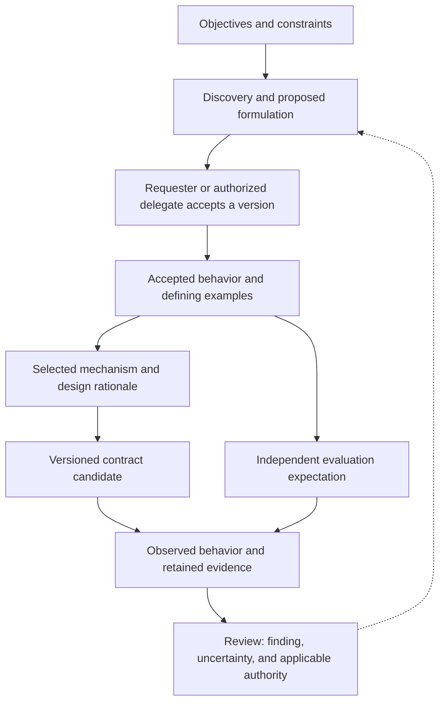

# Engineering authority and change propagation

This document owns the shared BDD activities, authority and evidence classifications, documentation ownership boundaries, and change-propagation guidance. The [current engineering architecture](architecture.md) owns the repository overview and domain relationships; [engineering history](engineering-history.md) owns earlier arrangements, authority-transition provenance, and system-wide decision records. Detailed product, design, and evaluator knowledge remains with its domain owners.

For a behavioral change, start with [BDD responsibilities](#bdd-activities-and-complementary-responsibilities) and the [authority model](#development-time-and-runtime-authority), then follow [traceability](#cross-domain-traceability-and-feedback), [documentation ownership](#documentation-ownership-boundaries), and [change impact](#change-impact). The [status classification](#status-and-evidence-boundaries) distinguishes acceptance, current prescriptions, proposals, and history.

## BDD activities and complementary responsibilities

BDD is the methodological foundation for future behavioral development. [Cucumber's BDD account](https://cucumber.io/docs/bdd/) supplies the reference practice: collaborate on concrete examples, formulate them precisely in a form that can be automated, and connect them to automated checks that guide implementation. Discovery, Formulation, and Automation iterate; feedback can reopen an earlier question.

| Activity | Work and information owners |
| --- | --- |
| **Discovery** | Requester, implementation, and evaluation perspectives explore desired behavior through examples, counterexamples, assumptions, and material unknowns. One person may represent several perspectives. Durable questions and proposal coverage belong in [Discovery](../behavior/discovery.md), with scenarios in its [proposed example suites](../behavior/discovery.md#proposed-example-suites), linked to the relevant objective, constraint, design, or evidence. |
| **Formulation** | Express agreed behavior as precise rules and distinguishing examples. Proposed rules and examples remain in discovery until independent product acceptance; `behavior/baseline.md` owns accepted wording and only those examples expressly accepted as defining. BR1–BR10 are accepted, while all Phase 2 examples remain proposed. Record the accepted scope, version, and decision authority. |
| **Automation** | Connect agreed examples to repeatable checks in `evaluations/`, starting with the check to guide any authorized implementation change. Exercise the identified candidate, inspect outcomes, and return feedback. Establish that a check distinguishes satisfying from violating the accepted condition before claiming coverage. If existing behavior already satisfies the rule, no implementation edit follows solely to create a change. |

These activities do not independently settle the responsibilities below. Use existing documents, stable IDs or headings, Markdown links, and version control proportionately; no additional lifecycle, schema, tool, or framework is introduced.

| Complementary responsibility | Authority and durable result |
| --- | --- |
| Objectives, priorities, and product acceptance | The requester or explicitly authorized delegate decides intended outcomes, priorities, and acceptance of a scoped rule and its defining examples. `behavior/baseline.md` owns established intent; pending decisions remain in discovery. BDD agreement or passing checks alone cannot establish acceptance. |
| Requirements completeness and baselining | Review the affected topic's actors, normal and exceptional conditions, conflicts, feasibility, and missing evidence. Keep unresolved scope explicit in its behavior owner. The [Phase 2 baseline](../behavior/baseline.md#phase-2-acceptance-and-editorial-provenance) records BR1–BR10 acceptance and its editorial limits. [Candidate and example history](../behavior/candidate-and-example-history.md#disposition-of-the-earlier-candidates) retains the RC history, while [Discovery](../behavior/discovery.md#formulation-questions-and-evidence-limits) retains unresolved example detail; neither the earlier ten candidates nor the current examples imply exhaustive coverage or automatic new approval obligations. |
| Design-mechanism selection | The design owner relates consequential choices, alternatives, reasons, trade-offs, status, and successors to accepted intent and constraints, under requester authority. Current binding mechanisms remain binding at their existing strength; later reconsideration needs its own authorization. |
| Governance and change authorization | Record who authorized what scope and version. Requirement acceptance, design selection, implementation permission, and release permission remain distinct. No BDD activity or evaluation result grants any of them automatically. |
| Traceability and impact analysis | Follow the direct relationships below in both directions. Missing links remain visible; shared wording, an implementation clause, or a tidy tree cannot supply missing authority. |
| Outcome validation | Evaluation owners retain observations and limitations. Claims about O1/O2 benefits require appropriate comparative evidence, representative tasks, and requester feedback where relevant. Verification of a case or of the evaluator alone does not establish those benefits. |

**Reference practice, project choice, and departure.** The iterative three-activity practice above follows the reference. Responsibility-based directories, Markdown linked to the existing Python evaluator, and product acceptance authority are project choices BDD leaves open. A genuine future departure belongs with the affected owner: identify the reference practice, precise scope and conditions, reason, closer alternatives and why they are inadequate, and consequences. The competent owner decides whether to adopt it. If it changes verification, identify the reviewer, evidence, judgment method, and remaining inconclusive scope; a standing engineering change belongs here. This provision authorizes no departure during Phase 1 and creates no standing exception to Automation.

The existing [requester-guidance case](../evaluations/docs/evaluations.md#requester-guidance) illustrates an evidence limit: both a request for the missing timezone and an unsupported timezone guess can produce a nonempty response. Its automated presence and contract-preservation assertions do not decide the semantic distinction; the retained human rubric examines communications and changes. That partially automated case retains its original interpretation. It supplies no general exemption from Automation for future accepted examples; an inability to check a distinction reliably leaves a gap to report and review under the scoped provision above.

## Cross-domain traceability and feedback

Keep two distinct relationships: **objective or constraint → accepted requirement → selected mechanism → contract implementation**, and **accepted requirement → independent evaluation expectation → observed behavioral evidence**. Every observation also identifies the versioned candidate examined. A future expectation derives its authority from accepted intent or an expressly defining example, fixed before using the observation to judge the candidate; the current candidate alone cannot authorize the expected result.

The following view describes interfaces for future accepted behavioral changes, not completed coverage of every existing clause. Solid arrows show intent, implementation, and evidence relationships; the dashed return sends a question to Discovery through review and grants no authority.

| Exchange | Ownership, versioning, and reverse navigation |
| --- | --- |
| Objective or constraint → proposal → accepted behavior | Discovery retains the question, source, uncertainty, and decision link. The baseline owns accepted wording, conditions, exceptions, expressly defining examples, and acceptance provenance. Retain provisional IDs and unresolved aspects; replacement decisions link predecessors and successors without erasing their status. |
| Accepted intent → selected design → implementation | Design records link to the actual accepted intent and retain selection authority and reasons. The existing [clause index](../design/contract-design.md#current-semantics-vocabulary-and-coverage) links mechanisms to candidate passages. Inherited design without an independently accepted behavioral requirement retains its design authority and trace gap. PR1 can support direct standalone-text inspection without inventing an intermediary mechanism. Trace metadata stays outside consumer text. |
| Accepted behavior → independent expectation | The evaluation owner defines the operational criterion once, with the accepted rule/version and defining example where established. Distinguish product verification, design conformance, and fictional fixture correctness. Existing clause-based cases retain their original regression or design-conformance interpretation; they are not retroactively derived from a complete accepted baseline. |
| Candidate and expectation → observation → review | Existing bundles identify candidate bytes/digest, case, settings, observations, assertions, and applicable rubric. A future requirements-led claim also identifies the accepted requirement/expectation and evaluator versions in its review reference or run-associated record. Navigate from the run to both candidate and expectation; retain failed, pending, inconclusive, and unexercised distinctions. Phase 1 changes no bundle schema or runner. |
| Finding → appropriate owner | Observation, fixture, or evaluator faults return to evaluations; implementation discrepancies return to contract/design review. Unsettled behavior, conflicting intent, design trade-offs requiring new product direction, or inadequate evidence return to Discovery and the competent decision owner. Evidence proposes questions and changes; it does not accept requirements, select mechanisms, or authorize revisions. |

Store each edge once at its dependent or the existing clause index; use exact IDs, targets, and versions for reverse lookup. Review direct dependents and the role of each link before a change. Changing a fixture raises observation and comparability questions; changing an expected verdict under the same accepted conditions raises an interpretation or authority question. Matching terminology is insufficient evidence of a trace link.

For example, historical [RC4](../behavior/candidate-and-example-history.md#disposition-of-the-earlier-candidates) now maps to accepted [BR4](../behavior/baseline.md#br4--bounded-investigation-and-timely-reassessment). The design's [bounded-inquiry account](../design/mechanisms/work-cycle-and-inquiry.md#completion-predictions-and-bounded-investigation) supports that outcome, and [proposed examples](../behavior/discovery.md#requirement-to-scenario-coverage) distinguish sufficient evidence, justified continuation, and missing authority. The existing [bounded-inquiry case](../evaluations/docs/evaluations.md#bounded-inquiry) retains its clause-based interpretation: its consistency assertion is not retroactively an accepted product criterion. Defining-example acceptance and requirement-to-evaluation authority remain separate work.

## Development-time and runtime authority

**Engineering authority.** [baseline.md](../behavior/baseline.md) is the canonical owner of established product objectives, accepted BR1–BR10, PR1, and product constraints. [discovery.md](../behavior/discovery.md) owns proposal status, classification definitions, coverage, and remaining formulation questions. Its [proposed example suites](../behavior/discovery.md#proposed-example-suites) own the scenarios; [candidate and example history](../behavior/candidate-and-example-history.md) owns the retained RC inventory, disposition, and draft provenance. The product-design decisions and rationale reached through [design/contract-design.md](../design/contract-design.md) guide development of the candidate AGENTS.md. That entry point owns design goals and boundaries, layer interaction and composition, shared current-semantics vocabulary, and the contract-clause coverage index. The [indexed mechanism documents](../design/contract-design.md#crosscutting-concepts) own detailed current binding prescriptions, semantics, and rationale; [delivery and portability](../design/delivery-and-portability.md) owns integration and wording trade-offs; [methods and references](../design/methods-and-references.md) owns selection and source assignments; [decisions and alternatives](../design/decisions-and-alternatives.md) owns selected contract-design decisions, historical alternatives, and structural evolution. Product objectives, established product requirements and constraints, accepted engineering decisions, and requester direction govern that evolution and its acceptance criteria, including intended evaluation expectations. Design rationale explains why selected mechanisms realize that intent. Existing `AGENTS.md` wording is implementation evidence, not an independent justification for preserving every mechanism or automatic proof of accepted product intent. Inferred detail and proposed defining examples remain separate from accepted requirements. [Phase 2 provenance](../behavior/baseline.md#phase-2-acceptance-and-editorial-provenance) records the owner's BR acceptance without claiming a verbatim original formulation, acceptance of every mechanism, or exhaustive coverage. The [historical record](engineering-history.md#temporary-migration-authority) preserves the authority-transition provenance.

[behavior/README.md](../behavior/README.md) remains a navigational entry point. The transfers to `behavior/baseline.md`, `behavior/discovery.md`, and `design/contract-design.md` preserve provenance, qualifications, and decision status; design explanations in the contract architecture provide rationale and application of established constraints and evidence for provisional candidates, without independent authority to redefine or accept requirements. Acceptance of the proposed defining examples and requirement-to-evaluation traceability remain separate work.

**Repository applicability.** The applicable engineering practices selected for AGENTS.md also guide AGENTS-spec development as established engineering direction: [bounded work and adequate depth](../design/mechanisms/work-cycle-and-inquiry.md#small-commitments-with-sufficient-depth), [adequate validation](../design/mechanisms/engineering-and-validation.md#validation-and-test-evidence), [preservation of existing behavior](../design/mechanisms/engineering-and-validation.md#component-boundaries-refactoring-and-validation), [canonical knowledge ownership](../design/mechanisms/knowledge-and-documentation.md#dry-keeping-knowledge-consistent-as-work-progresses), and appropriate [documentation](../design/mechanisms/knowledge-and-documentation.md#documentation-choices) and [decision records](../design/mechanisms/knowledge-and-documentation.md#adrs-preserving-the-reasons-for-lasting-choices). This scoped adoption remains subject to developer direction, actual tool permissions, and applicable higher-priority instructions. It does not adopt the entire candidate as independently accepted development policy or automatically apply consumer-specific instructions, provider loading mechanisms, or protected-file rules to this repository. [Classification and evidence](#status-and-evidence-boundaries) preserves the distinctions between established decisions, selected mechanisms, and provisional requirements.

**Runtime normative authority.** `AGENTS.md` is the complete, self-contained normative operating contract delivered to consuming agents, within the applicable instruction hierarchy and tool permissions. Requirements and rationale in internal documentation create no additional operating duties or runtime dependencies. A mismatch between intended requirements and contract wording calls for human review and authorized correction, not an implicit change to the rules applied to an agent. Existing runs remain interpreted under their captured contract and rubric until approved changes are implemented; revised criteria do not silently revise historical conclusions. Neither source automatically grants permission to edit protected files or make consequential decisions beyond existing authorization; requester authority and tool permissions continue to apply.

**Development instruction loading.** The candidate is staged as `contract/prerelease_AGENTS.md`, with no root `AGENTS.md`, root `CLAUDE.md`, or active `.github/copilot-instructions.md`. Its `prerelease_` filename is not a standard automatic instruction entry point. The staged candidate remains source material, not an automatically loaded development instruction file; agents may explicitly read it. Documented engineering direction does not guarantee that a tool will load, discover, or enforce it. Development agents must receive applicable instructions through an actual supported instruction or task mechanism; this documentation creates or configures none. Authorization for development changes derives from developer direction and accepted engineering decisions, within applicable instructions and tool permissions, not from the candidate's protected-file rule. That rule protects instruction files in consuming repositories. Evaluation workspaces separately receive its unchanged bytes under the standard filename `AGENTS.md`, where its rules remain normative for the evaluated agents. The [staged-source mapping](architecture.md#staged-sources-and-release-relative-references) documents release-relative exceptions in the preserved artifacts. The documentation layout does not modify external instruction configuration or unload instructions already present in a session.

An authorized redesign may reconsider or replace an existing mechanism, including PDSA or another method currently prescribed by the contract. Authorization to reconsider a mechanism does not itself suspend applicable loaded instructions. If changing the engineering process itself becomes necessary, that change must be addressed explicitly through an authorized and technically effective mechanism; editing or evaluating the contract creates no exemption from the instructions governing the agent.

The contract prescribes intended conduct; it does not independently enforce or guarantee compliance. Technical enforcement depends on the tool's actual controls, and observed behavior requires evidence.

Verifying the contract against intended requirements examines whether its text expresses the intended obligations, permissions, conditions, exceptions, and constraints. Behavioral evaluation instead examines what agents receiving that text actually do. Evaluator tests verify the machinery's own specified execution, observation, grading, reporting, and failure behavior; they do not establish agent compliance or the semantic validity of the expectations. These are separate evidence relationships. The [current-semantic specification](../design/contract-design.md#current-semantics-vocabulary-and-coverage) records the current clauses and their interactions; the clause index now links accepted outcomes to current mechanisms, while complete realization and independently accepted evaluation expectations remain unestablished.

### Status and evidence boundaries

The [contract-design architecture](../design/contract-design.md) governs engineering design evolution within the established requirements and constraints owned by [baseline.md](../behavior/baseline.md), applicable accepted decisions, and requester authority under the [engineering authority model](#development-time-and-runtime-authority). This section owns classification and evidence and the shared design-status distinctions; the requirements documents preserve [established-item provenance](../behavior/baseline.md#status-and-provenance) and [candidate status and provenance](../behavior/candidate-and-example-history.md#status-and-provenance). Runtime obligations remain those delivered through the complete, self-contained `AGENTS.md`, within the consuming tool's instruction hierarchy and permissions. Protected-file rules and authority limits continue to apply. The [authority-transition history](engineering-history.md#temporary-migration-authority) retains the transfer provenance.

Currently mandatory methods and other prescribed mechanisms retain their present normative force, including PDSA, explicit increment predictions, decomposition rules, and EARS. Future revisability makes none of these optional now and changes neither recommendations nor permissions. Prospective RC proposals and D1–D10 alternatives must not redefine the current specification; future requirements acceptance and authorized redesign are separate work. The historical RC1–RC10 inventory and earlier 30 RCx-Py proposals are not accepted wholesale by the later BR1–BR10 decision; [candidate disposition](../behavior/candidate-and-example-history.md#disposition-of-the-earlier-candidates) records its scoped relationship to that inventory. Earlier in-principle acceptance of nine proposals and selection of D2-A/D3-A for planning do not replace or reinterpret current behavior or authorize design changes here.

The classification concerns engineering intent, not whether a currently loaded instruction applies to an agent. Existing clauses prove what the runtime contract presently specifies; they do not independently prove that every behavior or selected method is an accepted product requirement. An authorized redesign can reconsider mechanisms, including PDSA and the three-layer organization. The engineering architecture is provider-neutral; the candidate contract is staged and does not automatically govern development. It remains normative for consuming agents and explicitly isolated evaluations; historical loading during repository maintenance is not a permanent self-governance requirement. [Development-time and runtime authority](#development-time-and-runtime-authority) owns that distinction.

| Status | Evidence and interpretation in the design documents |
| --- | --- |
| **Established objective or product requirement** | Supported by explicit requester direction or accepted project records beyond the implemented clause alone. Objectives state desired outcomes. [BR1–BR10](../behavior/baseline.md#accepted-behavioral-requirements) and [PR1](../behavior/baseline.md#established-product-requirement) are accepted product requirements with equal authority in the same baseline: the former specify agent behavior, the latter a property of the delivered contract. Their subjects and verification methods differ, as explained in the [baseline](../behavior/baseline.md#status-and-provenance). |
| **Established constraint** | A retained, documented compatibility, portability, or design boundary. Its original strength, exceptions, measurement, and revision conditions remain attached; a preferred target is not a hard ceiling. |
| **Design rationale or selected decision** | Reasons for a mechanism, its interactions, costs, and alternatives. Selection in the current design does not make the mechanism a permanent product requirement. Explicit acceptance and supersession are distinguished in the [decision index](../design/decisions-and-alternatives.md#selected-design-and-retained-decisions). |
| **Current binding design prescription** | An operative mechanism recorded in the [contract-design architecture](../design/contract-design.md) and delivered through `AGENTS.md`, with its present modality, actor, trigger, timing, scope, conditions, and exceptions. The [indexed topic sections](../design/contract-design.md#current-semantics-vocabulary-and-coverage) specify these semantics alongside distinguishable rationale; the [assessment scenarios](../design/design-review.md#assessing-design-changes) illustrate interactions. Binding now does not imply independently accepted enduring product status. |
| **Requirement candidate — provisional** | Intended behavior inferred from rationale, examples, or clauses without independently established acceptance. The [historical inventory and its disposition](../behavior/candidate-and-example-history.md#disposition-of-the-earlier-candidates) distinguish accepted outcomes from residual inferred detail. |
| **Proposed defining example** | A distinguishing example awaiting owner acceptance, even when it directly demonstrates an accepted requirement. [Discovery](../behavior/discovery.md#formulation-questions-and-evidence-limits) labels direct demonstrations and detail relying on current design; neither is an accepted criterion or behavioral evidence. |
| **Historical or superseded reasoning** | Significant earlier mechanisms and reasons, with source context and current replacement links. These explain evolution; they are not current policy or accepted requirements. |

The [requirements owner's provenance section](../behavior/baseline.md#status-and-provenance) preserves the owner-supplied BR1–BR10 acceptance and why the ordered objectives, PR1, and constraints are established, including the earlier reader guidance, adoption guide, accepted requirements-led engineering decision, and requester preservation direction. Accepted product intent does not accept every implemented clause. Detailed behavioral acceptance cannot be reconstructed merely from an “accepted contract” commit title or normative wording, so it remains provisional where no separate evidence is available.

## What evaluation evidence can establish

Results are evidence about the specific cases run, not about general contract compliance. The cases are finite and present designed conditions; automated assertions answer defined technical questions, while semantic criteria remain with human reviewers; model behavior is nondeterministic, so one run is not repeated evidence; and showing that the contract caused an observed behavior requires comparative evidence. [Purpose and evaluation model](../evaluations/docs/evaluations.md#purpose-and-evaluation-model) owns these limits and the current coverage gaps. Human review distinguishes evaluator faults, unsuitable expectations or scenarios, contract wording that fails intended requirements, agent behavior, and unresolved product intent. Findings can inform proposals about requirements, design, implementation, or evaluation expectations; they authorize none of those changes. Contract edits follow the [development authority model](#development-time-and-runtime-authority) and the established [method-selection](../behavior/baseline.md#method-selection-qualifications) and [portability qualifications](../behavior/baseline.md#portability-and-standing-context-qualifications), with the [current wording trade-offs](../design/delivery-and-portability.md#current-wording-trade-offs) retaining their limited acceptance.

## Documentation ownership boundaries

Engineering documentation gives each detailed fact, requirement, interface, procedure, architectural explanation, and significant decision one identifiable owner. Other documents give a concise summary and direct link for their own readers. A permissible summary answers its reader's question, agrees with its owner, retains qualifications whose omission would mislead, and can be corrected from that owner. A copy that readers could treat as authoritative, or that needs independent maintenance to stay correct, creates a second owner; different wording alone does not create a separate responsibility. If navigation and an owner disagree, correct the navigation.

The two consumer guides serve different reading needs and may intentionally overlap while remaining independently useful. Their summaries preserve the contract's rule strengths, conditions, and exceptions and define no competing rules. This does not exempt them from canonical ownership. Essential practical explanations stay self-contained at each reader's depth or link to the contract, other product documentation, or external references; removing engineering navigation must not remove useful consumer knowledge. [Contract explanation review](../design/design-review.md#reviewing-contract-explanations) owns the audience, shared-example relationship, and meaning and comprehension checks.

Cross-domain changes start with the authoritative owner, distinguish clarification from changed behavior, and follow known direct dependents within authorization. Check incoming links when paths or headings change; a link warrants inspection, not necessarily an edit. This relationship authorizes no search for unknown dependents, audit, or backfill. A known external heading link may warrant retaining a heading pointing to its new owner. [Behavior/design editing](../behavior/README.md#working-with-requirements-and-design-documentation) and [evaluation maintenance](../evaluations/docs/evaluations.md#modify-or-extend-an-evaluation) keep the detailed work with its domain; this architecture adds no central editorial approval step.

## Specification-to-evaluation dependencies

The framework currently exercises the staged candidate contract, and the dependencies below describe that implementation. The agreed requirements-led model, integrated with the [BDD interfaces](#cross-domain-traceability-and-feedback), guides future development without claiming that product-requirement traceability already exists. These are the known direct dependents to inspect under the contract's [canonical-knowledge rule](../contract/prerelease_AGENTS.md#35-canonical-knowledge-and-affected-documentation) when `AGENTS.md` changes; they add no procedure or approval step.

| Dependency | Mechanism | Consequence |
| --- | --- | --- |
| Runtime contract injection | `CONTRACT_PATH` in [workspace.py](../evaluations/runtime/workspace.py) resolves to `contract/prerelease_AGENTS.md`. Workspace preparation copies its current bytes into every workspace as root `AGENTS.md`, and fixtures cannot override it (E1, E22). | Every run evaluates the contract as it stands at run time; no version is pinned. A contract edit reaches the next run whether or not affected cases and rubrics were reviewed. Offline tests compare against the same current bytes rather than fixed contents, so they neither depend on nor detect contract wording. |
| Clause references | The [case catalogue](../evaluations/docs/evaluations.md#cases-and-interpretation) and case sections cite contract sections and link their heading anchors. Rubrics in [assumptions.py](../evaluations/scenarios/assumptions.py), [inquiry.py](../evaluations/scenarios/inquiry.py), and [findings.py](../evaluations/scenarios/findings.py) cite section numbers and rule strengths. Other rubrics direct reviewers to the retained contract's strengths and triggers without numbering. Automated assertions encode scenario expectations derived from contract behavior, such as `ScopePreserved` for §1.2's restriction on unrelated cleanup. | Renumbered sections, renamed headings, or changed rule meaning can leave case descriptions, assertions, or rubrics stale. No automated check in the repository detects such staleness. |
| Contract identity in evidence | [codex.py](../evaluations/runtime/codex.py) records `contract_sha256` in `execution.json` and saves the injected `AGENTS.md` with each run's evidence. Each human-review run also retains its rubric as `review.md`. | Results stay tied to the contract and rubric they used. A later contract change neither revises earlier conclusions nor carries them over to the new text. |

Other documents also link `AGENTS.md` heading anchors, including `design/contract-design.md`, its indexed design documents, `design/design-review.md`, and the consumer guides. Their synchronization follows the [ownership and direct-dependency boundaries](#documentation-ownership-boundaries).

### Change impact

A contract change does not necessarily require an evaluation change. Established product requirements guide intended behavior and expectations; existing clauses and rubrics describe the current implementation and assessment baseline. Compare the changed clauses with the behavior each case exercises, using the catalogue's contract references and the rubric citations above, without treating contract edits alone as authority to redefine expected behavior:

- **Behavior an evaluated case exercises.** If a rule's strength, trigger, condition, exception, or scope changes where a case's assertions or rubric criteria depend on it, the scenario module and its catalogue entry are affected owners. Assess whether the case still presents its intended condition and whether its assertions and rubric still match the contract. An E1–E40 requirement changes only if the framework's own required behavior changes, through authorized requirement work.
- **Structure or wording without changed behavior.** Renumbering, renamed headings, or moved clauses need reference corrections in rubrics, the catalogue, and linking documents. Rubric meaning is unchanged.
- **No demonstrated evaluation impact.** A change to behavior that no case exercises needs no case change; [Purpose and evaluation model](../evaluations/docs/evaluations.md#purpose-and-evaluation-model) lists known coverage gaps. Proposing new coverage is a separate decision, not an obligation created by the change.

Changes in the other direction never alter the contract. Editing a case or rubric changes what is assessed and how; it does not change what `AGENTS.md` requires.

