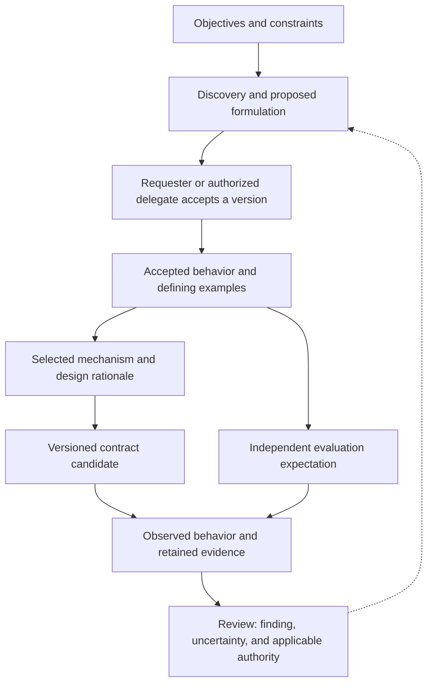

# Engineering authority and change propagation

This document defines shared BDD responsibilities, authority and status distinctions, traceability, and change guidance. Use [architecture](architecture.md) for the stage layout and responsibilities, and [system-wide engineering decisions](decisions.md) for lasting decision rationale and provenance.

## BDD activities and complementary responsibilities

BDD is the methodological foundation for future behavioral development through iterative Discovery, Formulation, and Automation, following [Cucumber's reference practice](https://cucumber.io/docs/bdd/). Feedback can reopen an earlier question.

| Activity | Work and durable result |
| --- | --- |
| **Discovery** | Bring requester, implementation, and evaluation perspectives to examples, counterexamples, assumptions, and material unknowns; one person may represent several perspectives. Keep questions, proposal coverage, and source links in [Discovery](../01-behavior/deliverables/discovery.md) and its proposed example suites. |
| **Formulation** | Express agreed behavior as precise rules and distinguishing examples. Proposals stay in discovery until product acceptance; the [baseline](../01-behavior/deliverables/baseline.md) owns accepted wording and only examples expressly accepted as defining. |
| **Automation** | Connect agreed examples to repeatable checks in `04-evaluations/`, starting with the check to guide authorized implementation. Exercise the identified candidate and inspect outcomes. Before claiming coverage, establish that the check distinguishes satisfying from violating the accepted condition. Existing satisfying behavior needs no implementation edit solely to create a change. |

BDD does not establish requirements completeness or settle product and design authority. Review the affected topic's actors, normal and exceptional conditions, conflicts, feasibility, and missing evidence; keep unresolved scope explicit in its behavior owner. Design owners retain consequential choices, reasons, alternatives, trade-offs, status, and successors. Use existing documents, IDs or headings, links, and version control proportionately.

Responsibility-based directories, Markdown linked to the Python evaluator, and requester acceptance are project choices. For a genuine departure from reference practice, record with the affected owner the practice, scope and conditions, reason, closer alternatives and why they are inadequate, and consequences; the competent owner decides adoption. A verification departure also identifies the reviewer, evidence, judgment method, and inconclusive scope. A standing engineering change belongs here. There is no standing exception to Automation.

When an automated check cannot reliably distinguish satisfying from violating an obligation, report the gap and review the evidence. The [requester-guidance case](../04-evaluations/deliverables/cases-and-requirements.md#requester-guidance) illustrates this limit. Future accepted examples remain subject to Automation.

## Cross-domain traceability and feedback

Maintain separate design and evaluation paths. Evaluation expectations derive from accepted intent or expressly defining examples and are fixed before judging the candidate; candidate wording alone cannot authorize the expected result.

This is the model for future accepted changes, not a claim of completed coverage. The dashed feedback path returns questions to Discovery without granting authority.

| Relationship | What to retain |
| --- | --- |
| Objective or constraint → proposal → accepted behavior | Discovery keeps sources, uncertainty, and decision links. The baseline keeps accepted wording, conditions, exceptions, defining examples, and acceptance provenance. Preserve provisional IDs and unresolved aspects; link replacements without erasing earlier status. |
| Accepted intent → design → contract | Design links accepted intent, selection authority, and reasons to implementation through the [clause index](../02-design/deliverables/contract-design.md#contract-clause-index). Inherited design without independently accepted intent retains its design authority and trace gap. PR1 permits direct artifact inspection without inventing an intermediary mechanism. Trace metadata stays outside consumer text. |
| Accepted behavior → evaluation expectation | The evaluation owner defines the operational criterion once, identifying its accepted rule/version and defining example where established. Distinguish product verification, design conformance, and correctness of fictional fixture applications. |
| Candidate and expectation → observation → review | Run bundles identify candidate bytes/digest, case, settings, observations, assertions, and applicable rubric. Requirements-led claims also identify the accepted requirement/expectation and evaluator versions in a review reference or run-associated record. Retain failed, pending, inconclusive, and unexercised distinctions. |
| Finding → responsible owner | Fixture, observation, and evaluator faults return to evaluations; implementation discrepancies to contract/design review; unsettled intent, consequential trade-offs, and inadequate evidence to Discovery and the decision owner. |

Store each relationship once at its dependent or the clause index, using exact IDs, targets, and versions for reverse lookup. Inspect direct dependents and each link's role. A fixture change raises observation and comparability questions; a changed expected verdict under unchanged accepted conditions raises an interpretation or authority question. Shared terminology alone proves no trace link.

**Current gaps:** no proposed example is accepted as defining, and explicit requirement-to-evaluation traceability remains later work. Existing cases retain their clause-based regression or design-conformance interpretation; they are not retroactively requirements-derived acceptance tests. The clause index links accepted outcomes to current mechanisms without proving complete realization. [Discovery](../01-behavior/deliverables/discovery.md#formulation-questions-and-evidence-limits) and the [evaluation model](../04-evaluations/docs/evaluation-model.md#purpose-and-evaluation-model) identify formulation and coverage limits.

## Development-time and runtime authority

**Engineering decisions.** Product objectives, established requirements and constraints, accepted engineering decisions, and requester direction govern contract evolution and intended evaluation expectations. The requester or explicitly authorized delegate decides outcomes, priorities, and product acceptance. Record the authorized scope, version, and decision authority; requirement acceptance, design selection, implementation permission, and release permission are distinct. BDD agreement, documentation edits, and evaluation results grant none automatically.

Behavior records the [established objectives](../01-behavior/deliverables/objectives-and-rationale.md#established-objectives) and the [accepted requirements and constraints](../01-behavior/deliverables/baseline.md). [Contract design](../02-design/deliverables/contract-design.md) specifies their selected realization. See [status and evidence boundaries](#status-and-evidence-boundaries) for their authority and provenance.

**Repository applicability.** Established engineering direction adopts [bounded work with sufficient depth](../02-design/deliverables/mechanisms/work-cycle-and-inquiry.md#small-commitments-with-sufficient-depth), [adequate validation](../02-design/deliverables/mechanisms/engineering-and-validation.md#validation-and-test-evidence), [behavior preservation](../02-design/deliverables/mechanisms/engineering-and-validation.md#component-boundaries-refactoring-and-validation), [canonical knowledge ownership](../02-design/deliverables/mechanisms/knowledge-and-documentation.md#dry-keeping-knowledge-consistent-as-work-progresses), and appropriate [documentation](../02-design/deliverables/mechanisms/knowledge-and-documentation.md#documentation-choices) and [decision records](../02-design/deliverables/mechanisms/knowledge-and-documentation.md#adrs-preserving-the-reasons-for-lasting-choices). This scoped adoption is subject to developer direction, higher-priority instructions, and actual permissions; it does not adopt the entire candidate or automatically apply consumer-specific loading or protected-file rules to this repository.

**Runtime authority.** Delivered `AGENTS.md` is the complete normative operating contract within the consuming tool's instruction hierarchy and permissions. Internal requirements and rationale add no operating duties. A mismatch requires human review and authorized correction, not an implicit rule change. Runs retain their captured contract and rubric interpretation; revised criteria neither rewrite historical conclusions nor carry them over to revised text. Requirements and contract wording grant no additional permission to edit protected files or make consequential decisions.

**Instruction loading.** `03-contract/prerelease_AGENTS.md` is staged source, not a standard automatic development instruction entry point. There is no root `AGENTS.md`, root `CLAUDE.md`, or active `.github/copilot-instructions.md` importing it. Agents may explicitly read the source, and Evaluations supplies it to the evaluated agent. Neither use activates it for repository development. See the [staged-source mapping](architecture.md#staged-sources-and-release-relative-references). Development instructions require an actual supported instruction or task mechanism; documentation neither configures loading nor unloads instructions already present in a session.

Authorized redesign can reconsider PDSA, the three-layer organization, or another selected mechanism. It does not suspend applicable loaded instructions: a necessary engineering-process change must be explicitly authorized and technically effective. The contract prescribes conduct without guaranteeing compliance; enforcement depends on actual tool controls, and behavior needs observational evidence.

### Status and evidence boundaries

| Status | Meaning |
| --- | --- |
| **Established objective or product requirement** | Supported by requester direction or accepted records beyond implementation wording. The [objectives](../01-behavior/deliverables/objectives-and-rationale.md#established-objectives) state desired outcomes and record the sources for their priority. BR1–BR10 and PR1 have equal accepted product authority. BR1–BR10 concern agent behavior, and PR1 concerns self-contained contract delivery. [Baseline provenance](../01-behavior/deliverables/baseline.md#status-and-provenance) records requirement sources and editorial limits. |
| **Established constraint** | A compatibility, portability, or design boundary retaining its original strength, exceptions, measurement, and revision conditions. A preferred target is not a hard ceiling. |
| **Design rationale or selected decision** | A mechanism's reasons, interactions, costs, and alternatives. Selection does not make it a permanent product requirement; the [decision index](../02-design/docs/decisions.md#selected-design-and-retained-decisions) distinguishes acceptance and supersession. |
| **Current binding design prescription** | An operative mechanism specified by design and delivered through `AGENTS.md`, retaining modality, actor, trigger, timing, scope, conditions, and exceptions. Binding now does not imply enduring product acceptance. |
| **Provisional requirement candidate** | Intent inferred from rationale, examples, or clauses without independently established acceptance. [Candidate disposition](../01-behavior/docs/candidate-and-example-history.md#disposition-of-the-earlier-candidates) separates accepted outcomes from residual inferred detail. |
| **Proposed defining example** | An example awaiting acceptance, including a direct demonstration of an accepted requirement. Discovery's Direct and Detail review labels classify proposed examples; neither establishes an accepted criterion or behavioral evidence. |
| **Historical or superseded reasoning** | Earlier mechanisms and reasons with source context and replacement links, not current policy. |

Currently mandatory methods, including PDSA, explicit increment predictions, decomposition rules, and EARS, retain their force until authorized change. BR acceptance does not accept every clause, historical RC proposal, or design illustration. The [candidate record](../01-behavior/docs/candidate-and-example-history.md#status-and-provenance) distinguishes in-principle acceptance and selection for planning. Detailed product acceptance needs evidence of a decision by the requester or an authorized delegate. Normative wording establishes what the contract prescribes.

E1–E40 specify evaluator behavior, while fictional application requirements in fixtures concern those applications; neither independently establishes product intent.

## What evaluation evidence can establish

| Evidence | What it establishes |
| --- | --- |
| Contract-text review | Whether the text expresses intended obligations, permissions, conditions, exceptions, and constraints. PR1 primarily uses standalone artifact inspection. |
| Behavioral evaluation | What agents receiving the identified contract did in the cases run, assessed against assertions and human rubrics. |
| Evaluator tests | Specified machinery behavior within the checks run: execution, observation, grading, reporting, and failures; neither agent compliance nor semantic validity of expectations. |

Limit claims to the tools, environments, and behavior actually exercised. The [evaluation model](../04-evaluations/docs/evaluation-model.md#purpose-and-evaluation-model) explains the suite's coverage, variability between runs, human-review limits, and the evidence needed for causal attribution. Missing evidence remains unverified. Claims about O1/O2 benefits require suitable comparative evidence, representative tasks, and requester feedback where relevant; textual alignment or evaluator success alone cannot establish them. Human review distinguishes evaluator faults, unsuitable expectations or scenarios, contract defects, agent behavior, and unresolved intent before proposing a change.

## Documentation ownership boundaries

Choose the owner by responsibility and scope before choosing a filename. Give each detailed fact, requirement, interface, procedure, explanation, or decision one canonical owner. Other documents may summarize for their readers and link directly to that owner, retaining qualifications needed to avoid misleading them. A copy that readers could treat as authoritative, or that needs independent maintenance to stay correct, creates a second owner. If navigation disagrees with its owner, correct navigation.

Accepted requirements, selected design, runtime instructions, evaluation definitions, and observations are distinct representations with their own status and owners; related content across them is not automatically duplication. [Root architecture](architecture.md#current-bdd-first-organization) defines stage responsibilities and shared interfaces. Each stage owns its implementation, procedures, and maintenance guidance. Root and stage READMEs orient and navigate without adding specifications or procedures.

The consumer guides may overlap at different depths while remaining independently useful. Summaries preserve contract strengths, conditions, and exceptions without competing rules. Keep essential practical explanations self-contained or link to product documentation, the contract, or external sources; removing engineering navigation must not remove useful consumer knowledge. [Contract explanation review](../02-design/docs/design-review.md#reviewing-contract-explanations) owns audience and comprehension checks.

Follow known direct dependents within authorized scope. Inspect what each reference is for before changing it. When a document moves or its structure changes, update affected incoming links, labels, fragments, and plain-text references. Link directly to the new destination without duplicate documents or forwarding anchors. This does not authorize searches for unknown dependents, audits, or backfills. Report out-of-scope gaps for separate work. These conventions add no central editorial approval.

### Engineering documentation convention

- **Architecture.** Use recognizable headings for relevant [arc42 topics](https://arc42.org/overview/). Prefer `architecture.md` when a scope needs a standalone overview. Where a deliverable already owns the architecture, link to it from the scope README. Cover the applicable topics within the existing owners, without empty sections, a file per topic, or a parallel hierarchy. Link to evidenced risks and technical debt with the classification and detail retained by the responsible owner.
- **Decisions.** Link significant decisions from the scope README. For a dedicated decision collection, use `docs/decisions.md` by default. For decisions kept in a canonical architecture document, link directly to its `Architecture decisions` section. Preserve the decision, context, scope, status, rationale, material alternatives, consequences, and known supersession to the extent documented. Retain only dates, status, and acceptance supported by the record. Related choices can share a record.
- **Guides and names.** Choose descriptive headings and filenames for the purpose or reader task. Apply the [Diátaxis](https://diataxis.fr/) distinction between tutorials, how-to guides, reference, and explanation where it helps readers. Keep related forms together when they serve one reading or maintenance task. Create categories or directories only for an actual need. Use lowercase hyphenated Markdown filenames, preserving established special names and staged consumer names. Rename an existing file only for a concrete navigation or maintenance benefit.

### Working with requirements and design documentation

Distinguish editorial clarification from changed operating behavior, and update the authoritative owner first. Current-operation explanations use the relevant contract clauses and rationale. Authorized behavior changes follow established intent, constraints, and decisions, and update the runtime contract and affected canonical documentation consistently, including evaluations where affected.

Follow affected summaries, examples, references, and bridge explanations. Review the complete reader task using [explanation checks](../02-design/docs/design-review.md#reviewing-contract-explanations) and relevant [non-normative design illustrations](../02-design/docs/design-review.md#assessing-design-changes). These textual checks do not establish behavioral evidence. Contract edits retain the [method-selection constraints](../01-behavior/deliverables/baseline.md#method-selection-qualifications), [portability qualifications](../01-behavior/deliverables/baseline.md#portability-and-standing-context-qualifications), and limited acceptance of existing [wording trade-offs](../02-design/deliverables/delivery-and-portability.md#current-wording-trade-offs).

For a substantial rewrite, keep a temporary old-to-new content map with reasons for removals. Preserve unique explanations, useful lasting rationale, accepted decisions, significant historical reasoning, and influential rejected or superseded alternatives with their status and replacement links. Keep decision attribution, scope, and evidence limits. Retain a development event or its date only when it matters for authority, provenance, compatibility, or the validity of evidence. Transient revision narratives, measurements, fingerprints, temporary maps, and validation records belong in working or delivery records.

### Finding an owner and checking a change

Start with the [stage that owns the proposed change](architecture.md#current-bdd-first-organization). Use Behavior's [rationale map](../01-behavior/deliverables/objectives-and-rationale.md#rationale-map) and [proposed examples](../01-behavior/deliverables/discovery.md#requirement-to-scenario-coverage) to trace intent, and Design's [clause index](../02-design/deliverables/contract-design.md#contract-clause-index) to trace realization. For a run, compare the [case's intended coverage](../04-evaluations/deliverables/cases-and-requirements.md#cases-and-interpretation) with its [retained evidence](../04-evaluations/docs/running-and-reviewing.md#results-evidence-and-failure-investigation).

Before changing an owner, identify affected direct dependents, applicable decision authority, and evidence that would verify the change, using the distinctions above. For PR1, follow [R5's artifact-inspection route](../01-behavior/deliverables/objectives-and-rationale.md#r5).

## Specification-to-evaluation dependencies

A change to the staged contract reaches the next evaluation even if its expectations have not been reviewed. Clause edits can invalidate a case's expectations even when its assertions still pass. Renumbering or moving a clause can break the references that connect a rubric or case to its intended rule. Review affected expectations against their authority and interpret earlier evidence against the candidate and criteria used at the time.

Design documents, design-review guidance, and consumer guides also link contract headings. Inspect affected references in those owners.

### Change impact

Compare changed clauses with the conditions each case exercises and its assertions and rubric, without treating a contract edit as authority to redefine expected behavior:

- **Exercised behavior changes:** inspect the scenario and catalogue when rule strength, trigger, condition, exception, or scope affects them. Check that the fixture still presents the intended condition and assessment still matches. E1–E40 change only through authorized requirement work when the evaluator's own required behavior changes.
- **References change without behavior:** correct section numbers, headings, and moved-clause links in rubrics, catalogue, and linking documents; preserve rubric meaning.
- **No demonstrated case impact:** no case edit is required for behavior no case exercises. New coverage is a separate decision, not an obligation created by the edit.

Editing a case or rubric changes assessment, not the contract's instructions.
