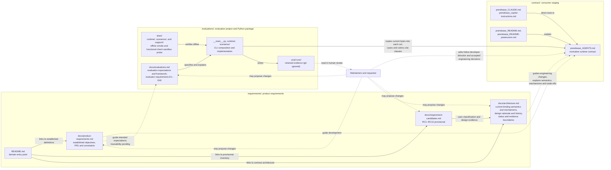

# Engineering history and decisions

This document owns previous engineering arrangements, the temporary migration-authority record, and complete system-wide decisions with their original status, rationale, alternatives, refinements, and approval provenance. Use the [current engineering architecture](architecture.md) for today's organization and decision index, and [authority and change propagation](authority-and-change.md) for current authority, classifications, and change guidance.

The historical accounts below were extracted from [architecture.md at `62a407e`](https://github.com/indisoluble/AGENTS-spec/blob/62a407ea4d4177c67c39d7a761645f6d3bbd1abc/docs/architecture.md). Their paths, diagrams, stage boundaries, and references to “this document,” “here,” “above,” or “below” retain that source-document context; they do not assign today's ownership. The [15 November successor](#shared-engineering-documentation-extraction-15-november-2026) records the structural change without rewriting those decisions.

## Historical responsibility arrangement at the Phase 1 baseline

The following account preserves the four responsibilities, reading path, and linear development path at [the accepted 9 November 2026 source revision](https://github.com/indisoluble/AGENTS-spec/blob/4e44bd2c03d2e708654f5060705398e630d0dace/docs/architecture.md#purpose-and-scope). Its former paths and ownership describe that arrangement. The [13 November successor](#bdd-first-reorganization-13-november-2026) changes organization and method, preserving its knowledge and authority distinctions.

`docs/` holds system-wide engineering documentation, including this architecture and its cross-domain relationships, authority model, and system-wide decisions; [requirements/](https://github.com/indisoluble/AGENTS-spec/blob/4e44bd2c03d2e708654f5060705398e630d0dace/requirements/README.md) owns established product requirements, provisional requirement candidates, and the [operating-contract architecture](https://github.com/indisoluble/AGENTS-spec/blob/4e44bd2c03d2e708654f5060705398e630d0dace/requirements/docs/architecture.md); `evaluations/` is the evaluation engineering project and Python package, containing its implementation, offline tests, dependencies, and documentation. Adopters do not install these engineering files, and they add no operating duties to the delivered contract. The [authority model below](https://github.com/indisoluble/AGENTS-spec/blob/4e44bd2c03d2e708654f5060705398e630d0dace/docs/architecture.md#development-time-and-runtime-authority) distinguishes engineering authority from the instructions currently governing maintenance work. The engineering project has four related responsibilities:

1. **Product requirements.** Defining desired collaboration outcomes and why they are wanted, applicable product constraints, and established versus provisional status, independently of contract mechanisms and evaluation machinery. [requirements/README.md](https://github.com/indisoluble/AGENTS-spec/blob/4e44bd2c03d2e708654f5060705398e630d0dace/requirements/README.md) provides domain navigation and remaining requirements work. [product-requirements.md](https://github.com/indisoluble/AGENTS-spec/blob/4e44bd2c03d2e708654f5060705398e630d0dace/requirements/docs/product-requirements.md) owns the established objectives, PR1, and product constraints; [requirement-candidates.md](https://github.com/indisoluble/AGENTS-spec/blob/4e44bd2c03d2e708654f5060705398e630d0dace/requirements/docs/requirement-candidates.md) owns RC1–RC10 as provisional candidates awaiting developer acceptance.
2. **Contract design and evolution.** Determining how instructions express desired outcomes and explaining the selected mechanisms, decisions, and trade-offs. [requirements/docs/architecture.md](https://github.com/indisoluble/AGENTS-spec/blob/4e44bd2c03d2e708654f5060705398e630d0dace/requirements/docs/architecture.md) owns the contract's design goals and boundaries, layer interaction, continuation behavior, shared current-semantics vocabulary and contract-clause coverage index, and [selected contract-design decisions and historical alternatives](https://github.com/indisoluble/AGENTS-spec/blob/4e44bd2c03d2e708654f5060705398e630d0dace/requirements/docs/architecture.md#architecture-decisions), together with [method-reference semantics and source assignments](https://github.com/indisoluble/AGENTS-spec/blob/4e44bd2c03d2e708654f5060705398e630d0dace/requirements/docs/architecture.md#principles-and-reference-boundaries) under Crosscutting Concepts and non-normative [assessment scenarios](https://github.com/indisoluble/AGENTS-spec/blob/4e44bd2c03d2e708654f5060705398e630d0dace/requirements/docs/architecture.md#assessing-design-changes) under Design Reference. The contract architecture also owns the current binding design prescriptions, their semantics, selected mechanisms, rationale, trade-offs, and evolution qualifications. This is a requirements-domain design owner, not an additional pipeline stage. Preserving current semantics does not accept provisional candidates as enduring requirements.
3. **Behavioral evaluation and evaluator verification.** A local Python framework runs Codex on finite cases against the current contract and produces evidence about those cases. Offline tests verify the evaluation machinery. [evaluations.md](https://github.com/indisoluble/AGENTS-spec/blob/4e44bd2c03d2e708654f5060705398e630d0dace/evaluations/docs/evaluations.md) owns the subsystem documentation, including evaluator requirements E1–E40, which are distinct from product requirements.
4. **Knowledge maintenance.** Keeping each fact, rule, explanation, and decision with one canonical owner and keeping its dependents consistent, across the whole repository including the consumer guides. Each domain owns its documentation and review guidance; [documentation ownership boundaries](https://github.com/indisoluble/AGENTS-spec/blob/4e44bd2c03d2e708654f5060705398e630d0dace/docs/architecture.md#documentation-ownership-boundaries) explains their relationship.

Its readers are people who engineer, evaluate, evolve, operate, and maintain the specification and its evaluation framework. This document explains the engineering relationships; it does not supply runtime operating rules, adopting-project facts or architecture, or provider-owned instruction-loading behavior. The staged files at the `contract/` root belong to the user-facing product or its adoption and usage material. They neither reference nor depend on engineering documentation, even for optional further reading. Engineering documentation may reference those files. Start requirements and contract-design work at [requirements/README.md](https://github.com/indisoluble/AGENTS-spec/blob/4e44bd2c03d2e708654f5060705398e630d0dace/requirements/README.md), evaluation work at [evaluations.md](https://github.com/indisoluble/AGENTS-spec/blob/4e44bd2c03d2e708654f5060705398e630d0dace/evaluations/docs/evaluations.md), and cross-domain work here.

The development path remains established product requirements → staged candidate contract → behavioral evaluations → human review → authorized revision when appropriate. Knowledge maintenance supports each domain; it adds no pipeline stage. The current contract and evaluation framework remain distinct from independently accepted product intent.

## Temporary migration authority

**Historical boundary — concluded November 8, 2026.** Throughout the source-of-truth migration, the frozen root `AGENTS.md` governed **all current operating semantics**, within the actual instruction hierarchy, permissions, and requester authority. The verified baseline is historical evidence:

| Identity | Value |
| --- | --- |
| `AGENTS.md` Git blob | `289a31a644d7ab1b816c873f244566ab632a330f` |
| File SHA-256 | `3d7b6c240e0f4b02713d166662d7d95ec74985b9939b23838863acd596407e81` |
| Reference commit on `refactor` | `184c7d5b26bfa78762c77e72381df9e408ac370b` |

Transfer required byte-for-byte preservation of `AGENTS.md`, semantic preservation in `contract-design.md`, and independent semantic and cross-document verification. The engineering specification had to preserve every obligation, prohibition, permission, recommendation, trigger, condition, exception, and relevant semantic interaction without weakening, strengthening, extending, or omitting them; other documentation had to remain consistent with the frozen contract.

Final requester-supplied independent verification against `66e63a443ac73712b4af8a54f5bc6fac3cb4fdff` returned **READY FOR TRANSFER DECISION**, with acceptance criteria A–H **PASS** and no corrective findings. Verification supplied evidence for the transfer decision; it did not itself transfer authority.

On **November 8, 2026**, after reviewing that verification, the requester explicitly replied **“Authorized”**, transferring engineering authority to `contract-design.md`. The transfer was documented in [`809e231`](https://github.com/indisoluble/AGENTS-spec/commit/809e231919c349b1ec3039ad3669dc88cf8b6e35). `AGENTS.md` retains self-contained normative runtime authority; internal documents create no runtime dependencies. The temporary byte-for-byte migration freeze concluded. The baseline was not a permanent prohibition on future separately authorized evolution under the authority model and protected-file rules then applicable; the [current authority model](authority-and-change.md#development-time-and-runtime-authority) distinguishes development from consumer runtime authority.

The transfer changes no existing agent operating behavior, amends no runtime contract, accepts none of RC1–RC10 as enduring product requirements, and selects or approves none of D1–D10. It authorizes no product redesign. Current methods, including PDSA, explicit increment predictions, EARS, and the other preserved prescriptions, retain their existing normative force until separately authorized change. The migration reviews establish neither comprehensive live-agent compliance nor measured token savings.

## Historical context graph at the Phase 1 baseline

The graph, legend, and accompanying relationship descriptions below retain the [preceding arrangement](https://github.com/indisoluble/AGENTS-spec/blob/4e44bd2c03d2e708654f5060705398e630d0dace/docs/architecture.md#context-and-relationships), including the original solid/dashed distinction and pending traceability. They are historical; the [current interface view](authority-and-change.md#cross-domain-traceability-and-feedback) shows the separate design and evaluation relationships. Historical links below resolve to that source revision.

Solid arrows are current references or mechanisms; dashed arrows are engineering responsibilities and human activities, including the requirements relationships, with candidate acceptance and traceability still pending. The engineering-to-consumer editing relationships create no reference or dependency from consumer files back into engineering documentation. No automated path leads from evaluation results to changes in requirements, design, the contract, or evaluation expectations.

- **Contract and bridges.** `AGENTS.md` is the only operating contract. The bridges apply it through different mechanisms: `CLAUDE.md` uses Claude Code's import syntax, while the Copilot file links to the contract and directs the tool to read and follow it. Neither adds policy, and actual loading still depends on the tool, interface, and settings; [why the bridges differ](https://github.com/indisoluble/AGENTS-spec/blob/4e44bd2c03d2e708654f5060705398e630d0dace/requirements/docs/architecture.md#why-the-bridges-differ) explains them.
- **Product requirements, current semantics, and design rationale.** `requirements/docs/product-requirements.md` owns established objectives, PR1, and product constraints; `requirements/docs/requirement-candidates.md` owns provisional RC1–RC10 and unresolved acceptance questions; [requirements/docs/architecture.md](https://github.com/indisoluble/AGENTS-spec/blob/4e44bd2c03d2e708654f5060705398e630d0dace/requirements/docs/architecture.md) owns the contract's design goals and boundaries, layer interaction, continuation, shared current-semantics vocabulary and contract-clause coverage index, and [selected contract-design decisions and historical alternatives](https://github.com/indisoluble/AGENTS-spec/blob/4e44bd2c03d2e708654f5060705398e630d0dace/requirements/docs/architecture.md#architecture-decisions), together with [classification and evidence](https://github.com/indisoluble/AGENTS-spec/blob/4e44bd2c03d2e708654f5060705398e630d0dace/requirements/docs/architecture.md#status-and-evidence-boundaries) and the [indexed current semantics and rationale](https://github.com/indisoluble/AGENTS-spec/blob/4e44bd2c03d2e708654f5060705398e630d0dace/requirements/docs/architecture.md#current-semantics-vocabulary-and-coverage). [Development-time and runtime authority](https://github.com/indisoluble/AGENTS-spec/blob/4e44bd2c03d2e708654f5060705398e630d0dace/docs/architecture.md#development-time-and-runtime-authority) owns their relationship. Acceptance of RC1–RC10 remains separate and pending. Internal intent and explanation cannot change the delivered contract's operating rules; a future authorized behavioral change must be reflected consistently in `AGENTS.md` and affected canonical engineering documentation, within the development authority described above.
- **Evaluation framework.** The framework depends on the specification; the specification does not depend on the framework. Evaluation workspaces contain the root contract and the case fixture, with no bridge files, and the framework runs only Codex, so it exercises neither bridge nor any other tool.
- **Offline tests.** The unittest suite, a fake Codex executable, and an offline smoke substitute verify infrastructure and technical assertions without contacting OpenAI. A separate opt-in probe checks the evaluator-owned functional-check sandbox using the installed Codex CLI; it does not verify the evaluated-agent permission profile. Neither establishes live agent behavior or the semantic validity of a rubric.
- **Evidence and human review.** Each run retains its evidence outside the disposable workspace. Human reviewers assess rubric criteria outside the CLI, which collects no verdicts.
- **Knowledge maintenance.** This concern spans all of the above: domain owners keep their documentation and known direct dependents consistent within authorized scope.

## Decisions

The system-wide records below retain their historical paths and constraints. Later structural relocations, including `contract/prerelease_*`, `contract/docs/prerelease_contract-design.md`, `evaluations/`, and `docs/architecture.md`, and the development instruction loading described in the [authority model](authority-and-change.md#development-time-and-runtime-authority), do not rewrite those decisions' rationale or the intended consumer filenames. Current ownership is described in the [engineering overview](architecture.md); earlier location-based descriptions of the product boundary below remain historical. The [evaluation guide](../04-evaluations/docs/running-and-reviewing.md#setup-and-running-evaluations) owns current evaluation paths and commands.

Specification-design decisions reside in [decisions and alternatives](../02-design/docs/decisions-and-alternatives.md#architecture-decisions), and evaluation-specific decisions reside in [framework design](../04-evaluations/docs/framework-design.md#engineering-decisions). The [cross-domain decision index](architecture.md#decisions) links these owners, including the [evaluation-documentation successor](../04-evaluations/docs/framework-design.md#evaluation-documentation-by-maintenance-responsibility-15-november-2026) to the integrated layout recorded below. That later decision changes only physical documentation ownership and navigation; the earlier record remains intact.

### Integrated engineering architecture with focused detailed owners

**Status:** Accepted. The requester accepted this direction after reviewing a read-only assessment of alternatives.

**Context.** The internal documents each had clear owners, but no document explained the engineering project as a whole. The internal README described two areas and a one-sentence dependency, while documentation maintenance appeared only as a file. `contract-design.md` does not refer to the evaluation framework, and `evaluations.md` links to contract clauses but not to the design rationale. The [dependencies above](https://github.com/indisoluble/AGENTS-spec/blob/4e44bd2c03d2e708654f5060705398e630d0dace/docs/architecture.md#specification-to-evaluation-dependencies) were undocumented as relationships. Constraints: the README is orientation only; `contract-design.md` is also the public technical guide, not contributor onboarding; root-guide links into `_internal/docs/` and module docstrings referencing `docs/evaluations.md` should stay valid; and the contract's [architecture rule](https://github.com/indisoluble/AGENTS-spec/blob/4e44bd2c03d2e708654f5060705398e630d0dace/contract/prerelease_AGENTS.md#36-architecture-guides-and-code-documentation) recommends starting architecture in one document, splitting sections as readability or maintenance warrants.

**Decision.** Add this document as the owner of system-level relationships, context, boundaries, and cross-domain dependencies. Keep `contract-design.md`, `evaluations.md`, and `documentation-maintenance.md` as the detailed owners, with `evaluations.md` intact as the framework's integrated documentation. The README keeps orientation and navigation. No paths or existing anchors change.

**Consequences.** One owner explains how specification design, evaluation, and documentation maintenance relate, without breaking external or docstring links. Maintainers keep one more document consistent, and must keep its summaries at the level of relationships so that it does not become a second owner of framework, rationale, or ownership detail.

**Rejected alternatives.**

- *Strengthen the existing documents only:* the README would have to own architecture, contrary to its role, and `contract-design.md` serves contract readers rather than the engineering project.
- *Subdirectories such as `specification/` and `evaluation/`:* folders do not explain relationships, and moving files would break root-guide links, docstrings, and anchors for a small document set.
- *Separate `evaluation-architecture.md` or `evaluation-cases.md`, extracted E1–E40, or another split of `evaluations.md`:* these would present evaluation as an independent subsystem and separate requirements from the case acceptance definitions and evidence they reference. Length alone did not justify a split.
- *Moving the framework lifecycle into this document:* it would separate that lifecycle from the outcome, evidence, and functional-check sections it explains.

**Later navigation change.** The context and rejected alternatives above record root-guide links into `_internal/docs/` as they existed when this decision was made. A later editorial decision replaced those links with one pointer from each root guide to `_internal/README.md`. That change concerned navigation only; it did not revise this decision's rationale or the remaining link constraints from docstrings and external references.

That pointer arrangement is historical. [Requirements-led engineering and product/internal separation](https://github.com/indisoluble/AGENTS-spec/blob/4e44bd2c03d2e708654f5060705398e630d0dace/docs/architecture.md#requirements-led-engineering-and-productinternal-separation) supersedes it and refines the earlier rationale-only description of specification design, while retaining the integrated architecture and focused detailed owners.

### Requirements-led engineering and product/internal separation

**Status:** Accepted. The requester approved this engineering direction and authorized its documentation in Stage 1; requirements extraction, design-document restructuring, evaluation traceability, and directory reorganization remain outside this stage.

**Context.** The project now develops and evaluates a reusable contract, with separate evaluation code and offline tests. Earlier ownership described `contract-design.md` as rationale, while cases and rubrics referred to the implemented contract. That arrangement did not separately identify product intent as the basis for development. Root guides also pointed into `_internal/`, following the historical navigation change above. The requester established independent product documentation, requirements-led development, preservation of existing knowledge, and unchanged paths as the constraints for this correction.

**Decision.** Product requirements define intended agent behavior and product constraints and guide contract development and evaluation expectations. `contract-design.md` is their canonical owner alongside clearly distinguishable design rationale and specification-design decisions, in one document. Existing clauses are not automatically accepted requirements; inferred candidates remain separate for later review by coherent topic. `AGENTS.md` remains the complete runtime normative contract, and current runs retain their captured contract and rubric interpretation. E1–E40 remain evaluator requirements. Evaluation results provide evidence for human review, without automatically authorizing changes to any of these artifacts.

Everything outside `_internal/` belongs to the user-facing product or its adoption and usage material. Root product files contain no references or dependencies into `_internal/`; internal documentation may reference them. Apply [§3.6](https://github.com/indisoluble/AGENTS-spec/blob/4e44bd2c03d2e708654f5060705398e630d0dace/contract/prerelease_AGENTS.md#36-architecture-guides-and-code-documentation) by scope: the root README identifies user-facing documentation, while `_internal/README.md` identifies engineering documentation and serves as its entry point. The clause names `README.md` without explicitly assigning all documentation locations to one root entry point. This records the approved repository interpretation without changing that clause or adding consumer duties.

This architecture owns engineering-system-wide decisions and their index. Specification-specific records belong in `contract-design.md`, and evaluation-specific records belong in `evaluations.md`; the existing evaluation records remain here until separately authorized relocation. Keep the current paths for this stage. The then-current ownership map and navigation guidance applied these boundaries without duplicating decision records.

**Consequences.** Product documentation remains independently usable, with no internal runtime dependency. Maintainers distinguish intended requirements, design reasoning, implemented instructions, observed agent behavior, and verification of the evaluator. The requirements inventory is not yet extracted or accepted, and evaluation traceability is not yet established. Later work preserves significant rationale, constraints, accepted decisions, and useful alternatives; the historical PDSA guide informs that work without overriding current decisions or implementation. No code, grading policy, contract behavior, or directory layout changes in this stage. The earlier integrated-architecture decision remains accepted, with its rationale-only ownership description refined and its root-guide pointer arrangement superseded.

**Rejected alternatives.**

- *Accept current implementation wording wholesale as product requirements:* would infer intent from implementation without topic-level review.
- *Retain optional root-guide pointers into internal engineering documentation:* would violate the approved product/internal boundary.
- *Make internal requirements or rationale additional runtime instructions:* would make the adopted contract incomplete and create hidden dependencies.

Splitting requirements from rationale into separate files, relocating existing decision records, and reorganizing directories are deferred; this decision does not perform or authorize them.

**Later partial ownership transfer (Task 003B).** The earlier stage's scope and deferrals above remain historical. The separately authorized transfer makes [requirements/docs/product-requirements.md](https://github.com/indisoluble/AGENTS-spec/blob/4e44bd2c03d2e708654f5060705398e630d0dace/requirements/docs/product-requirements.md) the canonical owner of the established objectives, PR1, and product constraints, preserving their meaning, qualifications, provenance, and status. At that stage, `contract-design.md` retained classification and evidence, provisional RC1–RC10 pending separate transfer, and all design-specific detail and history. This refines the earlier single-document ownership only for the transferred items; system-wide decisions remain here, and no candidate acceptance, contract redesign, or evaluation traceability is established.

**Later candidate ownership transfer (Task 003C).** [requirements/docs/requirement-candidates.md](https://github.com/indisoluble/AGENTS-spec/blob/4e44bd2c03d2e708654f5060705398e630d0dace/requirements/docs/requirement-candidates.md) became the canonical owner of provisional RC1–RC10 and their unresolved acceptance questions, preserving their content, order, evidence targets, qualifications, and status. At that stage, `contract-design.md` retained classification and evidence, current binding design prescriptions, the complete linked design explanations, and all design-specific detail and history; its original candidate heading remained a navigation pointer. This refines ownership only; earlier proposal acceptance and planning selections retain their distinct historical statuses, and no candidate acceptance, contract redesign, or evaluation traceability is established. System-wide relationships and decisions remain here.

**Ownership and navigation at the Phase 1 baseline (historical).** The historical location-based boundary above now applies between the five staged consumer artifacts in `contract/` and engineering documentation in `docs/`, `requirements/`, and `evaluations/`. Engineering navigation and editorial knowledge reside with those existing owners; the former `_internal/` entry point and editorial file have been removed. The scoped §3.6 interpretation still gives each audience its own navigation, and consumer artifacts remain independent of engineering documentation. The [documentation ownership boundaries](https://github.com/indisoluble/AGENTS-spec/blob/4e44bd2c03d2e708654f5060705398e630d0dace/docs/architecture.md#documentation-ownership-boundaries) describe the current relationship without changing runtime rules or development authority.

### BDD-first reorganization (13 November 2026)

**Status and approval provenance.** Architecture and migration mapping approved for local Phase 1 implementation by the owner's assignment, *AGENTS-spec — Phase 1: Knowledge-Preserving BDD-First Repository Reorganization*, on 13 November 2026. That assignment adopts *AGENTS-spec · BDD-first development with files grouped by responsibility*, dated 13 November 2026 (`AGENTS-spec-BDD-first-architecture-report.md`), especially §§6–9 and 11–12, against [source revision `4e44bd2`](https://github.com/indisoluble/AGENTS-spec/commit/4e44bd2c03d2e708654f5060705398e630d0dace). The assignment and report are owner delivery records. This records the architecture approval; implementation verification is evidence for the owner's separate acceptance of the migration, not acceptance on the owner's behalf.

**Context.** The preceding arrangement grouped established intent, provisional candidates, and mechanism design under `requirements/`. Its authority distinctions, engineering/runtime separation, knowledge ownership, and evaluation limits remain valid. The requirements baseline and independent evaluation traceability remain incomplete. The historical responsibility account, graph, transfers, and decisions above preserve that arrangement and its reasons.

**Decision.** Adopt the [current BDD-first organization](architecture.md#current-bdd-first-organization) for future behavioral development, with durable responsibility owners and the distinct design and evaluation relationships described above. Move the three behavior documents, retain current mechanism semantics and rationale together, transfer the shared classification here, and extract the full Design Reference into its companion. The following correspondence also locates former paths for readers of historical references:

| Former owner at the accepted source revision | Current canonical owner |
| --- | --- |
| `requirements/README.md` | [behavior/README.md](../01-behavior/README.md) |
| `requirements/docs/product-requirements.md` | [behavior/baseline.md](../01-behavior/baseline.md) |
| `requirements/docs/requirement-candidates.md` | [Candidate and example history](../01-behavior/docs/candidate-and-example-history.md), with current formulation questions and coverage in [Discovery](../01-behavior/discovery.md) |
| `requirements/docs/architecture.md`, introduction and design views through Architecture Decisions | [design/contract-design.md](../02-design/contract-design.md) |
| Same source, Status and evidence boundaries | [Global classification](authority-and-change.md#status-and-evidence-boundaries) |
| Same source, complete Design Reference | [design/design-review.md](../02-design/docs/design-review.md) |
| `docs/architecture.md` | This document, retaining historical accounts and adding the dated successor |

**Alternatives and rationale.** A directory per BDD activity would make the activities visible but scatter durable subjects and risk stage handoffs or competing definitions. A purely knowledge-oriented arrangement preserves ownership but makes the starting point for a behavioral question less apparent. Responsibility-based homes with a short BDD entry path keep the activity visible while preserving authority and allowing iteration across owners. Moving the evaluator to an `automation/` stage would disturb working package, fixture, and evidence relationships without a demonstrated need; it remains intact in `evaluations/`.

**Consequences and Phase 1 boundary.** The former `requirements/` paths are retired without a compatibility tree. Historical descriptions and immutable citations retain their original meaning. All five consumer artifacts, all 50 evaluator files, `.gitignore`, and `LICENSE` retain their paths, bytes, and modes; extraction yields 63 project files from 62. No active root instructions, provider development bridge, new tooling, or runtime dependency is introduced. Semantic drift, status promotion, and broken references require source-first and target-first preservation review; structural counts and passing offline tests alone cannot establish fidelity.

This successor changes engineering organization and explains BDD's responsibilities; it does not impose BDD on the consumer contract, accept or reject RC1–RC10, promote the 28 illustrations, revise E1–E40, select new consumer mechanisms, or complete the requirements baseline. Historical clause-based evaluations and captured runs keep their actual interpretation. No standing exception to Automation is adopted. Subsequent requirements engineering, requirements-derived checks, product redesign, and release need separately authorized work after migration review. The owner's independent acceptance remains distinct from this implementation assignment.

**Subsequent status (14 November 2026).** The owner's Phase 2 assignment states that Phase 1 is complete and accepted. [Baseline provenance](../01-behavior/baseline.md#phase-2-acceptance-and-editorial-provenance) records the separately authorized BR formalization; [Discovery](../01-behavior/discovery.md#proposed-example-suites) indexes its still-proposed example suites. The Phase 1 decision and preservation evidence above remain historical, and its architecture and authority boundaries remain intact.

### Shared engineering documentation extraction (15 November 2026)

**Status and approval provenance.** Accepted for structural organization and authorized for this local implementation step by the requester's assignment, *AGENTS-spec — Documentation Refactoring: Step 1, Engineering Architecture*, against reviewed revision [`62a407e`](https://github.com/indisoluble/AGENTS-spec/commit/62a407ea4d4177c67c39d7a761645f6d3bbd1abc). The requester approved the documentation architecture with refinements: preserve known incoming references and meaningful published anchors, keep concise existing entry points, separate relocation from substantive corrections, verify each step independently and later in aggregate, and retain earlier decisions. Implementation remains subject to independent review; this record does not claim that review or acceptance of the completed migration.

**Context.** The shared architecture combined the current repository overview, detailed authority and change guidance, and historical arrangements and decisions. These subjects support distinct reading tasks for maintainers returning after an interval. Their established content and authority boundaries remain applicable.

**Decision.** Keep [architecture.md](architecture.md) as the current system overview and stable navigation entry. [authority-and-change.md](authority-and-change.md) owns BDD responsibilities, traceability, development/runtime authority, status and evidence classifications, evidence limits, documentation ownership, specification-to-evaluation dependencies, and change impact. This document owns the historical arrangements, authority transition, and system-wide decision records. Each detailed knowledge unit has one canonical location; summaries and forwarding links identify that owner. Update known internal references and preserve meaningful old entry anchors without copying their canonical content.

**Relationship to earlier decisions and alternatives.** The [integrated-architecture decision](#integrated-engineering-architecture-with-focused-detailed-owners), [requirements-led separation](#requirements-led-engineering-and-productinternal-separation), and [BDD-first organization](#bdd-first-reorganization-13-november-2026) retain their status, original context, rationale, alternatives, and subsequent qualifications. This successor refines only the physical ownership of shared engineering documentation. Keeping all shared material in one file would retain fewer navigation links but combine the distinct reading tasks above; further subdivision is not part of this step. The earlier evaluation-document integration choice is unchanged here: contract-design, behavioral-discovery, and evaluation-document migrations have not begun.

**Consequences and boundary.** Maintainers can select the current overview, authority/change guidance, or history independently, at the cost of maintaining explicit links. This change alters no product requirement, proposed example, design prescription, runtime instruction, evaluator behavior, consumer artifact, or acceptance/change authority, and creates no runtime dependency or additional approval process. Other files receive only necessary link or navigation corrections. Each migration step needs independent preservation verification and the series needs a later aggregate review; authorization for this step includes neither committing/pushing nor implementing the remaining migration.

**Subsequent navigation decision (15 November 2026).** The requester’s *AGENTS-spec — Remove Unnecessary HTML Anchors* assignment records Steps 1 and 2 as complete and independently reviewed, and removes the requirement to preserve old documentation paths and fragments. Current navigation uses ordinary Markdown headings and direct canonical links. This supersedes only the compatibility-navigation constraint above; canonical ownership and the substantive decisions remain unchanged.

### Numbered pipeline and documentation ownership (15 November 2026)

**Status and approval provenance.** Accepted for structural organization and authorized for local implementation by the requester's assignment, *AGENTS-spec — Numbered Pipeline and Documentation Ownership Migration*, against approved starting revision [`2104f19`](https://github.com/indisoluble/AGENTS-spec/commit/2104f19c9e45d44127beee4584e9d4c3e661d34c) on `formalize`. This record documents that authorization, not independent acceptance of the completed implementation; committing and pushing are outside its scope.

**Context.** The responsibility-based organization and its authority distinctions remain applicable. The approved refinement makes conceptual progression visible and gives readers concise entry points while distinguishing substantive stage artifacts from supporting metadata. Shared editing guidance previously embedded in Behavior's README belongs with cross-stage authority and documentation ownership.

**Decision.** Use `01-behavior/`, `02-design/`, `03-contract/`, and `04-evaluations/`. Numbers express conceptual progression, not mandatory sequential gates; BDD activities and feedback continue across owners. The root README introduces the project and routes tasks to stages. Behavior, Design, and Evaluations READMEs orient readers and link directly to canonical definitions without becoming additional specifications. The three shared root documents retain current architecture, authority/change guidance, and engineering history respectively.

Keep accepted requirements, discovery and proposed examples, contract-design specifications with their mechanisms and rationale, and evaluation cases with E1–E40 as substantive stage artifacts. Local `docs/` holds supporting history, design review, evaluation model, operations, architecture, and decisions. Move shared requirements/design editing guidance to [authority and change](authority-and-change.md#working-with-requirements-and-design-documentation), retaining Behavior's remaining formulation work in [Discovery](../01-behavior/discovery.md#remaining-requirements-work). `03-contract/` is the artifact-only exception: exactly the existing five consumer files, with unchanged bytes, modes, and delivery-relative references, and no engineering README or local `docs/`.

Nest the existing `evaluations` Python package in `04-evaluations/`, preserving its import namespace, runtime/scenario/test organization, and interfaces. The stage root holds `requirements.txt` and `cases-and-requirements.md`; its `docs/` holds the other three evaluation documents. Run evaluator commands from `04-evaluations/`; new evidence goes to `04-evaluations/.eval-runs/`. Contract lookup resolves to `03-contract/prerelease_AGENTS.md`. Historical captured evidence stays at its existing locations. Use [current architecture](architecture.md#current-bdd-first-organization) for the tree and [operations](../04-evaluations/docs/running-and-reviewing.md#setup-and-running-evaluations) for commands.

**Relationship to prior decisions and alternatives.** This refines the [BDD-first organization](#bdd-first-reorganization-13-november-2026), [shared-document extraction](#shared-engineering-documentation-extraction-15-november-2026), [design-document extraction](../02-design/docs/decisions-and-alternatives.md#contract-design-documentation-extraction-15-november-2026), and evaluation [package hierarchy](../04-evaluations/docs/framework-design.md#evaluation-framework-package-and-verification-hierarchy) and [documentation ownership](../04-evaluations/docs/framework-design.md#evaluation-documentation-by-maintenance-responsibility-15-november-2026). Their original status, context, rationale, alternatives, and phase-specific constraints remain historical records. Retaining the unnumbered tree would avoid path churn but would not implement the approved progression and entry-point layout. Renaming the Python package would change its import interface; nesting preserves that interface without compatibility packages, launchers, symlinks, or new packaging infrastructure. Keeping metadata beside stage artifacts would retain fewer directory levels but obscure the approved ownership distinction. Detailed prescriptions stay with their necessary rationale rather than being split by normative status.

**Consequences and preservation boundary.** Readers gain direct stage entry points at the cost of updating repository-local links, documentation references, filesystem paths, and working-directory assumptions. Each substantive fact retains one authoritative owner; brief linked context is allowed, and accepted requirements, selected design, normative contract text, evaluation definitions, and observations retain distinct authority. This successor changes no product behavior, acceptance status, evaluation policy, case criteria, rubric, security boundary, provider evidence date, or historical interpretation. It introduces no runtime dependency on engineering documentation and no new approval procedure. Preservation and runtime verification remain evidence about this migration, not behavioral acceptance or live-provider validation.
