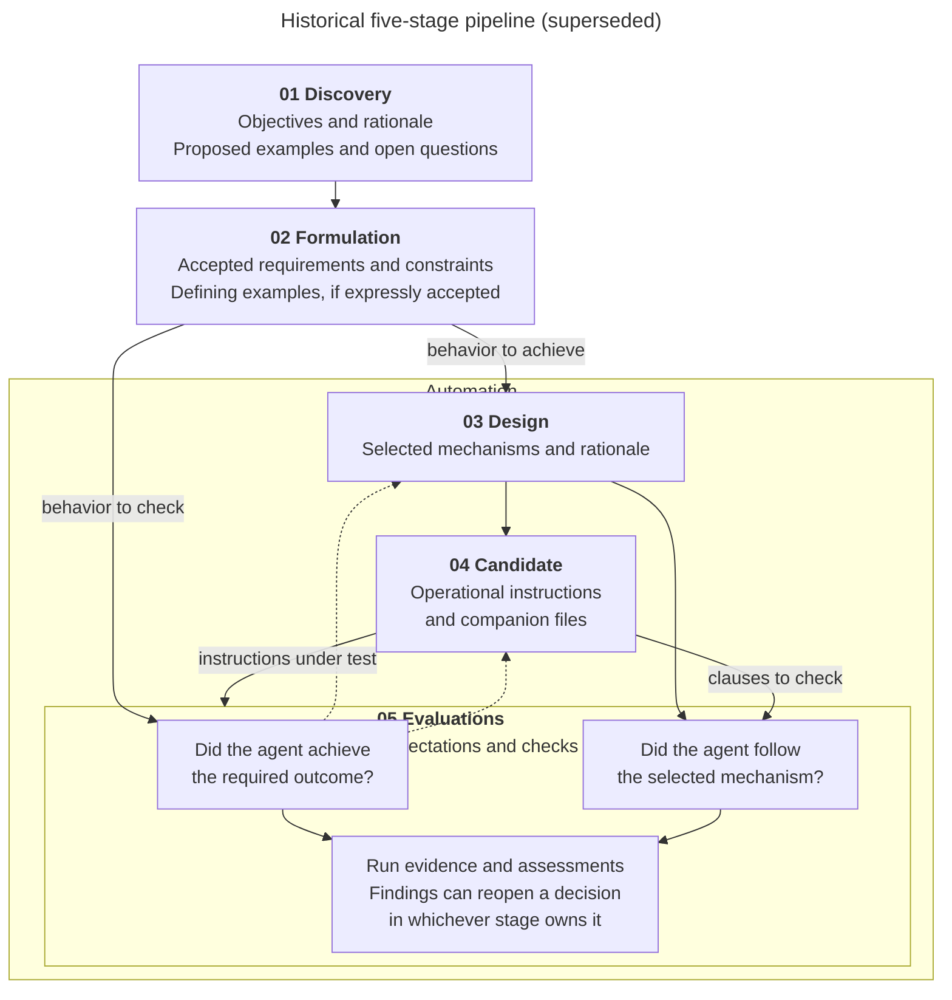

# Tracked-file relocation record

The baseline revision is **39fbcfdd20ec72b9bc9f7a9f6eb805757224fbad**. Every one of its 119 tracked paths has one row. Destinations are relative to the repository root. The leading directory identifies the owner. “Intact” means byte-identical. Edits outside the evaluator repair navigation, stage labels or structural status. Evaluator edits adapt imports, callers, verification and documentation to the owning packages. The [issue inventory](migration-inventory.md) explains provisional placement.

| Original tracked path | Current destination(s) | Treatment |
| --- | --- | --- |
| `.gitignore` | [.gitignore](../.gitignore) | Retain intact |
| `01-discovery/README.md` | [01-discovery/README.md](../01-discovery/README.md) | Retain intact |
| `01-discovery/deliverables/example-coverage.md` | [01-discovery/deliverables/example-coverage.md](../01-discovery/deliverables/example-coverage.md) | Retain intact |
| `01-discovery/deliverables/objectives-and-rationale.md` | [01-discovery/deliverables/objectives-and-rationale.md](../01-discovery/deliverables/objectives-and-rationale.md) | Retain intact |
| `01-discovery/deliverables/open-questions.md` | [01-discovery/deliverables/open-questions.md](../01-discovery/deliverables/open-questions.md) | Retain intact |
| `01-discovery/deliverables/proposed-examples/authorization-and-communication.md` | [01-discovery/deliverables/proposed-examples/authorization-and-communication.md](../01-discovery/deliverables/proposed-examples/authorization-and-communication.md) | Retain intact |
| `01-discovery/deliverables/proposed-examples/bounded-inquiry.md` | [01-discovery/deliverables/proposed-examples/bounded-inquiry.md](../01-discovery/deliverables/proposed-examples/bounded-inquiry.md) | Retain intact |
| `01-discovery/deliverables/proposed-examples/engineering-quality.md` | [01-discovery/deliverables/proposed-examples/engineering-quality.md](../01-discovery/deliverables/proposed-examples/engineering-quality.md) | Retain intact |
| `01-discovery/deliverables/proposed-examples/knowledge-and-documentation.md` | [01-discovery/deliverables/proposed-examples/knowledge-and-documentation.md](../01-discovery/deliverables/proposed-examples/knowledge-and-documentation.md) | Retain intact |
| `01-discovery/deliverables/proposed-examples/planning-and-scope.md` | [01-discovery/deliverables/proposed-examples/planning-and-scope.md](../01-discovery/deliverables/proposed-examples/planning-and-scope.md) | Retain intact |
| `01-discovery/deliverables/proposed-examples/self-contained-delivery.md` | [01-discovery/deliverables/proposed-examples/self-contained-delivery.md](../01-discovery/deliverables/proposed-examples/self-contained-delivery.md) | Retain intact |
| `01-discovery/deliverables/proposed-examples/validation-and-learning.md` | [01-discovery/deliverables/proposed-examples/validation-and-learning.md](../01-discovery/deliverables/proposed-examples/validation-and-learning.md) | Retain intact |
| `01-discovery/docs/maintaining-discovery.md` | [01-discovery/docs/maintaining-discovery.md](../01-discovery/docs/maintaining-discovery.md) | Retain intact |
| `02-formulation/README.md` | [02.0-formulation/README.md](../02.0-formulation/README.md) | Move with edits |
| `02-formulation/deliverables/baseline.md` | [02.0-formulation/deliverables/baseline.md](../02.0-formulation/deliverables/baseline.md) | Move with edits |
| `02-formulation/deliverables/example-coverage.md` | [02.0-formulation/deliverables/example-coverage.md](../02.0-formulation/deliverables/example-coverage.md) | Move with edits |
| `02-formulation/docs/acceptance-record.md` | [02.0-formulation/docs/acceptance-record.md](../02.0-formulation/docs/acceptance-record.md) | Move with edits |
| `02-formulation/docs/maintaining-formulation.md` | [02.0-formulation/docs/maintaining-formulation.md](../02.0-formulation/docs/maintaining-formulation.md) | Move with edits |
| `03-design/README.md` | [03.0-design/README.md](../03.0-design/README.md) | Move with edits |
| `03-design/deliverables/contract-design.md` | [03.0-design/deliverables/contract-design.md](../03.0-design/deliverables/contract-design.md) | Move with edits |
| `03-design/deliverables/delivery-and-portability.md` | [03.0-design/deliverables/delivery-and-portability.md](../03.0-design/deliverables/delivery-and-portability.md) | Move with edits |
| `03-design/deliverables/mechanisms/bounded-inquiry.md` | [03.0-design/deliverables/mechanisms/bounded-inquiry.md](../03.0-design/deliverables/mechanisms/bounded-inquiry.md) | Move with edits |
| `03-design/deliverables/mechanisms/engineering-and-validation.md` | [03.0-design/deliverables/mechanisms/engineering-and-validation.md](../03.0-design/deliverables/mechanisms/engineering-and-validation.md) | Move with edits |
| `03-design/deliverables/mechanisms/knowledge-and-documentation.md` | [03.0-design/deliverables/mechanisms/knowledge-and-documentation.md](../03.0-design/deliverables/mechanisms/knowledge-and-documentation.md) | Move with edits |
| `03-design/deliverables/mechanisms/requester-decisions-and-reporting.md` | [03.0-design/deliverables/mechanisms/requester-decisions-and-reporting.md](../03.0-design/deliverables/mechanisms/requester-decisions-and-reporting.md) | Move with edits |
| `03-design/deliverables/mechanisms/work-cycle.md` | [03.0-design/deliverables/mechanisms/work-cycle.md](../03.0-design/deliverables/mechanisms/work-cycle.md) | Move with edits |
| `03-design/deliverables/methods-and-references.md` | [03.0-design/deliverables/methods-and-references.md](../03.0-design/deliverables/methods-and-references.md) | Move with edits |
| `03-design/docs/decisions.md` | [03.0-design/docs/decisions.md](../03.0-design/docs/decisions.md) | Move with edits |
| `03-design/docs/design-illustrations.md` | [03.0-design/docs/design-illustrations.md](../03.0-design/docs/design-illustrations.md) | Move with edits |
| `03-design/docs/design-review.md` | [03.0-design/docs/design-review.md](../03.0-design/docs/design-review.md) | Move with edits |
| `03-design/docs/maintaining-design.md` | [03.0-design/docs/maintaining-design.md](../03.0-design/docs/maintaining-design.md) | Move with edits |
| `04-candidate/pre_AGENTS.md` | [04-candidate/pre_AGENTS.md](../04-candidate/pre_AGENTS.md) | Retain intact |
| `04-candidate/pre_CLAUDE.md` | [04-candidate/pre_CLAUDE.md](../04-candidate/pre_CLAUDE.md) | Retain intact |
| `04-candidate/pre_README-powerusers.md` | [04-candidate/pre_README-powerusers.md](../04-candidate/pre_README-powerusers.md) | Retain intact |
| `04-candidate/pre_README.md` | [04-candidate/pre_README.md](../04-candidate/pre_README.md) | Retain intact |
| `04-candidate/pre_copilot-instructions.md` | [04-candidate/pre_copilot-instructions.md](../04-candidate/pre_copilot-instructions.md) | Retain intact |
| `05-evaluations/README.md` | [05-evaluation/README.md](../05-evaluation/README.md) | Move with edits |
| `05-evaluations/deliverables/__init__.py` | [05-evaluation/deliverables/evaluation/__init__.py](../05-evaluation/deliverables/evaluation/__init__.py) | Move intact |
| `05-evaluations/deliverables/__main__.py` | [05-evaluation/deliverables/evaluation/__main__.py](../05-evaluation/deliverables/evaluation/__main__.py) | Move with edits |
| `05-evaluations/deliverables/cases/assumption-disclosure.md` | [03.1-conformance/deliverables/cases/assumption-disclosure.md](../03.1-conformance/deliverables/cases/assumption-disclosure.md) | Move with edits |
| `05-evaluations/deliverables/cases/bounded-inquiry.md` | [03.1-conformance/deliverables/cases/bounded-inquiry.md](../03.1-conformance/deliverables/cases/bounded-inquiry.md) | Move with edits |
| `05-evaluations/deliverables/cases/contract-change-followthrough.md` | [03.1-conformance/deliverables/cases/contract-change-followthrough.md](../03.1-conformance/deliverables/cases/contract-change-followthrough.md) | Move with edits |
| `05-evaluations/deliverables/cases/durable-finding-review.md` | [03.1-conformance/deliverables/cases/durable-finding-review.md](../03.1-conformance/deliverables/cases/durable-finding-review.md) | Move with edits |
| `05-evaluations/deliverables/cases/independent-execution.md` | [03.1-conformance/deliverables/cases/independent-execution.md](../03.1-conformance/deliverables/cases/independent-execution.md) | Move with edits |
| `05-evaluations/deliverables/cases/missing-permission.md` | [03.1-conformance/deliverables/cases/missing-permission.md](../03.1-conformance/deliverables/cases/missing-permission.md) | Move with edits |
| `05-evaluations/deliverables/cases/no-safe-next-step.md` | [03.1-conformance/deliverables/cases/no-safe-next-step.md](../03.1-conformance/deliverables/cases/no-safe-next-step.md) | Move with edits |
| `05-evaluations/deliverables/cases/requester-guidance.md` | [03.1-conformance/deliverables/cases/requester-guidance.md](../03.1-conformance/deliverables/cases/requester-guidance.md) | Move with edits |
| `05-evaluations/deliverables/cases/scope-discipline.md` | [03.1-conformance/deliverables/cases/scope-discipline.md](../03.1-conformance/deliverables/cases/scope-discipline.md) | Move with edits |
| `05-evaluations/deliverables/cases/smoke.md` | [engine/cases/smoke.md](../engine/cases/smoke.md) | Move with edits |
| `05-evaluations/deliverables/requirements.txt` | [engine/requirements.txt](../engine/requirements.txt) | Move intact |
| `05-evaluations/deliverables/requirements/agent-execution.md` | [05-evaluation/deliverables/requirements/agent-execution.md](../05-evaluation/deliverables/requirements/agent-execution.md) · [engine/requirements/agent-execution.md](../engine/requirements/agent-execution.md) | Partition |
| `05-evaluations/deliverables/requirements/evidence-and-capture.md` | [05-evaluation/deliverables/requirements/evidence-and-capture.md](../05-evaluation/deliverables/requirements/evidence-and-capture.md) · [engine/requirements/evidence-and-capture.md](../engine/requirements/evidence-and-capture.md) | Partition |
| `05-evaluations/deliverables/requirements/functional-checks.md` | [engine/requirements/functional-checks.md](../engine/requirements/functional-checks.md) · [03.1-conformance/deliverables/requirements/functional-checks.md](../03.1-conformance/deliverables/requirements/functional-checks.md) | Partition |
| `05-evaluations/deliverables/requirements/suite-execution-and-results.md` | [05-evaluation/deliverables/requirements/suite-execution-and-results.md](../05-evaluation/deliverables/requirements/suite-execution-and-results.md) | Move with edits |
| `05-evaluations/deliverables/requirements/workspace-and-observation.md` | [05-evaluation/deliverables/requirements/workspace-and-observation.md](../05-evaluation/deliverables/requirements/workspace-and-observation.md) · [engine/requirements/workspace-and-observation.md](../engine/requirements/workspace-and-observation.md) | Partition |
| `05-evaluations/deliverables/runtime/__init__.py` | [engine/runtime/__init__.py](../engine/runtime/__init__.py) | Move intact |
| `05-evaluations/deliverables/runtime/_check_process.py` | [engine/runtime/_check_process.py](../engine/runtime/_check_process.py) | Move intact |
| `05-evaluations/deliverables/runtime/auth.py` | [engine/runtime/auth.py](../engine/runtime/auth.py) | Move with edits |
| `05-evaluations/deliverables/runtime/codex.py` | [engine/runtime/codex.py](../engine/runtime/codex.py) | Move with edits |
| `05-evaluations/deliverables/runtime/evaluation.py` | [engine/runtime/evaluation.py](../engine/runtime/evaluation.py) | Move with edits |
| `05-evaluations/deliverables/runtime/functional.py` | [engine/runtime/functional.py](../engine/runtime/functional.py) | Move with edits |
| `05-evaluations/deliverables/runtime/functional_checks.py` | [engine/runtime/functional_checks.py](../engine/runtime/functional_checks.py) | Move with edits |
| `05-evaluations/deliverables/runtime/process.py` | [engine/runtime/process.py](../engine/runtime/process.py) | Move with edits |
| `05-evaluations/deliverables/runtime/workspace.py` | [engine/runtime/workspace.py](../engine/runtime/workspace.py) | Move with edits |
| `05-evaluations/deliverables/scenarios/__init__.py` | [03.1-conformance/deliverables/conformance/__init__.py](../03.1-conformance/deliverables/conformance/__init__.py) | Move intact |
| `05-evaluations/deliverables/scenarios/assumptions.py` | [03.1-conformance/deliverables/conformance/assumptions.py](../03.1-conformance/deliverables/conformance/assumptions.py) | Move with edits |
| `05-evaluations/deliverables/scenarios/findings.py` | [03.1-conformance/deliverables/conformance/findings.py](../03.1-conformance/deliverables/conformance/findings.py) | Move with edits |
| `05-evaluations/deliverables/scenarios/followthrough.py` | [03.1-conformance/deliverables/conformance/followthrough.py](../03.1-conformance/deliverables/conformance/followthrough.py) | Move with edits |
| `05-evaluations/deliverables/scenarios/guidance.py` | [03.1-conformance/deliverables/conformance/guidance.py](../03.1-conformance/deliverables/conformance/guidance.py) | Move with edits |
| `05-evaluations/deliverables/scenarios/independence.py` | [03.1-conformance/deliverables/conformance/independence.py](../03.1-conformance/deliverables/conformance/independence.py) | Move with edits |
| `05-evaluations/deliverables/scenarios/inquiry.py` | [03.1-conformance/deliverables/conformance/inquiry.py](../03.1-conformance/deliverables/conformance/inquiry.py) | Move with edits |
| `05-evaluations/deliverables/scenarios/permissions.py` | [03.1-conformance/deliverables/conformance/permissions.py](../03.1-conformance/deliverables/conformance/permissions.py) | Move with edits |
| `05-evaluations/deliverables/scenarios/scheduling.py` | [03.1-conformance/deliverables/conformance/scheduling.py](../03.1-conformance/deliverables/conformance/scheduling.py) | Move with edits |
| `05-evaluations/deliverables/scenarios/scope.py` | [03.1-conformance/deliverables/conformance/scope.py](../03.1-conformance/deliverables/conformance/scope.py) | Move with edits |
| `05-evaluations/deliverables/scenarios/smoke.py` | [engine/smoke.py](../engine/smoke.py) | Move with edits |
| `05-evaluations/deliverables/tests/__init__.py` | [05-evaluation/deliverables/evaluation/tests/__init__.py](../05-evaluation/deliverables/evaluation/tests/__init__.py) | Move intact |
| `05-evaluations/deliverables/tests/offline_smoke.py` | [engine/tests/offline_smoke.py](../engine/tests/offline_smoke.py) | Move with edits |
| `05-evaluations/deliverables/tests/probe_functional_sandbox.py` | [engine/tests/probe_functional_sandbox.py](../engine/tests/probe_functional_sandbox.py) | Move with edits |
| `05-evaluations/deliverables/tests/runtime/__init__.py` | [05-evaluation/deliverables/evaluation/tests/runtime/__init__.py](../05-evaluation/deliverables/evaluation/tests/runtime/__init__.py) | Move intact |
| `05-evaluations/deliverables/tests/runtime/test_auth.py` | [05-evaluation/deliverables/evaluation/tests/runtime/test_auth.py](../05-evaluation/deliverables/evaluation/tests/runtime/test_auth.py) | Move with edits |
| `05-evaluations/deliverables/tests/runtime/test_capture.py` | [engine/tests/runtime/test_capture.py](../engine/tests/runtime/test_capture.py) | Move with edits |
| `05-evaluations/deliverables/tests/runtime/test_cli.py` | [05-evaluation/deliverables/evaluation/tests/runtime/test_cli.py](../05-evaluation/deliverables/evaluation/tests/runtime/test_cli.py) | Move with edits |
| `05-evaluations/deliverables/tests/runtime/test_codex.py` | [05-evaluation/deliverables/evaluation/tests/runtime/test_codex.py](../05-evaluation/deliverables/evaluation/tests/runtime/test_codex.py) · [engine/tests/runtime/test_codex.py](../engine/tests/runtime/test_codex.py) | Partition |
| `05-evaluations/deliverables/tests/runtime/test_evidence.py` | [05-evaluation/deliverables/evaluation/tests/runtime/test_evidence.py](../05-evaluation/deliverables/evaluation/tests/runtime/test_evidence.py) | Move with edits |
| `05-evaluations/deliverables/tests/runtime/test_functional.py` | [engine/tests/runtime/test_functional.py](../engine/tests/runtime/test_functional.py) | Move with edits |
| `05-evaluations/deliverables/tests/runtime/test_functional_checks.py` | [engine/tests/runtime/test_functional_checks.py](../engine/tests/runtime/test_functional_checks.py) | Move with edits |
| `05-evaluations/deliverables/tests/runtime/test_workspace.py` | [engine/tests/runtime/test_workspace.py](../engine/tests/runtime/test_workspace.py) | Move with edits |
| `05-evaluations/deliverables/tests/scenarios/__init__.py` | [05-evaluation/deliverables/evaluation/tests/scenarios/__init__.py](../05-evaluation/deliverables/evaluation/tests/scenarios/__init__.py) | Move intact |
| `05-evaluations/deliverables/tests/scenarios/test_assumptions.py` | [05-evaluation/deliverables/evaluation/tests/scenarios/test_assumptions.py](../05-evaluation/deliverables/evaluation/tests/scenarios/test_assumptions.py) | Move with edits |
| `05-evaluations/deliverables/tests/scenarios/test_findings.py` | [05-evaluation/deliverables/evaluation/tests/scenarios/test_findings.py](../05-evaluation/deliverables/evaluation/tests/scenarios/test_findings.py) · [03.1-conformance/deliverables/conformance/tests/test_findings.py](../03.1-conformance/deliverables/conformance/tests/test_findings.py) | Partition |
| `05-evaluations/deliverables/tests/scenarios/test_followthrough.py` | [05-evaluation/deliverables/evaluation/tests/scenarios/test_followthrough.py](../05-evaluation/deliverables/evaluation/tests/scenarios/test_followthrough.py) · [03.1-conformance/deliverables/conformance/tests/test_followthrough.py](../03.1-conformance/deliverables/conformance/tests/test_followthrough.py) | Partition |
| `05-evaluations/deliverables/tests/scenarios/test_guidance.py` | [05-evaluation/deliverables/evaluation/tests/scenarios/test_guidance.py](../05-evaluation/deliverables/evaluation/tests/scenarios/test_guidance.py) | Move with edits |
| `05-evaluations/deliverables/tests/scenarios/test_independence.py` | [05-evaluation/deliverables/evaluation/tests/scenarios/test_independence.py](../05-evaluation/deliverables/evaluation/tests/scenarios/test_independence.py) | Move with edits |
| `05-evaluations/deliverables/tests/scenarios/test_inquiry.py` | [05-evaluation/deliverables/evaluation/tests/scenarios/test_inquiry.py](../05-evaluation/deliverables/evaluation/tests/scenarios/test_inquiry.py) · [03.1-conformance/deliverables/conformance/tests/test_inquiry.py](../03.1-conformance/deliverables/conformance/tests/test_inquiry.py) · [03.1-conformance/deliverables/conformance/tests/inquiry_data.py](../03.1-conformance/deliverables/conformance/tests/inquiry_data.py) | Partition |
| `05-evaluations/deliverables/tests/scenarios/test_permissions.py` | [05-evaluation/deliverables/evaluation/tests/scenarios/test_permissions.py](../05-evaluation/deliverables/evaluation/tests/scenarios/test_permissions.py) · [03.1-conformance/deliverables/conformance/tests/test_permissions.py](../03.1-conformance/deliverables/conformance/tests/test_permissions.py) | Partition |
| `05-evaluations/deliverables/tests/scenarios/test_scheduling.py` | [05-evaluation/deliverables/evaluation/tests/scenarios/test_scheduling.py](../05-evaluation/deliverables/evaluation/tests/scenarios/test_scheduling.py) · [03.1-conformance/deliverables/conformance/tests/test_scheduling.py](../03.1-conformance/deliverables/conformance/tests/test_scheduling.py) | Partition |
| `05-evaluations/deliverables/tests/scenarios/test_scope.py` | [05-evaluation/deliverables/evaluation/tests/scenarios/test_scope.py](../05-evaluation/deliverables/evaluation/tests/scenarios/test_scope.py) · [03.1-conformance/deliverables/conformance/tests/test_scope.py](../03.1-conformance/deliverables/conformance/tests/test_scope.py) | Partition |
| `05-evaluations/deliverables/tests/scenarios/test_smoke.py` | [engine/tests/test_smoke.py](../engine/tests/test_smoke.py) | Move with edits |
| `05-evaluations/deliverables/tests/support/__init__.py` | [05-evaluation/deliverables/evaluation/tests/support/__init__.py](../05-evaluation/deliverables/evaluation/tests/support/__init__.py) | Move intact |
| `05-evaluations/deliverables/tests/support/cli_harness.py` | [05-evaluation/deliverables/evaluation/tests/support/cli_harness.py](../05-evaluation/deliverables/evaluation/tests/support/cli_harness.py) | Move with edits |
| `05-evaluations/deliverables/tests/support/fake_codex.py` | [05-evaluation/deliverables/evaluation/tests/support/fake_codex.py](../05-evaluation/deliverables/evaluation/tests/support/fake_codex.py) | Move intact |
| `05-evaluations/docs/evaluation-model.md` | [05-evaluation/docs/evaluation-model.md](../05-evaluation/docs/evaluation-model.md) | Move with edits |
| `05-evaluations/docs/framework-design.md` | [05-evaluation/docs/framework-design.md](../05-evaluation/docs/framework-design.md) · [engine/docs/framework-design.md](../engine/docs/framework-design.md) | Partition |
| `05-evaluations/docs/maintaining-evaluations.md` | [05-evaluation/docs/maintaining-evaluations.md](../05-evaluation/docs/maintaining-evaluations.md) · [engine/docs/maintaining-engine.md](../engine/docs/maintaining-engine.md) | Partition |
| `05-evaluations/docs/running-and-reviewing.md` | [05-evaluation/docs/running-and-reviewing.md](../05-evaluation/docs/running-and-reviewing.md) | Move with edits |
| `LICENSE` | [LICENSE](../LICENSE) | Retain intact |
| `README.md` | [README.md](../README.md) | Retain with edits |
| `docs/README.md` | [docs/README.md](README.md) | Retain with edits |
| `docs/architecture.md` | [docs/architecture.md](architecture.md) | Retain with edits |
| `docs/authority.md` | [docs/authority.md](authority.md) | Retain with edits |
| `docs/changing-the-contract.md` | [docs/changing-the-contract.md](changing-the-contract.md) | Retain with edits |
| `docs/consumer-documentation-review.md` | [docs/consumer-documentation-review.md](consumer-documentation-review.md) | Retain with edits |
| `docs/contract-traces.md` | [docs/contract-traces.md](contract-traces.md) | Retain with edits |
| `docs/decisions.md` | [docs/decisions.md](decisions.md) | Retain with edits |
| `docs/documentation.md` | [docs/documentation.md](documentation.md) | Retain with edits |
| `docs/maintaining-documentation.md` | [docs/maintaining-documentation.md](maintaining-documentation.md) | Retain intact |
| `docs/pipeline.md` | [docs/pipeline.md](pipeline.md) | Retain with edits |
| `docs/traceability.md` | [docs/traceability.md](traceability.md) | Retain with edits |
| `docs/writing-documentation.md` | [docs/writing-documentation.md](writing-documentation.md) | Retain with edits |

## Additional files

These 14 files introduce owner guidance, coverage, verification routes, package markers, binding checks and migration records. Files produced by a partition already appear in the table above.

- [02.1-acceptance/README.md](../02.1-acceptance/README.md)
- [02.1-acceptance/deliverables/coverage.md](../02.1-acceptance/deliverables/coverage.md)
- [03.1-conformance/README.md](../03.1-conformance/README.md)
- [03.1-conformance/deliverables/conformance/tests/__init__.py](../03.1-conformance/deliverables/conformance/tests/__init__.py)
- [03.1-conformance/deliverables/coverage.md](../03.1-conformance/deliverables/coverage.md)
- [05-evaluation/deliverables/evaluation/tests/runtime/test_candidate_binding.py](../05-evaluation/deliverables/evaluation/tests/runtime/test_candidate_binding.py)
- [05-evaluation/docs/evaluator-verification.md](../05-evaluation/docs/evaluator-verification.md)
- [docs/migration-inventory.md](migration-inventory.md)
- [docs/migration-relocations.md](migration-relocations.md)
- [docs/migration-test-purposes.tsv](migration-test-purposes.tsv)
- [engine/README.md](../engine/README.md)
- [engine/__init__.py](../engine/__init__.py)
- [engine/tests/__init__.py](../engine/tests/__init__.py)
- [engine/tests/runtime/__init__.py](../engine/tests/runtime/__init__.py)

## Divided material

- **Evaluator requirements.** The [per-ID map](../05-evaluation/docs/evaluator-verification.md) reconciles every original normative paragraph, attached verification references and applicable live, sandbox and human checks. Four of the five shared specifications split by complete E block. Suite execution and results remains together. Each of the ten case specifications retains its requirement blocks. The shared functional-check preamble's named E33/E34 cases remain with those two norms. The common qualification concerning evaluator obligations, product authority and limitations of evidence remains in the integrated specifications. General fixture-handling policy E5 still applies to smoke.
- **Tests.** The [method-level ledger](migration-test-purposes.tsv) records one successor for every original purpose. Runtime command-construction tests moved to the engine and the fake-command end-to-end test to Evaluation. All nine original behavioral test modules included CLI integration. Six split along coherent class boundaries. The findings registration method moved from the grading class into the CLI class. Inquiry's two test-only data producers moved to a shared, non-discovered module. Guidance, independence and assumptions remained intact downstream because their existing suite and substitutes share integration dependencies. Fake Codex, its supporting harness and case-aware runtime tests remain downstream. The original test and package initializers are accounted for above.
- **Framework design.** The original execution and security boundaries, agent execution, observation and capture, deadlines and cleanup, functional-check execution, shared interfaces, fixture inputs and restrictive-permissions decision have their technical owner in [engine design](../engine/docs/framework-design.md). The [integrated design](../05-evaluation/docs/framework-design.md) retains stage-specific verification, the CLI timeout, suite-level cancellation, case-specific capture and checks, directory ownership, Pydantic concepts, evaluating an agent versus testing the evaluator, responsibility tables, lifecycle, scope walkthrough and integration contract. The contract-injection subsection is divided between writing supplied bytes and selecting an invocation's trusted source. Architecture-decision context, package hierarchy alternatives, documentation-maintenance decision and operational consequences remain in the integrated record. Both guides retain the technical references appropriate to their interfaces. The earlier runtime contract lookup and one-module verification layout are historical.
- **Maintenance.** Establish the expectation, change/add a scenario and verify a behavior change remain in [integrated maintenance](../05-evaluation/docs/maintaining-evaluations.md), including the BR3 and bounded-inquiry examples, approval limits, and behavior-change verification. The shared-functionality subsection assigns reusable coding and substitute-interface guidance to [engine maintenance](../engine/docs/maintaining-engine.md). The worked snapshot correction and its scenario-specific checks remain downstream.
- **Navigation.** The old stage README's case catalog, assessment split and E identifiers remain in the [Evaluation README](../05-evaluation/README.md). Its former five-domain requirement lookup is replaced by the per-ID verification map. The pre-migration root diagram and its explanation are reproduced below as historical context for the deferred documentation alignment.

Historical five-stage overview, superseded as a description of current ownership

The project uses behavior-driven development (BDD) to build agreement from concrete examples. **Discovery** explores what should happen in a situation like this and why. **Formulation** records what the requester or their delegate accepts as a requirement.

Several approaches can satisfy the same requirement. In AGENTS-spec, BDD’s **Automation** practice spans three stages. **Design** selects an approach and **Candidate** expresses it in the working `AGENTS.md`. **Evaluations** defines what to check and assesses how an agent behaves with those instructions.

The diagram shows what each stage owns and how the work can overlap in the intended model. For a **test-first** change, Evaluations can derive an expectation directly from an accepted requirement before Design selects a mechanism. That expectation guides Design and Candidate (dotted arrows) and still applies if the mechanism changes. [`docs/pipeline.md` § Test-first iteration](pipeline.md#test-first-iteration)

