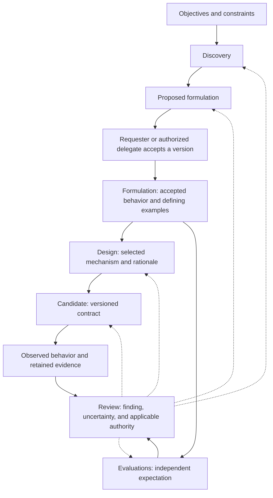

# Cross-stage traceability and evidence

## Reading a reference

Read a cross-stage reference according to the question it answers. A link can serve more than one purpose.

| Relationship | Question it answers | Example |
| --- | --- | --- |
| Authority dependency | Which source governs this decision, and within what scope? | An accepted requirement constrains mechanism selection. Its conditions and exceptions apply to the design choice. |
| Traceability relationship | Which items are connected, and what does the connection establish? | A clause-index entry connects a contract clause to its mechanism and supported intent. The link records that correspondence without granting product acceptance to the mechanism. |
| Navigation reference | Where should the reader go next? | A stage README points to a case or a specification. A moved destination calls for a link correction. |

## Tracing a requirement and its evaluation

Maintain separate design and evaluation paths. For requirements-led evaluation, derive the expectation from accepted intent or an expressly accepted defining example and fix it before judging the candidate. Candidate wording alone cannot authorize the expected result.

The diagram shows the intended trace for requirements-led work. Follow the dashed feedback path relevant to a finding. Review can reopen a question in any stage within the applicable [decision authority](authority.md#development-decisions).

| Relationship | What to retain |
| --- | --- |
| Objective or constraint → proposal → accepted behavior | Discovery keeps sources, uncertainty, and decision links. The [Formulation baseline](../02-formulation/deliverables/baseline.md) keeps accepted wording, conditions, exceptions, any expressly accepted defining examples, and a link to the [acceptance record](../02-formulation/docs/acceptance-record.md). Preserve provisional IDs and unresolved aspects. Link replacements without erasing earlier status. |
| Accepted intent → design → contract | Design links accepted intent, selection authority, and reasons to implementation through the [clause index](../03-design/deliverables/contract-design.md#contract-clause-index). Inherited design without independently accepted intent retains its design authority and trace gap. PR1 permits direct artifact inspection without inventing an intermediary mechanism. Trace metadata stays outside consumer text. |
| Accepted behavior → evaluation expectation | The evaluation owner defines the operational criterion once, identifying its accepted rule/version and defining example where established. Distinguish product verification, design conformance, and correctness of fictional fixture applications. |
| Candidate and expectation → observation → review | Run bundles identify candidate bytes/digest, case, settings, observations, assertions, and applicable rubric. Requirements-led claims also identify the accepted requirement/expectation and evaluator versions in a review reference or run-associated record. Retain failed, pending, inconclusive, and unexercised distinctions. |
| Finding → responsible owner | Fixture, observation, and evaluator faults return to Evaluations. Implementation discrepancies go to contract or design review. Unsettled intent, consequential trade-offs, and inadequate evidence go to Discovery and the decision owner. |

Store each relationship once at its dependent or the clause index. Use exact IDs, targets, and applicable versions. To find direct dependents, look up the changed ID, heading, or path in the clause index and affected owners. Inspect what each dependent relies on before following the next link. A fixture change raises observation and comparability questions. A changed expected verdict under unchanged accepted conditions raises an interpretation or authority question. Shared terminology alone proves no trace link.

### Current traceability gaps

No existing proposed example has been accepted as defining. Explicit requirement-to-evaluation traceability remains incomplete. Existing behavioral cases exercise contract clauses and support regression or design-conformance review. The clause index connects accepted outcomes to current mechanisms. Neither those links nor passing cases establish complete realization or requirements-derived acceptance. [Discovery](../01-discovery/deliverables/open-questions.md) records open formulation questions. The [evaluation model](../05-evaluations/docs/evaluation-model.md#purpose-and-evaluation-model) identifies suite coverage and limits.

## What evidence can establish

| Evidence | What it establishes |
| --- | --- |
| Contract-text review | Whether the text expresses intended obligations, permissions, conditions, exceptions, and constraints. PR1 primarily uses standalone artifact inspection. |
| Behavioral evaluation | What agents receiving the identified contract did in the cases run, assessed against assertions and human rubrics. |
| Evaluator tests | Specified machinery behavior for execution, observation, grading, reporting, and failures within the checks run. Agent compliance and the semantic validity of expectations require separate evidence. |

Limit claims to the tools, environments, and behavior actually exercised. The [evaluation model](../05-evaluations/docs/evaluation-model.md#purpose-and-evaluation-model) explains the suite's coverage, variability between runs, human-review limits, and the evidence needed for causal attribution. Missing evidence remains unverified. Claims about O1/O2 benefits require suitable comparative evidence, representative tasks, and requester feedback where relevant. Textual alignment or evaluator success alone cannot establish them. Human review distinguishes evaluator faults, unsuitable expectations or scenarios, contract defects, agent behavior, and unresolved intent before proposing a change.

## Specification-to-evaluation dependencies

A run exercises the staged contract even when its expectations have not been reviewed. A clause edit can invalidate a case’s expectations while its assertions still pass. A moved or renumbered clause can break a rubric or case reference. Design specifications, design-review guidance, and consumer guides also refer to contract headings.

| What changed? | Impact on dependents |
| --- | --- |
| An exercised rule’s strength, trigger, condition, exception, or scope | Compare the affected scenario, fixture, assertions, and rubric against the authority for the expectation. A contract edit alone cannot authorize a new expected result. |
| Only a clause’s number, heading, or location | Correct affected references in rubrics, cases, and linking documents while preserving their meaning. |
| Behavior no case exercises | No case edit is needed without a demonstrated impact. Adding coverage is a separate decision. |

A case or rubric edit changes the assessment. Earlier runs retain their captured candidate and criteria. Revised criteria neither rewrite those conclusions nor transfer them to a revised contract. [E1–E40](../05-evaluations/README.md#evaluator-requirements) govern evaluator behavior. They change only through authorized requirement work when the evaluator’s required behavior changes. Evaluations owns the [maintenance and verification procedures](../05-evaluations/docs/maintaining-evaluations.md).
